# TÀI LIỆU YÊU CẦU SẢN PHẨM — PRD

## Hệ thống thuyết minh tự động Thảo Cầm Viên Sài Gòn

| Thuộc tính | Nội dung |
|---|---|
| Mã tài liệu | PRD-TCV-001 |
| Phiên bản | 1.1 — Bản cập nhật để nhóm rà soát |
| Ngày cập nhật | 29/10/2026 |
| Nhóm thực hiện | Dương Quan Đạt — 3124411063 Nguyễn Hồng Khương — 3124411140 Trần Trung Hậu — 3124411088|
| Người duyệt | Nguyễn Quốc Huy |
| Phạm vi | Website thuyết minh đa ngôn ngữ, GPS, quản trị nội dung và thống kê truy cập qua QR |
| Trạng thái | Tài liệu yêu cầu và thiết kế mục tiêu; kết quả triển khai được xác nhận qua kiểm thử |

## Mục lục

1. Tổng quan sản phẩm.
2. Mục tiêu sản phẩm.
3. Đối tượng người dùng.
4. Kiến trúc chức năng.
5. Đặc tả chi tiết chức năng.
6. User Stories.
7. Luồng người dùng.
8. Yêu cầu phi chức năng.
9. Công nghệ và thiết kế hệ thống.
10. Phương pháp phát triển và phân công.
11. Kế hoạch kiểm thử.
12. Lộ trình và mức độ ưu tiên.
13. Định nghĩa hoàn thành.
14. Phụ lục.

---

# 1. Tổng quan sản phẩm

## 1.1. Tên sản phẩm

**Hệ thống thuyết minh tự động Thảo Cầm Viên Sài Gòn**, gọi tắt là **TCV Audio Guide**.

## 1.2. Mô tả sản phẩm

TCV Audio Guide là ứng dụng web giúp du khách tìm hiểu các khu động vật, thực vật và tiện ích bằng văn bản và âm thanh.

Du khách quét mã QR để mở website, chọn ngôn ngữ, thiết lập quyền vị trí và sử dụng bản đồ tham quan. Khi bật tự phát và di chuyển vào vùng kích hoạt hợp lệ, hệ thống chọn điểm phù hợp để phát thuyết minh theo ngôn ngữ hiện hành.

Du khách không cấp quyền vị trí vẫn có thể xem thông tin và chọn nghe thủ công.

Admin quản lý điểm tham quan, nhập nội dung tiếng Việt, tạo bản dịch và audio bằng Azure, hiệu chỉnh, nghe thử và xuất bản. Chỉ nội dung đã xuất bản mới được cung cấp cho du khách.

Hệ thống ghi nhận lượt mở website từ liên kết QR để thống kê số lượt truy cập và khung giờ cao điểm.

## 1.3. Vấn đề cần giải quyết

- Du khách tự tham quan khó tiếp cận đầy đủ thông tin tại từng khu.
- Nội dung chỉ bằng tiếng Việt hạn chế khả năng phục vụ khách quốc tế.
- Tìm và chọn bài thủ công tại từng điểm có thể làm gián đoạn hành trình.
- Nội dung, bản dịch và audio dễ không đồng nhất khi quản lý riêng lẻ.
- Đơn vị quản lý thiếu dữ liệu về lượt truy cập hệ thống và thời điểm sử dụng cao nhất.

## 1.4. Giải pháp

Xây dựng website ưu tiên thiết bị di động, kết hợp:

- Bản đồ số và vị trí do trình duyệt cung cấp.
- Vùng kích hoạt hình tròn cho từng điểm tham quan.
- Nội dung đa ngôn ngữ được quản lý theo phiên bản.
- Azure Translator để dịch văn bản.
- Azure Speech để tạo file âm thanh trước khi xuất bản.
- SQL Server để lưu dữ liệu nghiệp vụ.
- Kho media để lưu ảnh và audio.
- Báo cáo dựa trên sự kiện truy cập qua QR.

Khi khách nghe, hệ thống sử dụng audio đã tạo; không gọi Azure để sinh audio mới cho mỗi lượt nghe.

## 1.5. Tình huống sử dụng

Một du khách quét QR tại Thảo Cầm Viên, mở website và chọn tiếng Anh. Website giải thích việc sử dụng vị trí; khách đồng ý cấp quyền và bật tự phát.

Khi khách đi vào vùng của khu voi, hệ thống kiểm tra vị trí và điều kiện phát, sau đó phát đúng bài tiếng Anh đã xuất bản. Khách có thể tạm dừng, nghe tiếp, nghe lại hoặc đổi ngôn ngữ.

Admin có thể cập nhật nội dung trong bản nháp mà không làm thay đổi bài đang công khai. Sau khi hoàn thiện bản dịch và audio, Admin xuất bản phiên bản mới.

## 1.6. Phạm vi

| Trong phạm vi | Ngoài phạm vi phiên bản này |
|---|---|
| Website Du khách và Admin | Ứng dụng native Android/iOS |
| Năm ngôn ngữ: vi, en, zh, ko, ja | Hỗ trợ thêm ngôn ngữ ngoài danh sách |
| Bản đồ, vị trí GPS và vùng kích hoạt | Định vị trong nhà bằng beacon/UWB |
| Nghe tự động và nghe thủ công | Cam kết hoạt động liên tục khi khóa màn hình |
| Quản lý điểm, ảnh, tọa độ và bán kính | Bán vé, thanh toán, đặt tour |
| Bản nháp, dịch, audio và xuất bản | Chatbot, đề xuất lộ trình tối ưu |
| QR truy cập và báo cáo lượt truy cập | Đếm chính xác số người thực tế |
| Giả lập vị trí phục vụ kiểm thử/demo | Cam kết hoạt động offline toàn bộ |

Dữ liệu ban đầu dự kiến có 7 khu. Hệ thống không giới hạn cứng số điểm tham quan ở con số này.

## 1.7. Giả định và phụ thuộc

- Theo bối cảnh sử dụng của dự án, du khách tiếp cận website qua QR.
- Thiết bị khách có trình duyệt và kết nối Internet.
- GPS phụ thuộc quyền truy cập và khả năng định vị của thiết bị.
- Audio phụ thuộc chính sách phát của trình duyệt.
- Có tài khoản Admin và nội dung được kiểm tra trước khi xuất bản.
- Backend kết nối được SQL Server, Azure và kho media.
- URL trong QR phải truy cập được từ thiết bị khác; không sử dụng localhost.
- URL demo có thể thay đổi; QR cần được tạo lại theo URL đang hoạt động.

---

# 2. Mục tiêu sản phẩm

Các tiêu chí dưới đây là mục tiêu nghiệm thu, không phải kết quả đã được đo.

| Mã | Mục tiêu | Tiêu chí chấp nhận |
|---|---|---|
| OBJ-01 | Truy cập thuận tiện | Quét QR mở đúng website HTTPS, không yêu cầu tài khoản khách |
| OBJ-02 | Đúng thứ tự thiết lập | Chọn ngôn ngữ trước khi đề nghị cấp quyền GPS |
| OBJ-03 | Phát đúng vùng | Ngoài vùng không tự phát; trong vùng hợp lệ chọn đúng điểm |
| OBJ-04 | Đồng nhất đa ngôn ngữ | Văn bản và audio cùng ngôn ngữ, cùng phiên bản |
| OBJ-05 | Kiểm soát công khai | Bản nháp không được cung cấp qua API hoặc audio công khai |
| OBJ-06 | Bảo toàn trải nghiệm | Đổi ngôn ngữ không tải lại trang hoặc xóa trạng thái tham quan |
| OBJ-07 | Có thống kê | Tổng lượt và giờ cao điểm khớp dữ liệu kiểm thử |
| OBJ-08 | Demo trên thiết bị khác | Điện thoại mở bản đồ và nghe được audio qua URL public |

---

# 3. Đối tượng người dùng

## 3.1. Du khách

Bao gồm khách nội địa và khách quốc tế.

Nhu cầu:

- Mở website nhanh qua QR.
- Chọn ngôn ngữ phù hợp.
- Xem thông tin, vị trí và vùng tham quan.
- Nghe tự động khi vào vùng hoặc nghe thủ công.
- Điều khiển audio và đổi ngôn ngữ trong hành trình.

Du khách không cần đăng nhập.

## 3.2. Admin

Hệ thống chỉ có một vai trò quản trị là Admin. Các tài khoản Admin có cùng phạm vi chức năng.

Nhu cầu:

- Quản lý điểm tham quan.
- Soạn nội dung tiếng Việt.
- Tạo, kiểm tra và hiệu chỉnh bản dịch/audio.
- Xuất bản nội dung.
- Xem báo cáo truy cập.

Admin phải đăng nhập trước khi sử dụng chức năng quản trị.

## 3.3. Dịch vụ hỗ trợ

- Azure Translator: dịch văn bản.
- Azure Speech: tạo audio.
- Dịch vụ bản đồ: cung cấp nền bản đồ.
- API định vị trình duyệt: cung cấp vị trí thiết bị.

SQL Server và kho media là thành phần hạ tầng của hệ thống.

---

# 4. Kiến trúc chức năng

## 4.1. Các nhóm chức năng

| Nhóm | Tên nhóm | Tác nhân | UC chi tiết |
|---|---|---|---|
| 01 | Bắt đầu tham quan | Du khách | UC01.1–UC01.3 |
| 02 | Xem bản đồ tham quan | Du khách | UC02.1–UC02.2 |
| 03 | Nghe thuyết minh | Du khách | UC03.1–UC03.6 |
| 04 | Đăng nhập quản trị | Admin | UC04.1 |
| 05 | Quản lý điểm tham quan | Admin | UC05.1–UC05.4 |
| 06 | Quản lý bản thuyết minh | Admin | UC06.1–UC06.7 |
| 07 | Xem báo cáo thống kê | Admin | UC07.1–UC07.3 |

Các nhóm dùng để tổ chức chức năng. Không dùng quan hệ `include` hoặc `extend` chỉ để thể hiện một chức năng thuộc nhóm.

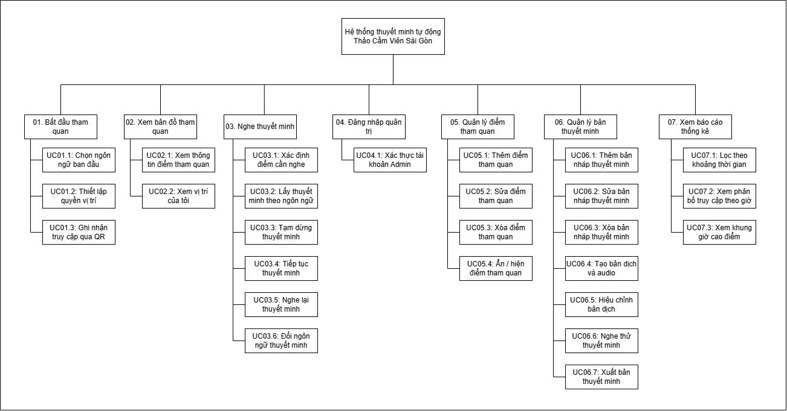

## 4.2. Sơ đồ Use Case tổng quan

Sơ đồ thể hiện hai tác nhân Du khách và Admin cùng các chức năng liên quan. Nhóm chức năng được thể hiện bằng khung/package khi cần tổ chức sơ đồ.

Không đưa UC “Kiểm tra quyền truy cập” thành chức năng riêng. Điều kiện đăng nhập được mô tả trong tiền điều kiện của các UC quản trị.

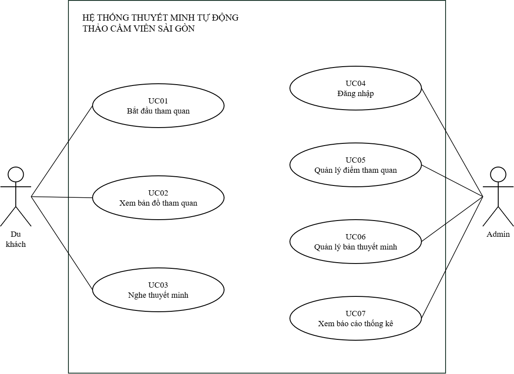

## 4.3. Danh mục Use Case

| Mã | Tên chức năng |
|---|---|
| UC01.1 | Chọn ngôn ngữ ban đầu |
| UC01.2 | Thiết lập quyền vị trí |
| UC01.3 | Ghi nhận truy cập qua QR |
| UC02.1 | Xem thông tin điểm tham quan |
| UC02.2 | Xem vị trí của tôi |
| UC03.1 | Xác định điểm cần nghe |
| UC03.2 | Lấy thuyết minh theo ngôn ngữ |
| UC03.3 | Tạm dừng thuyết minh |
| UC03.4 | Tiếp tục thuyết minh |
| UC03.5 | Nghe lại thuyết minh |
| UC03.6 | Đổi ngôn ngữ thuyết minh |
| UC04.1 | Xác thực tài khoản Admin |
| UC05.1 | Thêm điểm tham quan |
| UC05.2 | Sửa điểm tham quan |
| UC05.3 | Xóa điểm tham quan |
| UC05.4 | Ẩn / hiện điểm tham quan |
| UC06.1 | Thêm bản nháp thuyết minh |
| UC06.2 | Sửa bản nháp thuyết minh |
| UC06.3 | Xóa bản nháp thuyết minh |
| UC06.4 | Tạo bản dịch và audio |
| UC06.5 | Hiệu chỉnh bản dịch |
| UC06.6 | Nghe thử thuyết minh |
| UC06.7 | Xuất bản thuyết minh |
| UC07.1 | Lọc theo khoảng thời gian |
| UC07.2 | Xem phân bố truy cập theo giờ |
| UC07.3 | Xem khung giờ cao điểm |

---

# 5. Đặc tả chi tiết chức năng

## 5.1. Quy tắc nghiệp vụ chung

| Mã | Quy tắc |
|---|---|
| BR-01 | Du khách không đăng nhập. Chức năng quản trị yêu cầu phiên Admin hợp lệ; backend phải xác thực yêu cầu quản trị. |
| BR-02 | Trong luồng bắt đầu tham quan, chọn ngôn ngữ trước khi đề nghị quyền GPS. |
| BR-03 | Hỗ trợ vi, en, zh, ko, ja; không tự phát audio ngôn ngữ khác thay thế khi thiếu bản phù hợp. |
| BR-04 | Chỉ điểm đang hoạt động, có phiên bản công khai hợp lệ thuộc chính điểm đó mới xuất hiện trong danh sách public. |
| BR-05 | Vĩ độ trong [-90,90], kinh độ trong [-180,180]; bán kính lớn hơn 0 và không quá 500 m. |
| BR-06 | Mã điểm được sinh tự động, duy nhất. Ảnh tải lên kho media; database lưu đường dẫn và thông tin liên quan. |
| BR-07 | Vị trí dùng tự phát phải hợp lệ, còn mới và đủ độ chính xác theo cấu hình. Mục tiêu ban đầu: tuổi vị trí không quá 15 giây, sai số không quá 25 m. |
| BR-08 | Trong vùng khi khoảng cách tới tâm không lớn hơn bán kính. Nếu nhiều vùng phù hợp: ưu tiên cao hơn, sau đó khoảng cách nhỏ hơn, sau cùng dùng ID ổn định để phân định. |
| BR-09 | GPS thật cần xác nhận ổn định trước tự phát. Cấu hình mục tiêu: đánh giá khoảng 5 giây/lần, 2 kết quả liên tiếp cùng điểm. Giả lập có cấu hình riêng và nhãn nhận biết. |
| BR-10 | Chỉ một bài phát tại một thời điểm; tự phát không chen ngang bài đang phát. |
| BR-11 | Không tự phát lặp cùng điểm, ngôn ngữ và phiên bản trong một phiên tham quan; nghe lại thủ công được phép. |
| BR-12 | Đổi ngôn ngữ không tải lại trang; giữ vị trí, điểm đang chọn, điểm đã đi qua và lịch sử nghe. Trạng thái đã đi qua khác với đã nghe. |
| BR-13 | Mỗi điểm có nhiều phiên bản; cặp PlaceId và Version là duy nhất. Mỗi điểm có tối đa một phiên bản công khai hiện hành. |
| BR-14 | Chỉ sửa bản Draft; thay đổi nội dung đã xuất bản phải thực hiện qua bản nháp mới. |
| BR-15 | Sửa script làm audio tương ứng hết hiệu lực; sửa tiếng Việt làm các kết quả dịch phụ thuộc cần được cập nhật hoặc duyệt lại. |
| BR-16 | Không tự ghi đè bản dịch đã hiệu chỉnh thủ công trong lần tạo lại mặc định. |
| BR-17 | Xuất bản yêu cầu đủ nội dung và audio hợp lệ của 5 ngôn ngữ; audio phải khớp script hiện tại. |
| BR-18 | Cập nhật trạng thái xuất bản và PublishedRevisionId phải nhất quán; bản public trước được giữ trong lịch sử. |
| BR-19 | Văn bản và audio public phải thuộc cùng phiên bản; bản nháp chỉ được xem/nghe thử qua chức năng Admin. |
| BR-20 | Chỉ ghi nhận lượt truy cập QR khi website mở từ liên kết có dấu nguồn QR và backend lưu sự kiện thành công. |
| BR-21 | Mỗi SessionId chỉ được ghi một lượt QR. Tải lại trang hoặc gửi lại cùng sự kiện trong phiên không cộng thêm lượt. |
| BR-22 | SessionId được duy trì trong phiên trình duyệt; mở lại sau ít nhất 30 phút không hoạt động tạo phiên mới. Quy tắc này không bảo đảm nhận diện một người duy nhất giữa các tab hoặc trình duyệt. |
| BR-23 | Thời điểm sự kiện do server ghi UTC; báo cáo hiển thị giờ Việt Nam. Khoảng lọc sử dụng [bắt đầu, kết thúc). |
| BR-24 | Báo cáo cộng lượt theo 24 khung giờ trong ngày của khoảng lọc; khung có tổng lớn nhất là cao điểm. Đồng hạng phải hiển thị đủ; không có lượt thì không kết luận cao điểm. |
| BR-25 | Không xóa điểm đang có phiên bản thuyết minh tham chiếu; sử dụng chức năng ẩn. Chỉ xóa bản nháp đủ điều kiện, không xóa phiên bản đã xuất bản qua chức năng xóa nháp. |
| BR-26 | Dữ liệu được đánh dấu demo được loại khỏi báo cáo vận hành mặc định. Không mặc định mọi lượt qua URL tunnel đều là demo. |
| BR-27 | GenerationJobs lưu trạng thái tác vụ tạo nội dung; trạng thái job không thay thế trạng thái phiên bản hoặc hiệu lực audio. |
| BR-28 | SiteTexts lưu văn bản giao diện theo khóa và ngôn ngữ; không lưu thuyết minh của từng điểm. |

## 5.2. Quy ước đặc tả và hình vẽ

- Luồng chính trình bày theo hành động tác nhân và phản hồi hệ thống.
- [A1], [A2] đánh dấu luồng thay thế.
- [E1], [E2] đánh dấu ngoại lệ nghiệp vụ.
- Hình chữ nhật bo góc biểu diễn hành động.
- Hình thoi biểu diễn quyết định rẽ nhánh hoặc hợp nhất luồng.
- Hành động trong nhánh thay thế/ngoại lệ vẫn là hình chữ nhật bo góc.
- Không thêm hình thoi khi không có điều kiện cần phân nhánh.
- Lỗi hạ tầng được quy định ở phần phi chức năng và kiểm thử, không lặp thành ngoại lệ trong mọi UC.

---

## 5.3. Nhóm 01 — Bắt đầu tham quan

Nhóm này hỗ trợ mở website qua QR, ghi nhận truy cập, chọn ngôn ngữ và thiết lập quyền vị trí.

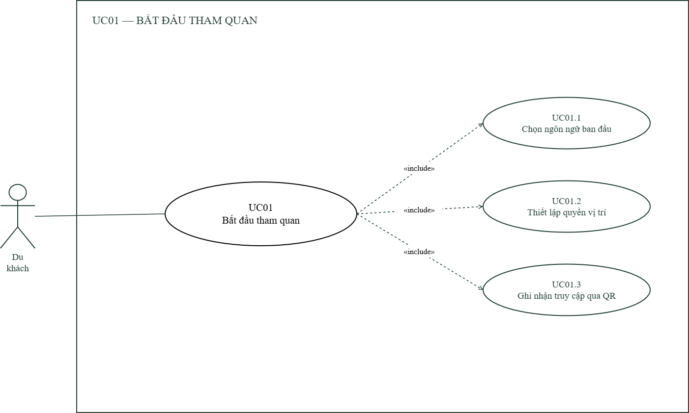

### UC01.1 — Chọn ngôn ngữ ban đầu

| Thuộc tính | Nội dung |
|---|---|
| Tác nhân | Du khách |
| Mục tiêu | Chọn ngôn ngữ sử dụng trong hành trình |
| Kích hoạt | Mở website qua QR |
| Tiền điều kiện | Giao diện chọn ngôn ngữ đã được tải |
| Hậu điều kiện | Ngôn ngữ được lưu, áp dụng và chuyển tới thiết lập vị trí |
| Quy tắc | BR-02, BR-03 |

**Luồng chính**

| Bước | Hành động tác nhân | Phản hồi hệ thống |
|---|---|---|
| 1 | Xem lựa chọn ngôn ngữ. | Hiển thị Việt, Anh, Trung, Hàn và Nhật. |
| 2 | Chọn một ngôn ngữ. | Đánh dấu lựa chọn. |
| 3 | Nhấn tiếp tục. | Lưu, áp dụng ngôn ngữ và chuyển sang UC01.2. |

**Luồng thay thế / ngoại lệ:** Không có luồng riêng. Giao diện chỉ cho tiếp tục khi có lựa chọn hợp lệ.

### UC01.2 — Thiết lập quyền vị trí

| Thuộc tính | Nội dung |
|---|---|
| Tác nhân | Du khách |
| Mục tiêu | Quyết định việc sử dụng vị trí để hỗ trợ tham quan |
| Kích hoạt | Hoàn thành chọn ngôn ngữ |
| Tiền điều kiện | Website đã áp dụng ngôn ngữ |
| Hậu điều kiện | Mở bản đồ với khả năng sử dụng GPS tương ứng |
| Quy tắc | BR-02, BR-07 |

**Luồng chính**

| Bước | Hành động tác nhân | Phản hồi hệ thống |
|---|---|---|
| 1 | Xem hướng dẫn GPS. | Giải thích mục đích sử dụng vị trí. |
| 2 | Chọn bật GPS. | Yêu cầu quyền vị trí qua trình duyệt khi cần. |
| 3 | Cho phép truy cập vị trí. | Ghi nhận quyền và bắt đầu lấy tọa độ. [A1] |
| 4 | Tiếp tục tham quan. | Mở bản đồ, hiển thị vị trí khi có tọa độ hợp lệ. |

**A1 — Không cấp quyền tại bước 3**

Hệ thống vẫn mở bản đồ, cho phép chọn điểm và nghe thủ công. Không hiển thị vị trí giả hoặc tự phát theo GPS. Kết thúc chức năng.

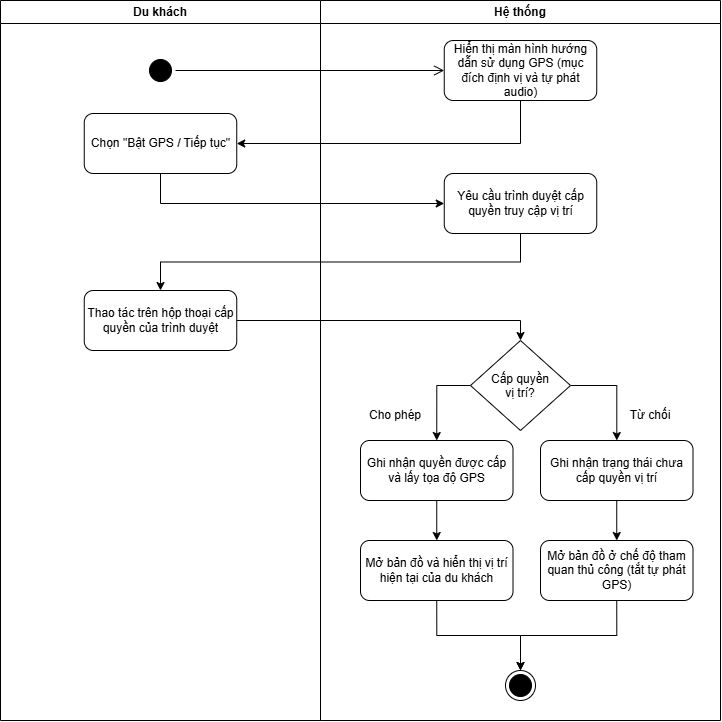

### UC01.3 — Ghi nhận truy cập qua QR

| Thuộc tính | Nội dung |
|---|---|
| Tác nhân | Du khách |
| Mục tiêu | Ghi nhận lượt mở website từ liên kết QR |
| Kích hoạt | Du khách mở liên kết từ QR |
| Tiền điều kiện | Liên kết truy cập được website và có dấu nguồn QR |
| Hậu điều kiện | Một lượt hợp lệ được ghi nhận hoặc bản ghi trùng được bỏ qua |
| Quy tắc | BR-20–BR-23, BR-26 |

**Luồng chính**

| Bước | Hành động tác nhân | Phản hồi hệ thống |
|---|---|---|
| 1 | Quét QR và mở liên kết. | Nhận diện nguồn QR; tạo hoặc khôi phục SessionId. |
| 2 | Chờ website hiển thị. | Kiểm tra sự kiện của SessionId đã tồn tại hay chưa. [A1] |
| 3 | Tiếp tục sử dụng website. | Lưu SessionId, thời điểm UTC và cờ demo phù hợp. |

**A1 — Đã có bản ghi tại bước 2**

Không tạo lượt mới. Hệ thống trả kết quả đã ghi nhận và cho du khách tiếp tục sử dụng.

Việc ghi nhận thống kê không chặn luồng chọn ngôn ngữ.

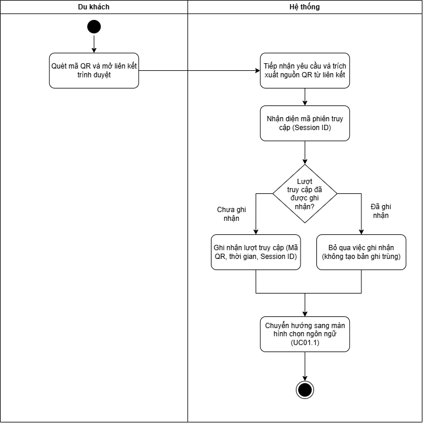

---

## 5.4. Nhóm 02 — Xem bản đồ tham quan

Nhóm này hỗ trợ xem các điểm công khai, thông tin chi tiết và vị trí hiện tại.

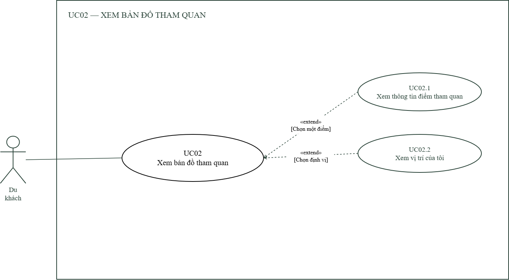

### UC02.1 — Xem thông tin điểm tham quan

| Thuộc tính | Nội dung |
|---|---|
| Tác nhân | Du khách |
| Mục tiêu | Xem thông tin của điểm được chọn |
| Kích hoạt | Chọn điểm trên bản đồ hoặc danh sách |
| Tiền điều kiện | Điểm đủ điều kiện công khai |
| Hậu điều kiện | Hiển thị thông tin theo ngôn ngữ hiện hành |
| Quy tắc | BR-03, BR-04, BR-19 |

**Luồng chính**

| Bước | Hành động tác nhân | Phản hồi hệ thống |
|---|---|---|
| 1 | Xem bản đồ hoặc danh sách. | Hiển thị các điểm công khai. |
| 2 | Chọn một điểm. | Đánh dấu điểm và vùng kích hoạt tương ứng. |
| 3 | Xem thông tin. | Hiển thị tên, ảnh, mô tả và lựa chọn nghe. |

**Luồng thay thế / ngoại lệ:** Không có luồng riêng.

Chọn xem một điểm không đồng nghĩa với đã đi đến hoặc đã nghe điểm đó.

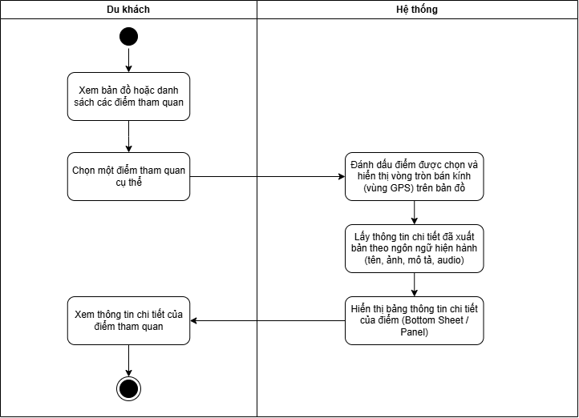

### UC02.2 — Xem vị trí của tôi

| Thuộc tính | Nội dung |
|---|---|
| Tác nhân | Du khách |
| Mục tiêu | Xác định vị trí hiện tại trên bản đồ |
| Kích hoạt | Nhấn “Vị trí của tôi” |
| Tiền điều kiện | Bản đồ đang mở |
| Hậu điều kiện | Hiển thị vị trí khi có tọa độ hợp lệ |
| Quy tắc | BR-07 |

**Luồng chính**

| Bước | Hành động tác nhân | Phản hồi hệ thống |
|---|---|---|
| 1 | Nhấn “Vị trí của tôi”. | Kiểm tra quyền vị trí. [A1] |
| 2 | Chờ xác định vị trí. | Lấy và kiểm tra tọa độ. [A2] |
| 3 | Xem vị trí. | Hiển thị dấu vị trí và đưa vào vùng nhìn thấy của bản đồ. |

**A1 — Chưa có quyền tại bước 1**

Hướng dẫn bật quyền vị trí. Nếu được cấp quyền, tiếp tục bước 2; nếu không, giữ nguyên bản đồ và kết thúc.

**A2 — Chưa có tọa độ hợp lệ tại bước 2**

Hiển thị trạng thái đang xác định vị trí. Tiếp tục bước 3 khi có dữ liệu hợp lệ; không dùng tọa độ không hợp lệ để kích hoạt vùng.

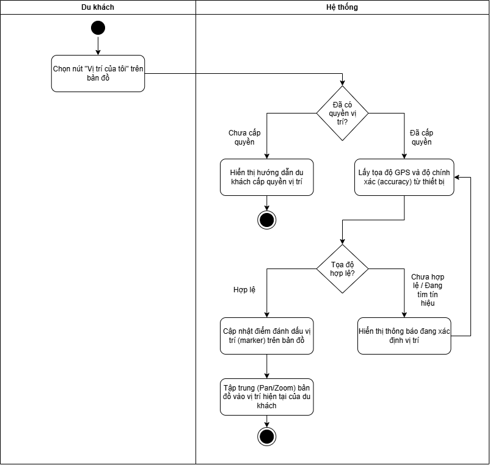

---

## 5.5. Nhóm 03 — Nghe thuyết minh

Nhóm này hỗ trợ chọn điểm cần nghe, lấy nội dung/audio phù hợp và điều khiển phát.

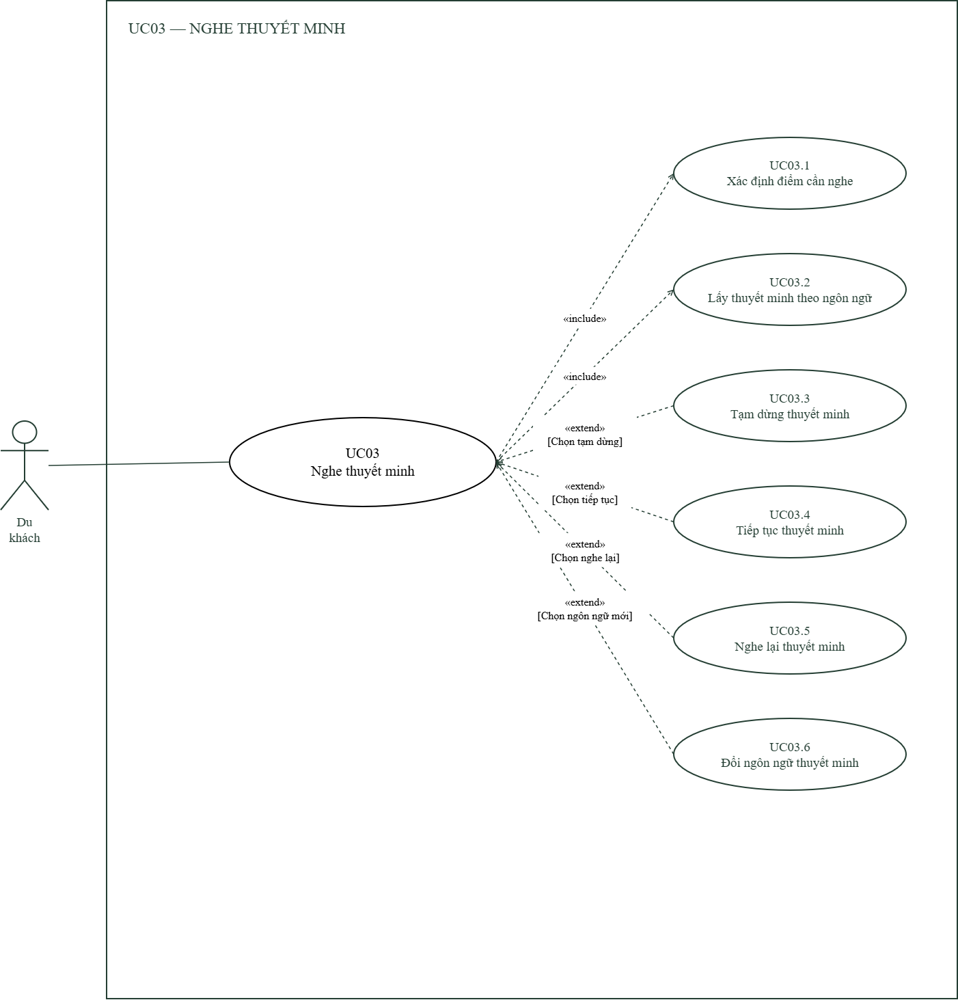

### UC03.1 — Xác định điểm cần nghe

| Thuộc tính | Nội dung |
|---|---|
| Tác nhân | Du khách |
| Mục tiêu | Xác định điểm cho yêu cầu nghe |
| Kích hoạt | Nghe thủ công hoặc cập nhật vị trí khi bật tự phát |
| Tiền điều kiện | Có điểm công khai; tự phát cần GPS hợp lệ |
| Hậu điều kiện | Có điểm để chuyển sang UC03.2 hoặc tiếp tục theo dõi |
| Quy tắc | BR-07–BR-11 |

**Luồng chính**

| Bước | Hành động tác nhân | Phản hồi hệ thống |
|---|---|---|
| 1 | Bật tự phát và di chuyển. | Tiếp nhận vị trí hợp lệ. [A1] |
| 2 | Tiếp tục di chuyển. | Đối chiếu vị trí với các vùng kích hoạt. [A2] |
| 3 | Đi vào vùng đủ điều kiện. | Chọn điểm phù hợp; kiểm tra chống phát lặp và phát chồng. [A3] |
| 4 | Tiếp tục tham quan. | Chuyển điểm đã xác định sang UC03.2. |

**A1 — Nghe thủ công tại bước 1**

Du khách chọn điểm và nhấn nghe. Hệ thống dùng điểm được chọn, không yêu cầu đang ở trong vùng GPS; chuyển sang bước 4.

**A2 — Chưa nằm trong vùng tại bước 2**

Chưa tạo yêu cầu tự phát. Tiếp tục theo dõi vị trí và quay lại bước 2 khi có dữ liệu mới.

**A3 — Chưa đủ điều kiện tự phát tại bước 3**

Nếu đang có bài phát hoặc yêu cầu bị xác định là phát lặp, chưa tự phát bài mới. Tiếp tục theo dõi vị trí và trạng thái phát.

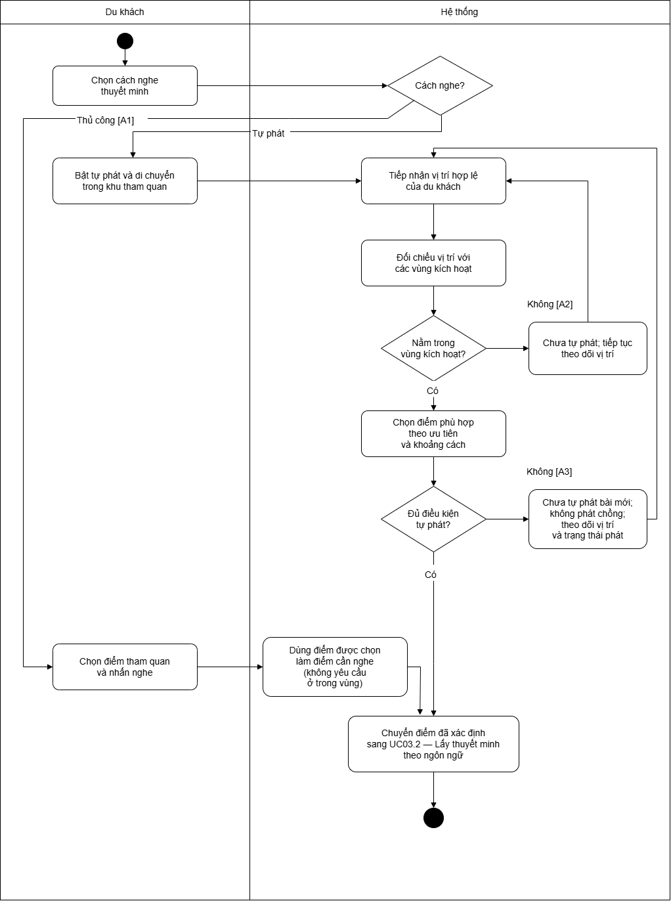

### UC03.2 — Lấy thuyết minh theo ngôn ngữ

| Thuộc tính | Nội dung |
|---|---|
| Tác nhân | Du khách |
| Mục tiêu | Sử dụng đúng văn bản và audio theo ngôn ngữ hiện hành |
| Kích hoạt | Điểm cần nghe đã được xác định |
| Tiền điều kiện | Điểm có phiên bản thuyết minh công khai |
| Hậu điều kiện | Nội dung và audio tương ứng được đưa vào trình phát |
| Quy tắc | BR-03, BR-19 |

**Luồng chính**

| Bước | Hành động tác nhân | Phản hồi hệ thống |
|---|---|---|
| 1 | Yêu cầu nghe hoặc tiếp tục ở chế độ tự phát. | Xác định phiên bản đã xuất bản của điểm. |
| 2 | — | Chọn nội dung và audio theo ngôn ngữ hiện hành. [E1] |
| 3 | Nghe thuyết minh. | Hiển thị nội dung và phát audio theo yêu cầu hợp lệ. |

**E1 — Không có nội dung hoặc audio hợp lệ tại bước 2**

Thông báo chưa có thuyết minh phù hợp. Không tự phát audio của ngôn ngữ khác. Du khách có thể đổi ngôn ngữ hoặc chọn điểm khác.

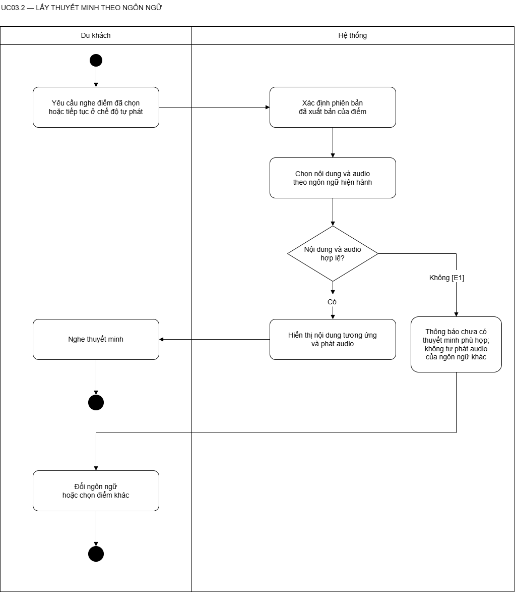

### UC03.3 — Tạm dừng thuyết minh

| Thuộc tính | Nội dung |
|---|---|
| Tác nhân | Du khách |
| Mục tiêu | Tạm ngừng bài và giữ vị trí nghe |
| Kích hoạt | Nhấn tạm dừng |
| Tiền điều kiện | Có bài đang phát |
| Hậu điều kiện | Bài tạm dừng và có thể tiếp tục |
| Quy tắc | BR-10 |

**Luồng chính**

| Bước | Hành động tác nhân | Phản hồi hệ thống |
|---|---|---|
| 1 | Nhấn tạm dừng. | Tạm dừng audio và giữ thời điểm đang nghe. |
| 2 | Xem trình phát. | Hiển thị trạng thái tạm dừng và nút tiếp tục. |

**Luồng thay thế / ngoại lệ:** Không có luồng riêng.

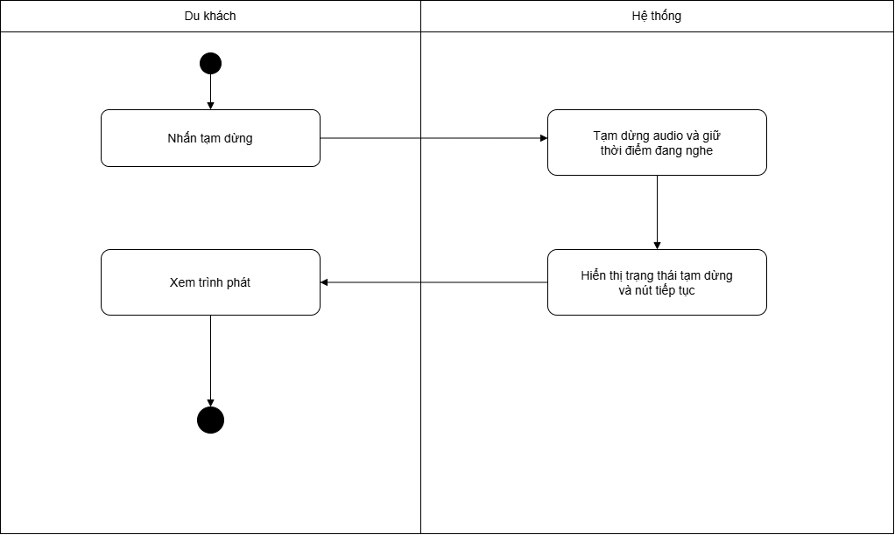

### UC03.4 — Tiếp tục thuyết minh

| Thuộc tính | Nội dung |
|---|---|
| Tác nhân | Du khách |
| Mục tiêu | Nghe tiếp từ thời điểm tạm dừng |
| Kích hoạt | Nhấn tiếp tục |
| Tiền điều kiện | Có bài đang tạm dừng, vẫn phù hợp ngôn ngữ hiện hành |
| Hậu điều kiện | Bài tiếp tục phát từ thời điểm đã lưu |
| Quy tắc | BR-10 |

**Luồng chính**

| Bước | Hành động tác nhân | Phản hồi hệ thống |
|---|---|---|
| 1 | Nhấn tiếp tục. | Lấy thời điểm tạm dừng. |
| 2 | Tiếp tục nghe. | Phát tiếp và cập nhật trạng thái đang phát. |

**Luồng thay thế / ngoại lệ:** Không có luồng riêng.

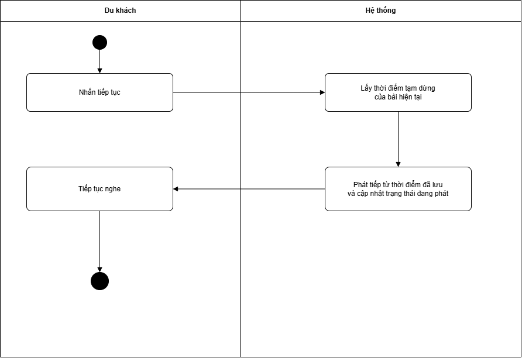

### UC03.5 — Nghe lại thuyết minh

| Thuộc tính | Nội dung |
|---|---|
| Tác nhân | Du khách |
| Mục tiêu | Nghe lại bài từ đầu |
| Kích hoạt | Nhấn nghe lại |
| Tiền điều kiện | Có bài phù hợp ngôn ngữ hiện hành |
| Hậu điều kiện | Bài được phát từ đầu |
| Quy tắc | BR-10, BR-11 |

**Luồng chính**

| Bước | Hành động tác nhân | Phản hồi hệ thống |
|---|---|---|
| 1 | Nhấn nghe lại. | Đưa thời điểm phát về đầu bài. |
| 2 | Nghe lại nội dung. | Phát từ đầu và cập nhật tiến trình. |

**Luồng thay thế / ngoại lệ:** Không có luồng riêng.

Nghe lại không xóa lịch sử tham quan.

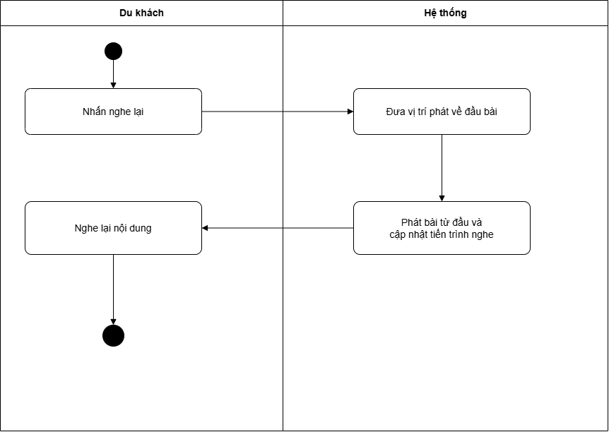

### UC03.6 — Đổi ngôn ngữ thuyết minh

| Thuộc tính | Nội dung |
|---|---|
| Tác nhân | Du khách |
| Mục tiêu | Đổi ngôn ngữ trong quá trình tham quan |
| Kích hoạt | Chọn ngôn ngữ mới |
| Tiền điều kiện | Du khách đang sử dụng website |
| Hậu điều kiện | Áp dụng ngôn ngữ mới, giữ trạng thái tham quan |
| Quy tắc | BR-03, BR-12 |

**Luồng chính**

| Bước | Hành động tác nhân | Phản hồi hệ thống |
|---|---|---|
| 1 | Mở bộ chọn ngôn ngữ. | Hiển thị 5 ngôn ngữ. |
| 2 | Chọn ngôn ngữ mới. | Lưu lựa chọn; dừng audio cũ nếu đang phát. |
| 3 | Tiếp tục sử dụng website. | Cập nhật giao diện và nội dung, giữ vị trí và lịch sử tham quan. |
| 4 | Yêu cầu nghe. | Sử dụng UC03.2 để lấy bài theo ngôn ngữ mới. |

**Luồng thay thế / ngoại lệ:** Không có luồng riêng.

Không tự phát lại chỉ vì đổi ngôn ngữ. Việc dừng audio cũ là xử lý thông thường, không phải ngoại lệ.

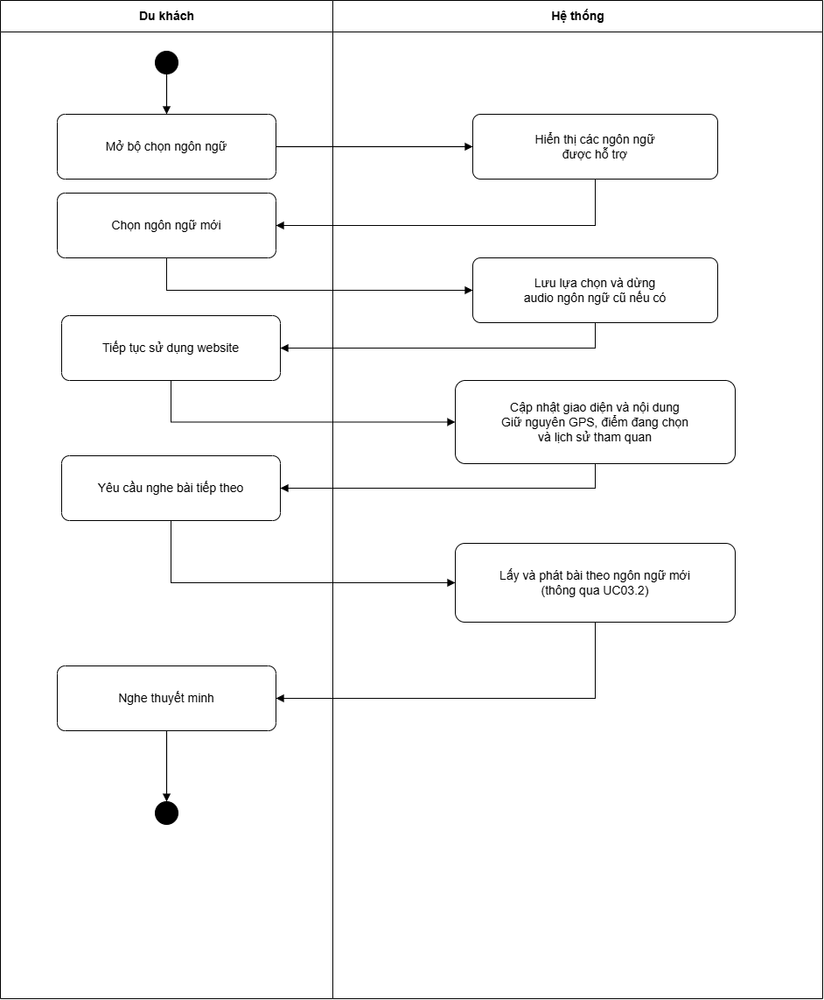

---

## 5.6. Nhóm 04 — Đăng nhập quản trị

Nhóm này xác thực tài khoản để truy cập khu vực Admin.

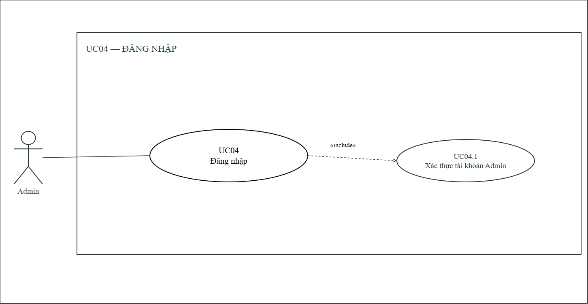

### UC04.1 — Xác thực tài khoản Admin

| Thuộc tính | Nội dung |
|---|---|
| Tác nhân | Admin |
| Mục tiêu | Xác thực tài khoản và mở phiên quản trị |
| Kích hoạt | Gửi biểu mẫu đăng nhập |
| Tiền điều kiện | Có tài khoản được cấp |
| Hậu điều kiện | Tạo phiên hợp lệ hoặc từ chối đăng nhập |
| Quy tắc | BR-01 |

**Luồng chính**

| Bước | Hành động tác nhân | Phản hồi hệ thống |
|---|---|---|
| 1 | Nhập tên đăng nhập và mật khẩu. | Tiếp nhận thông tin. |
| 2 | Nhấn đăng nhập. | Kiểm tra tài khoản, mật khẩu và trạng thái hoạt động. [E1] |
| 3 | Truy cập quản trị. | Thiết lập phiên và mở giao diện Admin. |

**E1 — Thông tin không hợp lệ tại bước 2**

Từ chối đăng nhập, hiển thị thông báo phù hợp. Admin nhập lại và thực hiện bước 2.

Không thêm UC kiểm tra quyền riêng. Các API quản trị vẫn phải xác thực phiên.

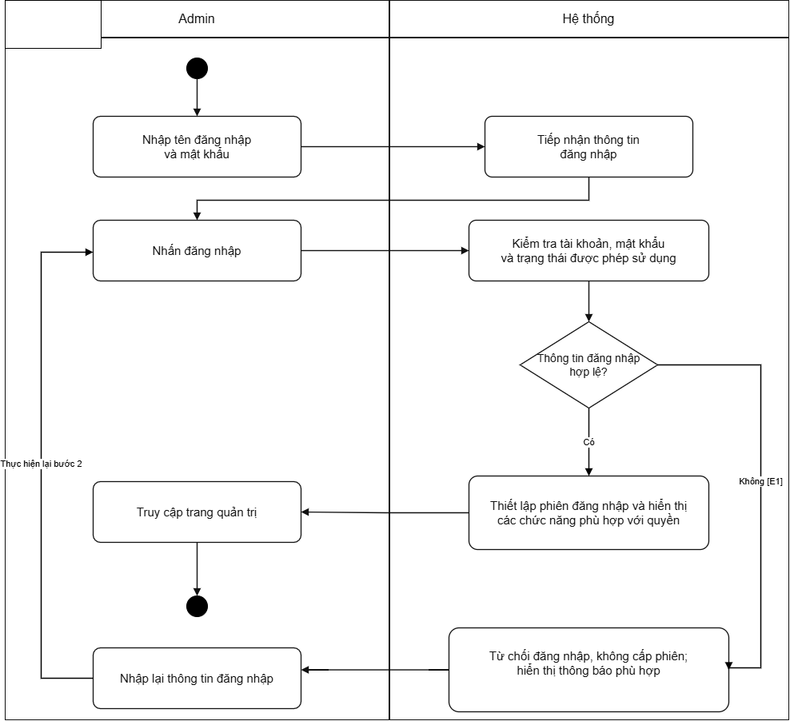

---

## 5.7. Nhóm 05 — Quản lý điểm tham quan

Admin quản lý thông tin, ảnh, tọa độ, bán kính và trạng thái của điểm.

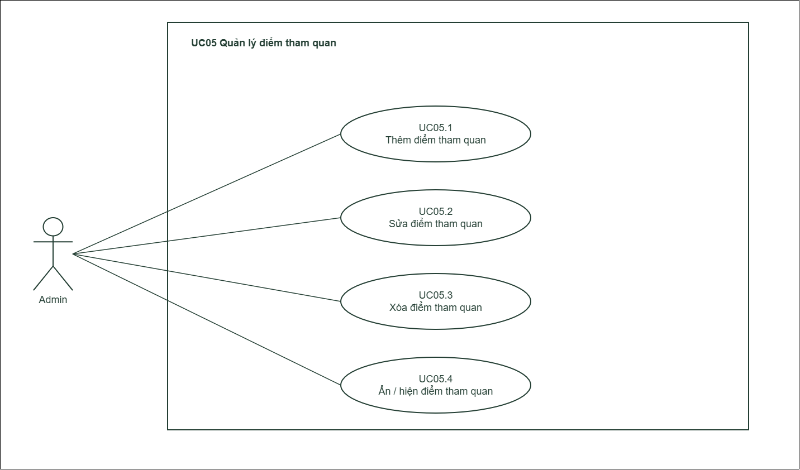

### UC05.1 — Thêm điểm tham quan

| Thuộc tính | Nội dung |
|---|---|
| Tác nhân | Admin |
| Mục tiêu | Tạo điểm tham quan mới |
| Kích hoạt | Chọn thêm điểm |
| Tiền điều kiện | Admin đã đăng nhập, phiên còn hiệu lực |
| Hậu điều kiện | Điểm mới được lưu và hiển thị trong quản trị |
| Quy tắc | BR-01, BR-04–BR-06 |

**Luồng chính**

| Bước | Hành động tác nhân | Phản hồi hệ thống |
|---|---|---|
| 1 | Chọn thêm điểm. | Mở biểu mẫu. |
| 2 | Nhập tên/mô tả tiếng Việt, loại, GPS, bán kính, ưu tiên và chọn ảnh. | Tiếp nhận thông tin, hiển thị ảnh xem trước. |
| 3 | Nhấn lưu. | Kiểm tra dữ liệu, sinh mã duy nhất. [E1] |
| 4 | Xem kết quả. | Lưu điểm và ảnh; nội dung chưa xuất bản chưa được dùng công khai. |

**E1 — Dữ liệu không hợp lệ tại bước 3**

Thông báo đúng trường cần sửa, giữ dữ liệu form. Admin sửa và lưu lại.

Nội dung giới thiệu đa ngôn ngữ được quản lý theo quy trình bản nháp của điểm, tránh tạo hai nguồn dữ liệu công khai không đồng nhất.

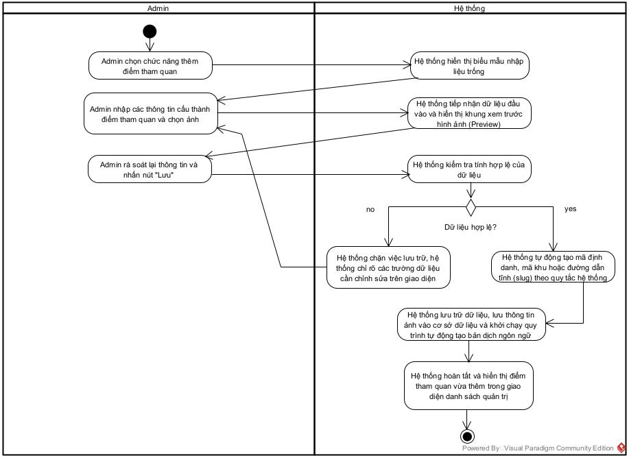

### UC05.2 — Sửa điểm tham quan

| Thuộc tính | Nội dung |
|---|---|
| Tác nhân | Admin |
| Mục tiêu | Cập nhật thông tin điểm |
| Kích hoạt | Chọn sửa |
| Tiền điều kiện | Phiên Admin hợp lệ; điểm tồn tại |
| Hậu điều kiện | Cập nhật thuộc tính điểm, giữ mã định danh và liên kết phiên bản |
| Quy tắc | BR-05, BR-06, BR-14 |

**Luồng chính**

| Bước | Hành động tác nhân | Phản hồi hệ thống |
|---|---|---|
| 1 | Chọn điểm cần sửa. | Hiển thị thông tin hiện tại. |
| 2 | Sửa thuộc tính điểm hoặc ảnh. | Tiếp nhận thay đổi. |
| 3 | Nhấn lưu. | Kiểm tra và lưu dữ liệu hợp lệ. [E1] |
| 4 | Xem kết quả. | Cập nhật thông tin; thay đổi GPS/ảnh có hiệu lực ở lần tải dữ liệu tiếp theo. |

**E1 — Dữ liệu không hợp lệ tại bước 3**

Chưa ghi thay đổi; thông báo trường cần sửa và cho lưu lại.

Sửa nội dung thuyết minh đã công khai phải qua bản nháp, không ghi đè trực tiếp phiên bản đang phát cho khách.

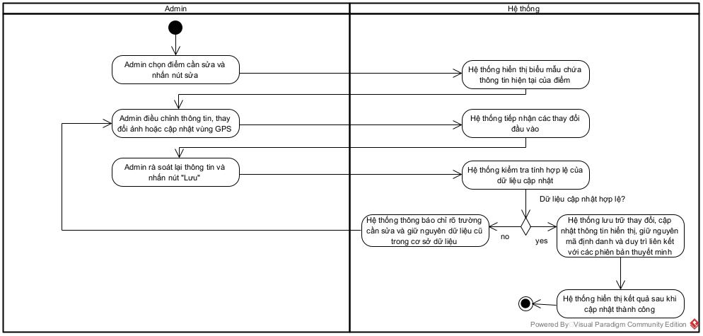

### UC05.3 — Xóa điểm tham quan

| Thuộc tính | Nội dung |
|---|---|
| Tác nhân | Admin |
| Mục tiêu | Xóa điểm không còn cần và đủ điều kiện |
| Kích hoạt | Chọn xóa |
| Tiền điều kiện | Phiên Admin hợp lệ; điểm tồn tại |
| Hậu điều kiện | Điểm đủ điều kiện bị xóa; không phá vỡ dữ liệu tham chiếu |
| Quy tắc | BR-25 |

**Luồng chính**

| Bước | Hành động tác nhân | Phản hồi hệ thống |
|---|---|---|
| 1 | Chọn xóa điểm. | Kiểm tra dữ liệu tham chiếu. [E1] |
| 2 | Xác nhận xóa. | Tiếp nhận xác nhận. [A1] |
| 3 | Xem danh sách. | Xóa điểm và cập nhật danh sách. |

**A1 — Hủy tại bước 2**

Giữ nguyên điểm, đóng hộp xác nhận.

**E1 — Điểm có phiên bản tham chiếu tại bước 1**

Từ chối xóa, thông báo lý do và hướng dẫn sử dụng chức năng ẩn.

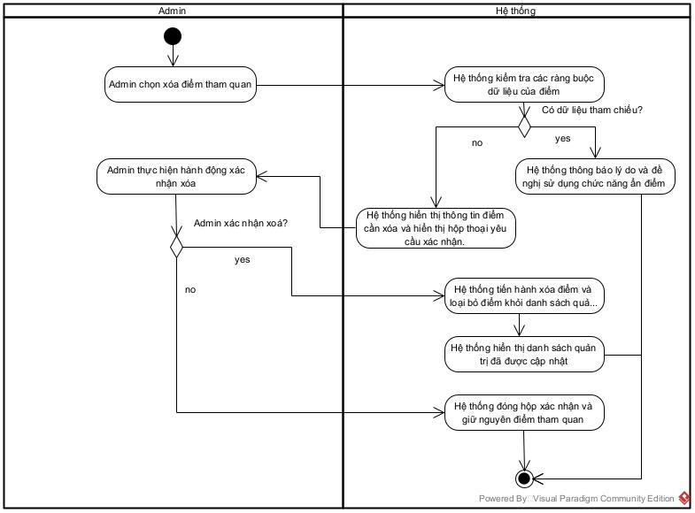

### UC05.4 — Ẩn / hiện điểm tham quan

| Thuộc tính | Nội dung |
|---|---|
| Tác nhân | Admin |
| Mục tiêu | Thay đổi khả năng hiển thị mà không xóa dữ liệu |
| Kích hoạt | Chọn ẩn hoặc hiện |
| Tiền điều kiện | Phiên Admin hợp lệ; điểm tồn tại |
| Hậu điều kiện | Trạng thái được cập nhật, lịch sử được giữ |
| Quy tắc | BR-04, BR-25 |

**Luồng chính**

| Bước | Hành động tác nhân | Phản hồi hệ thống |
|---|---|---|
| 1 | Chọn ẩn điểm đang hiện. | Hiển thị trạng thái và yêu cầu xác nhận. [A1] |
| 2 | Xác nhận. | Chuyển điểm sang trạng thái ẩn. |
| 3 | Xem kết quả. | Loại điểm khỏi danh sách public ở lần cập nhật tiếp theo. |

**A1 — Chọn hiện điểm tại bước 1**

Chuyển điểm sang hoạt động. Chỉ đưa ra web User nếu có phiên bản công khai hợp lệ; bật hoạt động không tự xuất bản bản nháp.

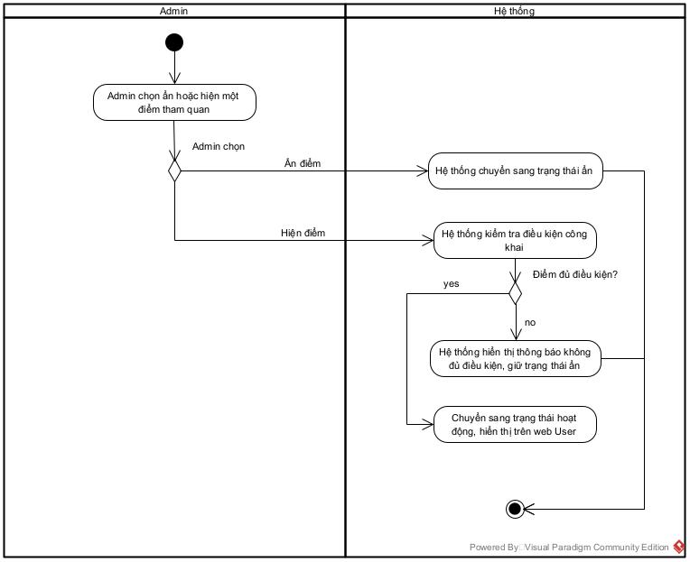

---

## 5.8. Nhóm 06 — Quản lý bản thuyết minh

Nhóm này quản lý nội dung từ bản nháp tiếng Việt đến bản dịch, audio và xuất bản.

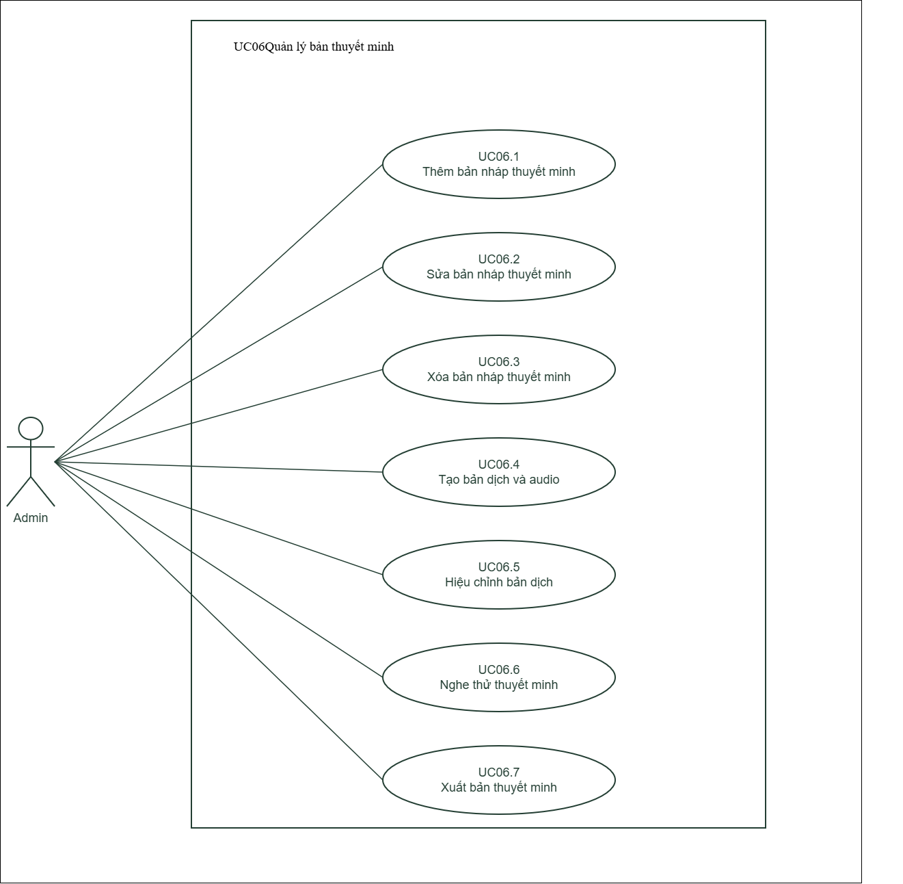

### UC06.1 — Thêm bản nháp thuyết minh

| Thuộc tính | Nội dung |
|---|---|
| Tác nhân | Admin |
| Mục tiêu | Tạo phiên bản nội dung mới |
| Kích hoạt | Chọn thêm bản nháp |
| Tiền điều kiện | Phiên Admin hợp lệ; điểm tồn tại |
| Hậu điều kiện | Lưu bản Draft liên kết với điểm |
| Quy tắc | BR-13, BR-14 |

**Luồng chính**

| Bước | Hành động tác nhân | Phản hồi hệ thống |
|---|---|---|
| 1 | Chọn điểm và thêm bản nháp. | Mở biểu mẫu nội dung. |
| 2 | Nhập tiêu đề, mô tả và script tiếng Việt. | Tiếp nhận thông tin. |
| 3 | Lưu bản nháp. | Kiểm tra nội dung, tạo số phiên bản và lưu Draft. [E1] |

**E1 — Nội dung không hợp lệ tại bước 3**

Thông báo phần cần bổ sung; Admin sửa và lưu lại.

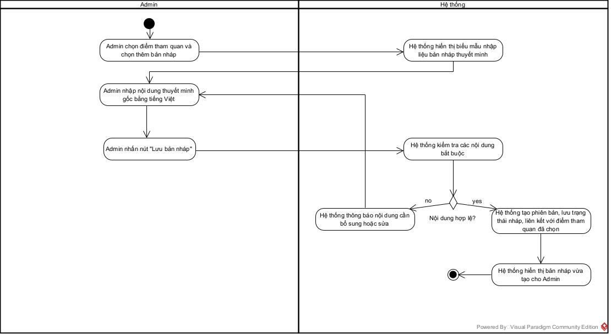

### UC06.2 — Sửa bản nháp thuyết minh

| Thuộc tính | Nội dung |
|---|---|
| Tác nhân | Admin |
| Mục tiêu | Điều chỉnh nội dung trước xuất bản |
| Kích hoạt | Chọn sửa phiên bản |
| Tiền điều kiện | Phiên Admin hợp lệ; phiên bản tồn tại |
| Hậu điều kiện | Lưu bản nháp và cập nhật hiệu lực dữ liệu phụ thuộc |
| Quy tắc | BR-14, BR-15 |

**Luồng chính**

| Bước | Hành động tác nhân | Phản hồi hệ thống |
|---|---|---|
| 1 | Chọn phiên bản cần sửa. | Kiểm tra trạng thái cho phép sửa. [E1] |
| 2 | Điều chỉnh nội dung tiếng Việt. | Tiếp nhận thay đổi. |
| 3 | Nhấn lưu. | Kiểm tra, lưu và đánh dấu bản dịch/audio cần cập nhật. [E2] |

**E1 — Phiên bản không được phép sửa tại bước 1**

Không ghi đè bản đã xuất bản. Hướng dẫn tạo bản nháp mới.

**E2 — Nội dung không hợp lệ tại bước 3**

Giữ bản đã lưu, thông báo trường cần sửa.

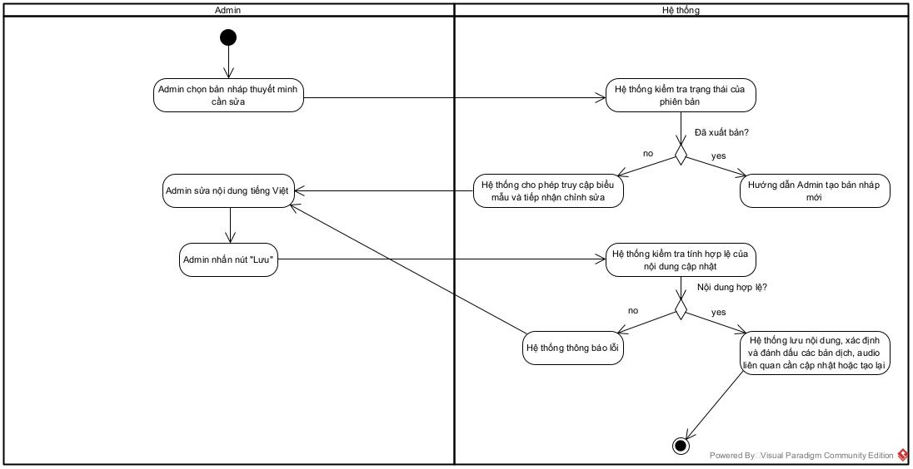

### UC06.3 — Xóa bản nháp thuyết minh

| Thuộc tính | Nội dung |
|---|---|
| Tác nhân | Admin |
| Mục tiêu | Loại bỏ bản nháp không sử dụng |
| Kích hoạt | Chọn xóa bản nháp |
| Tiền điều kiện | Phiên Admin hợp lệ; phiên bản tồn tại |
| Hậu điều kiện | Bản nháp đủ điều kiện được xóa |
| Quy tắc | BR-25, BR-27 |

**Luồng chính**

| Bước | Hành động tác nhân | Phản hồi hệ thống |
|---|---|---|
| 1 | Chọn xóa bản nháp. | Kiểm tra trạng thái và tác vụ liên quan. [E1] |
| 2 | Xác nhận xóa. | Tiếp nhận xác nhận. [A1] |
| 3 | Xem danh sách. | Xóa bản nháp và xử lý dữ liệu phụ thuộc theo chính sách. |

**A1 — Hủy tại bước 2**

Giữ nguyên bản nháp.

**E1 — Không đủ điều kiện xóa tại bước 1**

Từ chối nếu không phải Draft hoặc còn tác vụ đang xử lý. Không xóa phiên bản đang công khai.

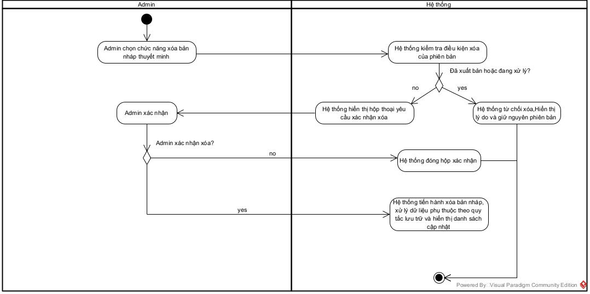

### UC06.4 — Tạo bản dịch và audio

| Thuộc tính | Nội dung |
|---|---|
| Tác nhân chính | Admin |
| Dịch vụ hỗ trợ | Azure Translator, Azure Speech |
| Mục tiêu | Tạo nội dung và audio cho 5 ngôn ngữ |
| Kích hoạt | Chọn tạo bản dịch và audio |
| Tiền điều kiện | Phiên Admin hợp lệ; có Draft và tiếng Việt hợp lệ |
| Hậu điều kiện | Lưu kết quả và trạng thái theo từng ngôn ngữ |
| Quy tắc | BR-15–BR-17, BR-27 |

**Luồng chính**

| Bước | Hành động tác nhân | Phản hồi hệ thống |
|---|---|---|
| 1 | Chọn bản nháp và yêu cầu tạo. | Kiểm tra dữ liệu, tạo GenerationJobs phù hợp. [A1] |
| 2 | Theo dõi tiến trình. | Dịch sang en, zh, ko, ja; giữ bản hiệu chỉnh thủ công theo quy tắc. [A2] |
| 3 | Tiếp tục theo dõi. | Tạo audio cho vi và 4 bản dịch, lưu file và metadata. [E1] |
| 4 | Xem kết quả. | Cập nhật trạng thái job và từng ngôn ngữ; cho phép nghe thử. |

**A1 — Đã có tác vụ tương ứng đang chạy tại bước 1**

Hiển thị trạng thái tác vụ hiện có, không tạo trùng.

**A2 — Có bản dịch đã hiệu chỉnh tại bước 2**

Giữ bản dịch đó và tạo audio từ nội dung hiện tại, trừ khi Admin chủ động xác nhận thay thế bản dịch.

**E1 — Một phần kết quả không hợp lệ tại bước 3**

Giữ kết quả đã hoàn thành, ghi phần lỗi và cho phép tạo lại. Không coi phiên bản là đủ điều kiện xuất bản khi còn phần thiếu hoặc sai.

GenerationJobs là dữ liệu theo dõi xử lý, không tự tạo thêm UC quản lý tác vụ riêng.

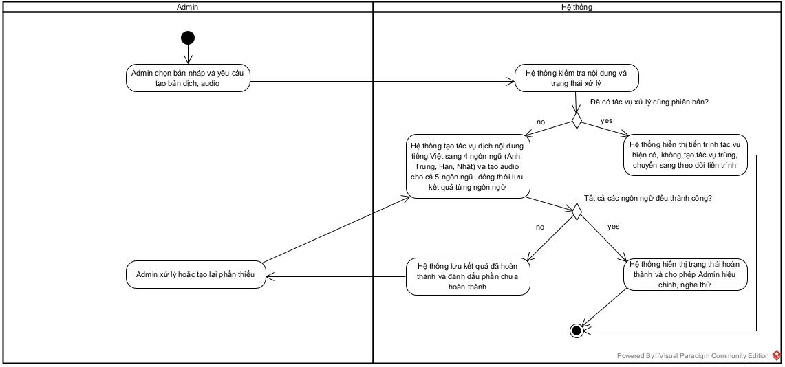

### UC06.5 — Hiệu chỉnh bản dịch

| Thuộc tính | Nội dung |
|---|---|
| Tác nhân | Admin |
| Mục tiêu | Sửa bản dịch trước xuất bản |
| Kích hoạt | Chọn bản dịch cần sửa |
| Tiền điều kiện | Phiên Admin hợp lệ; bản dịch thuộc Draft |
| Hậu điều kiện | Lưu bản dịch, đánh dấu audio cần cập nhật nếu script thay đổi |
| Quy tắc | BR-15, BR-16 |

**Luồng chính**

| Bước | Hành động tác nhân | Phản hồi hệ thống |
|---|---|---|
| 1 | Chọn ngôn ngữ. | Hiển thị bản dịch. |
| 2 | Chỉnh sửa nội dung. | Tiếp nhận thay đổi. |
| 3 | Nhấn lưu. | Kiểm tra, lưu và đánh dấu hiệu chỉnh thủ công. [E1] |
| 4 | Xem kết quả. | Đánh dấu audio hết hiệu lực nếu script đã thay đổi. |

**E1 — Nội dung không hợp lệ tại bước 3**

Thông báo và cho sửa lại, không ghi đè dữ liệu hợp lệ trước đó.

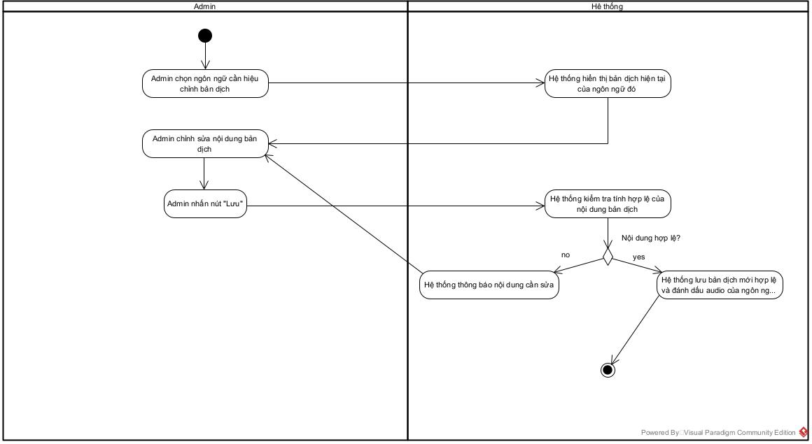

### UC06.6 — Nghe thử thuyết minh

| Thuộc tính | Nội dung |
|---|---|
| Tác nhân | Admin |
| Mục tiêu | Kiểm tra audio trước công bố |
| Kích hoạt | Chọn nghe thử |
| Tiền điều kiện | Phiên Admin hợp lệ; phiên bản tồn tại |
| Hậu điều kiện | Admin nghe được audio hợp lệ để kiểm tra |
| Quy tắc | BR-15, BR-19 |

**Luồng chính**

| Bước | Hành động tác nhân | Phản hồi hệ thống |
|---|---|---|
| 1 | Chọn phiên bản và ngôn ngữ. | Kiểm tra audio tương ứng. [E1] |
| 2 | Nhấn nghe thử. | Phát audio qua chức năng preview dành cho Admin. |
| 3 | Nghe và đối chiếu. | Hiển thị văn bản và điều khiển phát. |

**E1 — Audio chưa có hoặc không khớp nội dung tại bước 1**

Thông báo cần tạo hoặc tạo lại. Không trình bày audio cũ như kết quả hợp lệ.

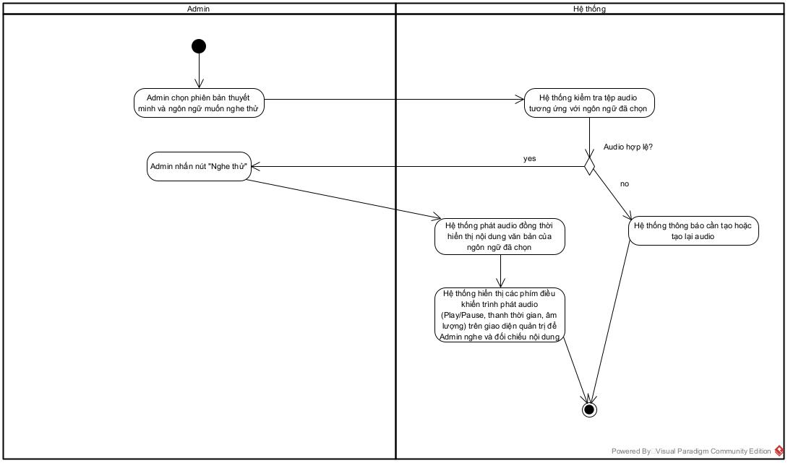

### UC06.7 — Xuất bản thuyết minh

| Thuộc tính | Nội dung |
|---|---|
| Tác nhân | Admin |
| Mục tiêu | Đưa phiên bản hoàn chỉnh vào sử dụng công khai |
| Kích hoạt | Chọn xuất bản |
| Tiền điều kiện | Phiên Admin hợp lệ; có bản Draft |
| Hậu điều kiện | Cập nhật phiên bản công khai nhất quán hoặc giữ nguyên bản cũ |
| Quy tắc | BR-04, BR-17–BR-19 |

**Luồng chính**

| Bước | Hành động tác nhân | Phản hồi hệ thống |
|---|---|---|
| 1 | Chọn xuất bản. | Kiểm tra đủ 5 ngôn ngữ, audio khớp nội dung và tác vụ liên quan đã hoàn tất. [E1] |
| 2 | Xác nhận công bố. | Tiếp nhận xác nhận. [A1] |
| 3 | Xem kết quả. | Cập nhật trạng thái và PublishedRevisionId nhất quán. |
| 4 | Kiểm tra web User. | Cung cấp phiên bản mới nếu điểm đang hoạt động. [A2] |

**A1 — Hủy tại bước 2**

Giữ bản nháp và phiên bản công khai cũ.

**A2 — Điểm đang ẩn tại bước 4**

Phiên bản vẫn được xuất bản nhưng điểm chưa xuất hiện trên web User cho đến khi được bật hoạt động.

**E1 — Chưa đủ điều kiện tại bước 1**

Liệt kê ngôn ngữ hoặc audio cần hoàn thiện; không thay đổi phiên bản công khai.

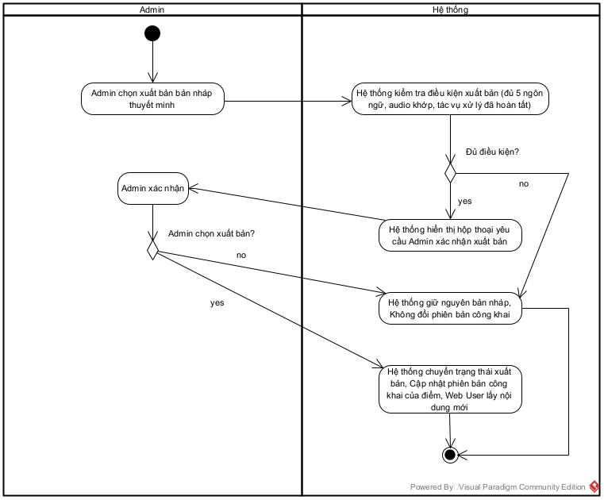

---

## 5.9. Nhóm 07 — Xem báo cáo thống kê

Báo cáo phản ánh lượt truy cập đã ghi nhận, không phải số người thực tế.

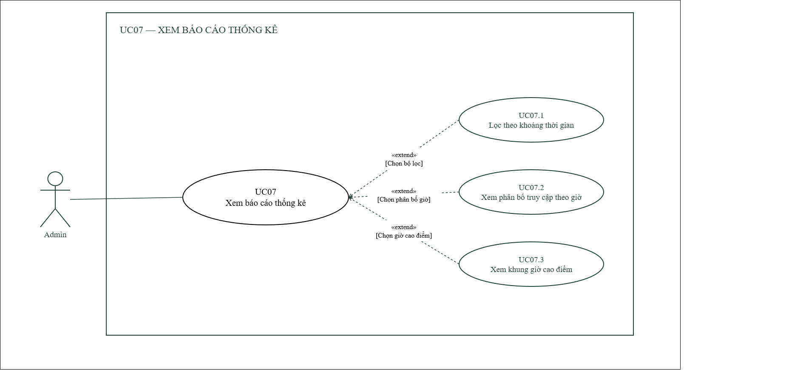

### UC07.1 — Lọc theo khoảng thời gian

| Thuộc tính | Nội dung |
|---|---|
| Tác nhân | Admin |
| Mục tiêu | Xem báo cáo trong khoảng thời gian mong muốn |
| Kích hoạt | Áp dụng bộ lọc |
| Tiền điều kiện | Phiên Admin hợp lệ |
| Hậu điều kiện | Báo cáo sử dụng đúng khoảng đã chọn |
| Quy tắc | BR-21–BR-24, BR-26 |

**Luồng chính**

| Bước | Hành động tác nhân | Phản hồi hệ thống |
|---|---|---|
| 1 | Chọn ngày bắt đầu và kết thúc. | Tiếp nhận điều kiện lọc. |
| 2 | Nhấn áp dụng. | Kiểm tra và quy đổi khoảng thời gian. [E1] |
| 3 | Xem báo cáo. | Tổng hợp lượt phù hợp. [A1] |

**A1 — Không có lượt tại bước 3**

Hiển thị 0 lượt và thông báo chưa có dữ liệu; không tạo số liệu mẫu.

**E1 — Khoảng thời gian không hợp lệ tại bước 2**

Thông báo và yêu cầu sửa; chưa áp dụng bộ lọc.

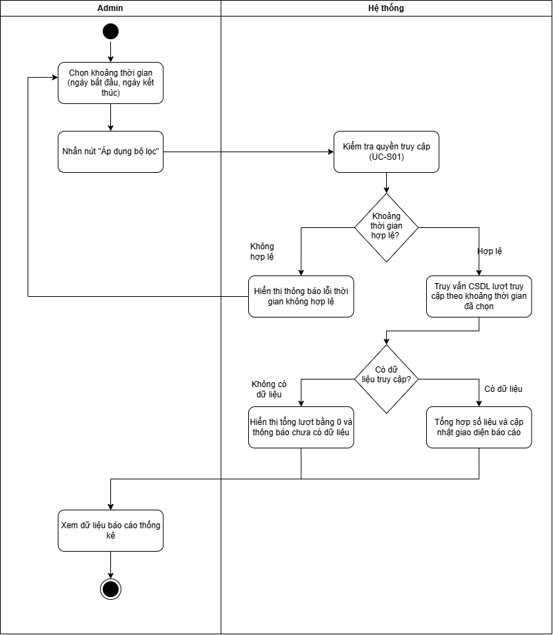

### UC07.2 — Xem phân bố truy cập theo giờ

| Thuộc tính | Nội dung |
|---|---|
| Tác nhân | Admin |
| Mục tiêu | So sánh lượt truy cập giữa các giờ trong ngày |
| Kích hoạt | Mở phần phân bố theo giờ |
| Tiền điều kiện | Phiên Admin hợp lệ; có khoảng lọc |
| Hậu điều kiện | Hiển thị số lượt của 24 khung giờ |
| Quy tắc | BR-23, BR-24 |

**Luồng chính**

| Bước | Hành động tác nhân | Phản hồi hệ thống |
|---|---|---|
| 1 | Chọn xem phân bố theo giờ. | Lấy dữ liệu trong khoảng lọc. |
| 2 | Xem biểu đồ/bảng. | Quy đổi giờ Việt Nam và cộng lượt vào 24 khung giờ. [A1] |
| 3 | So sánh các khung. | Hiển thị nhãn giờ và số lượt. |

**A1 — Không có dữ liệu tại bước 2**

Hiển thị trạng thái chưa có dữ liệu hoặc các khung bằng 0.

Nếu lọc nhiều ngày, lượt ở cùng giờ của các ngày được cộng vào cùng khung. Giao diện phải ghi rõ cách tổng hợp này.

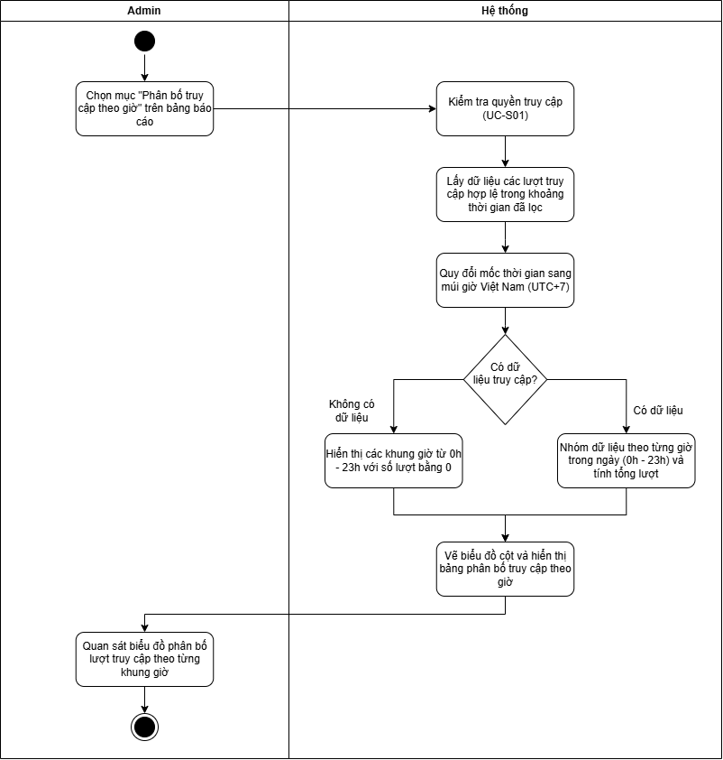

### UC07.3 — Xem khung giờ cao điểm

| Thuộc tính | Nội dung |
|---|---|
| Tác nhân | Admin |
| Mục tiêu | Xác định giờ có nhiều lượt truy cập nhất |
| Kích hoạt | Xem thông tin cao điểm |
| Tiền điều kiện | Phiên Admin hợp lệ; có khoảng lọc |
| Hậu điều kiện | Hiển thị giờ cao điểm và số lượt hoặc thông báo chưa có dữ liệu |
| Quy tắc | BR-23, BR-24 |

**Luồng chính**

| Bước | Hành động tác nhân | Phản hồi hệ thống |
|---|---|---|
| 1 | Chọn xem giờ cao điểm. | Lấy số lượt theo 24 khung giờ. [A1] |
| 2 | Chờ tổng hợp. | Tìm giá trị lớn nhất và khung tương ứng. [A2] |
| 3 | Xem kết quả. | Hiển thị giờ cao điểm, số lượt và khoảng lọc. |

**A1 — Không có lượt tại bước 1**

Thông báo chưa đủ dữ liệu để xác định cao điểm. Kết thúc.

**A2 — Nhiều giờ đồng hạng tại bước 2**

Hiển thị tất cả khung giờ có cùng số lượt lớn nhất.

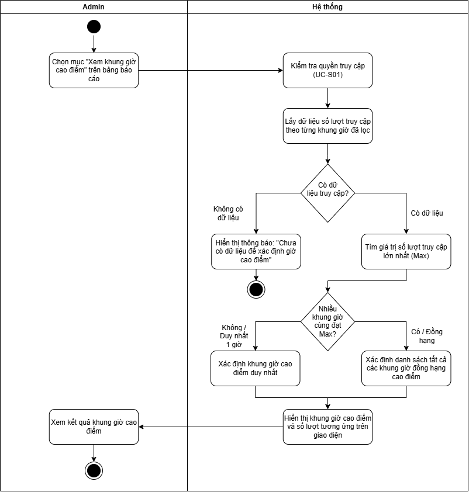

## 5.10. Giả lập vị trí phục vụ demo

Giả lập là chức năng hỗ trợ kiểm thử nhóm 02 và 03, không phải dữ liệu GPS thật.

- Chọn giả lập thì ngừng theo dõi GPS thật.
- Chọn điểm xuất phát, điểm đích và tốc độ.
- Vị trí giả lập được gửi qua cùng quy trình đánh giá vùng.
- Tạm dừng di chuyển khác với tạm dừng audio.
- Làm lại đưa về vị trí xuất phát, dừng audio và đặt lại lịch sử của lượt demo.
- Thoát giả lập không tự xin quyền GPS khi chưa có thao tác của khách.
- Kết quả request cũ phải được bỏ qua sau khi đổi chế độ hoặc đặt lại.
- Không dùng giả lập để khẳng định độ chính xác GPS thực địa.

---

# 6. User Stories

| Mã | User Story | UC liên quan | Tiêu chí chấp nhận |
|---|---|---|---|
| US-01 | Là du khách, tôi muốn mở web qua QR để không cần cài ứng dụng. | UC01.3 | Mở đúng URL public, ghi nhận không trùng |
| US-02 | Là du khách, tôi muốn chọn ngôn ngữ trước khi tham quan. | UC01.1, UC01.2 | Có 5 ngôn ngữ; chọn trước khi hỏi GPS |
| US-03 | Là du khách không cấp GPS, tôi vẫn muốn xem và nghe thủ công. | UC01.2, UC02.1, UC03.1–03.2 | Không tạo vị trí giả; vẫn chọn điểm và nghe được |
| US-04 | Là du khách, tôi muốn thấy vị trí và thông tin các khu. | UC02.1–02.2 | Hiển thị đúng điểm công khai và tọa độ hợp lệ |
| US-05 | Là du khách đang di chuyển, tôi muốn nghe đúng bài khi vào vùng. | UC03.1–03.2 | Đúng vùng, ngôn ngữ, phiên bản; không phát chồng |
| US-06 | Là du khách, tôi muốn tạm dừng, tiếp tục và nghe lại. | UC03.3–03.5 | Pause giữ thời điểm; tiếp tục đúng chỗ; nghe lại từ đầu |
| US-07 | Là du khách, tôi muốn đổi ngôn ngữ mà không mất hành trình. | UC03.6 | Không reload, không mất điểm đã đi qua và lịch sử nghe |
| US-08 | Là Admin, tôi muốn đăng nhập để quản trị nội dung. | UC04.1 | Chỉ tài khoản hợp lệ được tạo phiên |
| US-09 | Là Admin, tôi muốn quản lý điểm và vùng GPS. | UC05.1–05.4 | Mã tự sinh, ảnh tải lên, kiểm tra dữ liệu và bảo toàn tham chiếu |
| US-10 | Là Admin, tôi muốn soạn và quản lý bản nháp. | UC06.1–06.3 | Không sửa trực tiếp bản công khai; không xóa nhầm lịch sử |
| US-11 | Là Admin, tôi muốn tạo bản dịch/audio và theo dõi kết quả. | UC06.4 | Có trạng thái job, kết quả từng ngôn ngữ và khả năng tạo lại |
| US-12 | Là Admin, tôi muốn hiệu chỉnh và nghe thử trước công bố. | UC06.5–06.6 | Audio khớp bản dịch hiện hành; preview chỉ dành cho Admin |
| US-13 | Là Admin, tôi muốn xuất bản nội dung đã hoàn chỉnh. | UC06.7 | Kiểm tra đủ 5 ngôn ngữ; User lấy đúng phiên bản |
| US-14 | Là Admin, tôi muốn biết số lượt truy cập và giờ cao điểm. | UC07.1–07.3 | Đúng khoảng lọc, giờ Việt Nam, không trùng và có xử lý đồng hạng |

---

# 7. Luồng người dùng

## 7.1. Khởi đầu tham quan

Quét QR → mở website → ghi nhận truy cập theo phiên → chọn ngôn ngữ → giải thích quyền vị trí → cấp hoặc không cấp quyền → mở bản đồ.

Ghi nhận thống kê không làm chặn bước chọn ngôn ngữ.

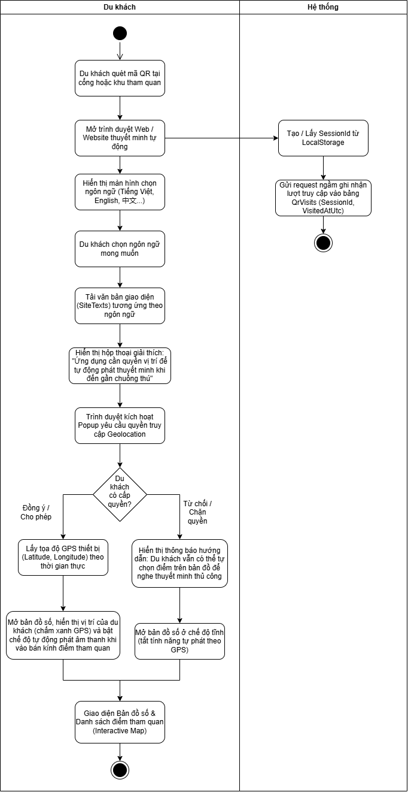

## 7.2. Nghe theo vị trí

Bật tự phát → tiếp nhận vị trí hợp lệ → xác định vùng → chọn điểm → kiểm tra chống lặp/phát chồng → lấy phiên bản public theo ngôn ngữ → phát audio.

Nhận diện được điểm không đồng nghĩa trình duyệt chắc chắn cho phép tự phát. Nếu tự phát bị chặn, giao diện cung cấp thao tác nghe chủ động.

## 7.3. Quản trị nội dung

Đăng nhập → chọn/tạo điểm → tạo bản nháp tiếng Việt → dịch và tạo audio → hiệu chỉnh nếu cần → tạo lại audio hết hiệu lực → nghe thử → xuất bản.

Trong quá trình chuẩn bị bản mới, bản public cũ vẫn được phục vụ.

## 7.4. Truy cập QR và báo cáo

URL có dấu nguồn QR → tạo/khôi phục SessionId → backend chống trùng → lưu QrVisits → Admin chọn khoảng ngày → tổng hợp giờ Việt Nam → hiển thị tổng lượt và cao điểm.

Không ghi nhận việc mở trang hiển thị QR của người trình bày là lượt khách truy cập.

## 7.5. Đổi URL demo

Khởi động tunnel mới → lấy URL mới → cập nhật QR → khách mở URL mới → tiếp tục ghi vào cùng database.

Đổi URL không xóa lịch sử SQL. Tuy nhiên, định danh lưu theo origin trình duyệt có thể thay đổi, nên không cam kết nhận diện cùng một khách giữa hai URL.

---

# 8. Yêu cầu phi chức năng

## 8.1. Hiệu năng

| Mã | Mục tiêu | Cách xác minh |
|---|---|---|
| NFR-P01 | Trang thiết lập tương tác được trong khoảng 3 giây ở mạng kiểm thử ổn định | Ghi thiết bị, mạng và đo nhiều lần |
| NFR-P02 | API đọc/đánh giá vùng có p95 không quá 1 giây ở tải mục tiêu 20 khách đồng thời | Đo cả backend và SQL; ghi ảnh hưởng tunnel |
| NFR-P03 | Nội dung public mới được nhận trong 15 giây khi tab hoạt động và mạng bình thường | Đo từ publish tới lần đồng bộ dữ liệu User |
| NFR-P04 | Tác vụ Azure hiển thị trạng thái thực tế | Kiểm tra tạo mới, lỗi, tạo lại và từng ngôn ngữ |

Các ngưỡng là mục tiêu kiểm thử, chưa phải công suất được chứng minh.

## 8.2. Bảo mật

- Hash mật khẩu bằng cơ chế thống nhất giữa tạo và xác minh.
- Backend xác thực phiên với mọi API quản trị.
- Không coi việc ẩn nút trên GUI là biện pháp bảo vệ API.
- Nếu dùng cookie, áp dụng HttpOnly, Secure theo môi trường và bảo vệ CSRF phù hợp.
- Không đưa Azure key hoặc connection string nhạy cảm lên Git.
- Kiểm tra đầu vào và file tải lên.
- Preview nháp yêu cầu đăng nhập; audio public phải kiểm tra điều kiện công khai.
- Bỏ qua đăng nhập chỉ là cấu hình demo, phải tắt khi vận hành.

## 8.3. Khả dụng và tương thích

- Giao diện thích ứng màn hình điện thoại.
- Kiểm tra trên Safari iPhone, Chrome Android và trình duyệt máy tính.
- GPS và audio dùng HTTPS trên thiết bị khách.
- Không để bảng điều khiển che toàn bộ bản đồ.
- Phân biệt lỗi tải dữ liệu với danh sách rỗng.
- Không cam kết theo dõi GPS/audio liên tục khi ứng dụng bị treo nền hoặc màn hình khóa.
- Trạng thái có chữ/biểu tượng, không chỉ dùng màu.

## 8.4. Riêng tư và thống kê

- Không yêu cầu tên, số điện thoại hoặc tài khoản của du khách.
- SessionId phục vụ chống trùng lượt, không phải danh tính cá nhân.
- Không mặc định lưu lịch sử tọa độ.
- Chỉ số chính là lượt truy cập, không gọi là số người duy nhất.
- Thời hạn lưu dữ liệu QR được nhóm xác nhận trước vận hành; đề xuất ban đầu là 90 ngày.

## 8.5. Tin cậy và bảo trì

- Không báo thành công khi dữ liệu/file chưa lưu đầy đủ.
- Có log lỗi nhưng không để lộ bí mật.
- Kết quả Azure chỉ được gắn vào đúng phiên bản và script còn hiệu lực.
- Backup SQL và kho media phải khôi phục được liên kết dữ liệu–file.
- Kiểm tra trạng thái job bị gián đoạn sau khi backend khởi động lại; không để “đang xử lý” vô thời hạn.
- Phân biệt lỗi kỹ thuật trong kế hoạch kiểm thử dù không lặp chúng trong mọi đặc tả UC.

---

# 9. Công nghệ và thiết kế hệ thống

## 9.1. Công nghệ

| Thành phần | Công nghệ |
|---|---|
| Frontend | React, TypeScript, Vite, CSS |
| Bản đồ | Leaflet và nguồn tile được cấu hình |
| Tạo QR | Thư viện mã hóa URL thành QR |
| Backend | C#, ASP.NET Core Web API |
| Nghiệp vụ | Zoo.BUS |
| Truy cập dữ liệu | Zoo.DAL, Entity Framework Core |
| Database | SQL Server |
| Dịch | Azure Translator |
| Tạo audio | Azure Speech |
| Media | File trên máy chủ; SQL lưu đường dẫn/metadata |
| Demo public | Cloudflare Quick Tunnel |
| Quản lý mã nguồn | Git, GitHub |

Phiên bản công nghệ phải lấy theo file cấu hình của bản mã nguồn dùng để nộp.

## 9.2. Kiến trúc ba lớp

| Lớp / thành phần | Trách nhiệm |
|---|---|
| GUI — web | Giao diện, lấy vị trí, bản đồ, player, quản trị và báo cáo |
| BUS — Zoo.BUS | Quy tắc vùng, nội dung, phiên bản, xuất bản, điều phối Azure và thống kê |
| DAL — Zoo.DAL | DbContext, repository, lưu/đọc dữ liệu; adapter tích hợp theo cấu trúc dự án |
| API — Zoo.Api | Đầu vào HTTP, xác thực, ánh xạ request/response và gọi BUS |

Luồng xử lý điển hình:

GUI → Zoo.Api → BUS → DAL → SQL Server hoặc kho media.

Azure được gọi từ phía backend qua thành phần tích hợp; không đưa khóa Azure cho trình duyệt.

API là đầu vào HTTP của backend. Việc có project API riêng không tạo thêm một lớp nghiệp vụ thứ tư.

Đây là kiến trúc mục tiêu. Cần đối chiếu mã nguồn trước khi khẳng định mọi controller đã tuân thủ hoàn toàn.

**[CHÈN HÌNH KIẾN TRÚC BA LỚP — GUI, API ĐẦU VÀO, BUS, DAL VÀ CÁC HỆ THỐNG LƯU TRỮ/TÍCH HỢP.]**

## 9.3. Component Diagram

Các thành phần chính:

- User UI, Admin UI.
- Language Context và dịch vụ SiteTexts.
- Geolocation/Simulation.
- Audio Player.
- API Client.
- Auth, Places, Narration, Visit, Reporting API.
- BUS Services.
- Repositories.
- Azure Translator/Speech adapters.
- Media Storage.

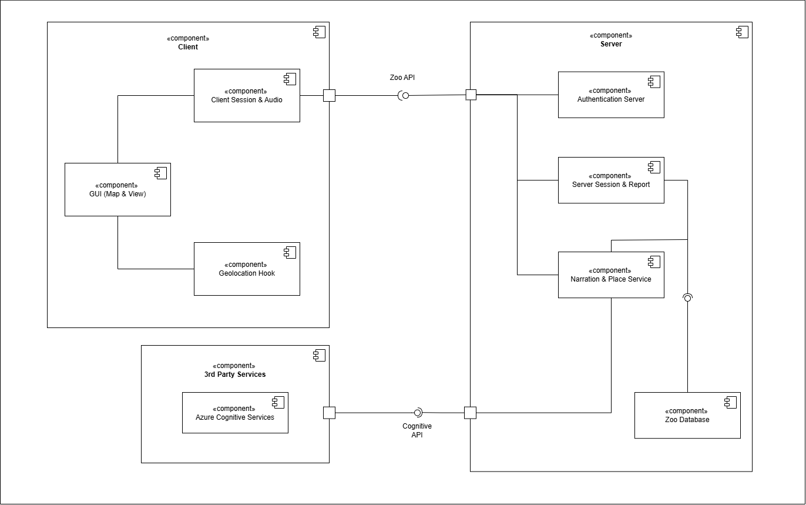

## 9.4. Deployment Diagram

Môi trường demo gồm:

- Thiết bị du khách/Admin chạy trình duyệt.
- Cloudflare Tunnel cung cấp URL HTTPS.
- Máy demo chạy frontend, backend và cloudflared.
- SQL Server.
- Kho file ảnh/audio.
- Dịch vụ Azure và nền bản đồ bên ngoài.

Cổng thực tế được lấy từ cấu hình khởi động. Không coi cổng ví dụ là giá trị cố định của mọi môi trường.

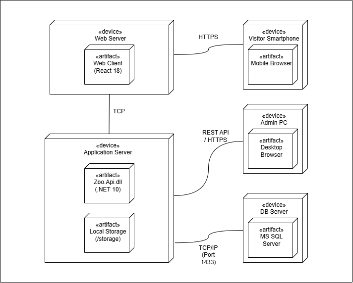

Quick Tunnel dùng cho demo, không phải cam kết hosting lâu dài.

## 9.5. Thiết kế cơ sở dữ liệu

Thiết kế gồm 7 bảng. Bỏ bảng QrCodes nhưng giữ QrVisits, GenerationJobs và SiteTexts.

Tên cột dưới đây là hợp đồng thiết kế cần đối chiếu với entity/migration trước khi lập lược đồ vật lý.

| Bảng | Vai trò | Thuộc tính chính |
|---|---|---|
| AdminUsers | Tài khoản Admin | Id, Username, PasswordHash, IsActive |
| Places | Điểm và vùng tham quan | Id, Code, Category, Icon, Latitude, Longitude, RadiusMeters, Priority, MapX, MapY, ImageUrl, IsActive, PublishedRevisionId |
| NarrationRevisions | Phiên bản nội dung | Id, PlaceId, Version, Status, CreatedByAdminId, CreatedAtUtc, PublishedAtUtc |
| NarrationTranslations | Nội dung và audio theo ngôn ngữ | Id, RevisionId, Language, Title, Description, Script, IsManualEdited, AudioPath, AudioStatus, ScriptHash, AudioScriptHash |
| GenerationJobs | Trạng thái tác vụ dịch/tạo audio | Id, RevisionId, Language, Stage, Status, AttemptCount, LastError, CreatedAtUtc, UpdatedAtUtc |
| SiteTexts | Văn bản giao diện đa ngôn ngữ | Id, Key, Language, Value |
| QrVisits | Lượt truy cập từ QR | Id, SessionId, VisitedAtUtc, IsDemo |

### Quan hệ và ràng buộc

- AdminUsers 1 — 0..N NarrationRevisions qua CreatedByAdminId.
- Places 1 — 0..N NarrationRevisions qua PlaceId.
- Unique (PlaceId, Version).
- Places có 0..1 PublishedRevision qua PublishedRevisionId.
- PublishedRevision phải thuộc chính Place và có trạng thái Published.
- NarrationRevisions 1 — 0..N NarrationTranslations.
- Unique (RevisionId, Language).
- NarrationRevisions 1 — 0..N GenerationJobs.
- Unique (Key, Language) trong SiteTexts.
- Unique SessionId trong QrVisits để chống trùng lượt.
- Index VisitedAtUtc hỗ trợ lọc báo cáo.
- QrVisits và SiteTexts không cần quan hệ với Places.
- Không có QrCodeId hoặc FK tới QrCodes.

Các quan hệ và ràng buộc nêu trên phải được kiểm tra trong migration trước khi mô tả là đã triển khai.

Dấu nguồn như `source=qr` chỉ xác định loại liên kết truy cập, không chứng minh hành động camera quét.

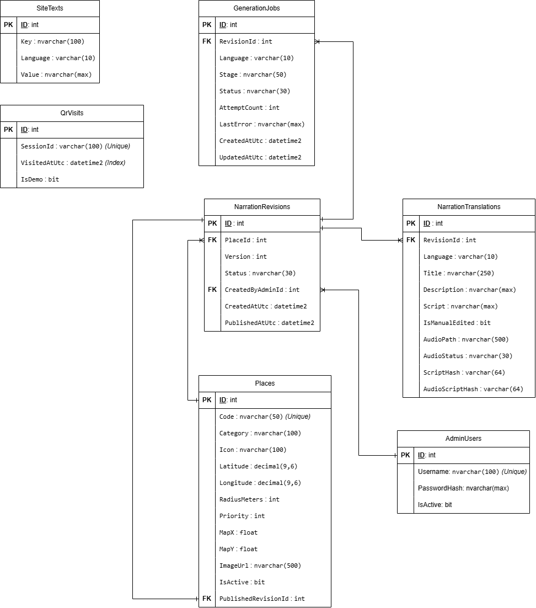

## 9.6. Hợp đồng API

Đường dẫn cụ thể phải được đối chiếu với controller; bảng này mô tả chức năng API cần có.

| Nhóm API | Trách nhiệm |
|---|---|
| Auth | Đăng nhập, trạng thái phiên, đăng xuất |
| Places public | Trả điểm đủ điều kiện công khai |
| Places admin | Thêm, sửa, xóa đủ điều kiện, ẩn/hiện và upload ảnh |
| Narration admin | Quản lý Draft, generate, hiệu chỉnh, preview, publish |
| Generation status | Trả trạng thái xử lý theo phiên bản/ngôn ngữ |
| Visit evaluate | Nhận tọa độ và trả kết quả đánh giá vùng |
| Audio | Phân biệt audio public và preview nháp |
| SiteTexts | Trả văn bản giao diện theo khóa/ngôn ngữ |
| QR visits | Nhận SessionId; server ghi UTC; chống gửi trùng |
| Reporting | Nhận khoảng thời gian và lựa chọn dữ liệu demo; trả tổng lượt, 24 khung giờ và cao điểm |

Yêu cầu thống nhất:

- ID GUID được truyền dưới dạng chuỗi.
- GUI dùng lat/lng thì API phải trả đúng hoặc có mapping rõ.
- Nội dung public kèm revisionId/version.
- Văn bản và audio cùng phiên bản.
- QR visits không yêu cầu QrCodeId.
- Reporting không có bộ lọc mã QR.
- Thời gian ghi nhận không lấy trực tiếp từ đồng hồ khách.

## 9.7. Trạng thái và tương tác

Trạng thái phiên bản:

Draft → Published → Archived.

Trạng thái job:

Pending → Running → Succeeded hoặc Failed.

Trạng thái audio:

Chưa có / đang tạo / hợp lệ / lỗi / hết hiệu lực.

Ba loại trạng thái phục vụ ba mục đích khác nhau, không dùng thay thế lẫn nhau.

**[CHÈN HÌNH STATE DIAGRAM — VÒNG ĐỜI PHIÊN BẢN DRAFT, PUBLISHED, ARCHIVED.]**

**[CHÈN HÌNH SEQUENCE GPS/AUDIO — GUI → API/BUS → DỮ LIỆU PUBLIC → TRÌNH PHÁT.]**

**[CHÈN HÌNH SEQUENCE AZURE — ADMIN → API/BUS → GENERATIONJOBS → AZURE → MEDIA/TRANSLATIONS → CẬP NHẬT KẾT QUẢ.]**

## 9.8. Giao diện

- Xanh lá chủ đạo, tím làm điểm nhấn.
- Menu điều hướng Trang chủ, Bản đồ và trang QR phục vụ truy cập/demo.
- Bản đồ hiển thị vùng kích hoạt và vị trí.
- Player thống nhất cho các bài thuyết minh.
- Admin phân biệt rõ Draft, Published và trạng thái audio.
- Báo cáo có khoảng lọc, múi giờ, đơn vị lượt và nhãn dữ liệu demo.

**[CHÈN HÌNH GIAO DIỆN DU KHÁCH — NGÔN NGỮ, GPS, BẢN ĐỒ VÀ PLAYER.]**

**[CHÈN HÌNH GIAO DIỆN ADMIN — ĐIỂM, BẢN NHÁP, BẢN DỊCH, JOB, AUDIO VÀ XUẤT BẢN.]**

**[CHÈN HÌNH GIAO DIỆN BÁO CÁO — TỔNG LƯỢT, 24 KHUNG GIỜ VÀ GIỜ CAO ĐIỂM.]**

---

# 10. Phương pháp phát triển và phân công

## 10.1. Phương pháp

Phát triển theo vòng lặp ngắn:

Chốt yêu cầu → thiết kế → hiện thực → kiểm thử → demo → điều chỉnh.

Mỗi thay đổi nghiệp vụ phải được cập nhật đồng thời trong đặc tả, sơ đồ, dữ liệu/API và test case liên quan.

## 10.2. Phân công theo Use Case

| Thành viên | Nhóm phụ trách | UC | Số UC |
|---|---|---|---:|
| TV1 — bổ sung tên | Nhóm 01, 02, 07 | UC01.1–01.3; UC02.1–02.2; UC07.1–07.3 | 8 |
| TV2 — bổ sung tên | Nhóm 03, 04 | UC03.1–03.6; UC04.1 | 7 |
| TV3 — bổ sung tên | Nhóm 05, 06 | UC05.1–05.4; UC06.1–06.7 | 11 |

Không phân công UC-S01 vì đã bỏ chức năng này khỏi danh mục.

Mỗi thành viên phụ trách:

- Đặc tả và quy tắc của UC.
- Sơ đồ Use Case nhóm.
- Activity Diagram từng UC.
- User Stories và test case liên quan.
- Rà soát dữ liệu/API phục vụ chức năng.
- Báo cáo tiến độ và lỗi còn tồn tại.

Phân công theo UC là trách nhiệm đầu mối nghiệp vụ. Công việc GUI, BUS và DAL vẫn cần phối hợp; không bắt buộc mỗi người tự làm tách biệt toàn bộ các lớp.

## 10.3. Điểm phối hợp

| Thành viên | Nội dung |
|---|---|
| TV1 và TV2 | Ngôn ngữ, quyền GPS, điểm công khai, tọa độ và trạng thái tham quan |
| TV2 và TV3 | Nội dung/audio public cùng phiên bản; thay đổi ngôn ngữ; điều kiện xuất bản |
| TV1 và TV3 | Thông tin điểm, ẩn/hiện, ảnh, vùng GPS và dữ liệu công khai |
| Cả nhóm | DTO, schema, thuật ngữ, mã UC và tiêu chí nghiệm thu |

## 10.4. Quản lý mã nguồn và CI/CD

- Làm việc trên nhánh chức năng.
- Review trước merge.
- Không commit secret, file build hoặc dữ liệu nhạy cảm.
- CI mục tiêu: cài dependency, build frontend/backend và chạy test liên quan.
- Chỉ mô tả CI/CD là đã có khi tồn tại cấu hình và kết quả chạy.
- Script khởi động demo và tunnel không được coi là pipeline CD.

---

# 11. Kế hoạch kiểm thử

## 11.1. Phạm vi

- Unit test cho quy tắc vùng, phiên bản, hiệu lực audio và tổng hợp báo cáo.
- Integration test cho SQL, publication, API quản trị và ghi nhận QR.
- Kiểm thử GUI theo các UC.
- Kiểm thử đầu-cuối từ Admin tạo nội dung đến điện thoại nghe.
- Kiểm thử GPS thực địa tách riêng giả lập.

## 11.2. Kiểm thử chấp nhận

| TC | UC | Kịch bản | Kết quả mong đợi |
|---|---|---|---|
| TC01 | UC01.3 | Mở QR trên điện thoại khác | Truy cập đúng URL public |
| TC02 | UC01.1–01.2 | Bắt đầu phiên tham quan | Chọn ngôn ngữ trước hỏi GPS |
| TC03 | UC01.2 | Không cấp GPS | Vẫn xem và nghe thủ công |
| TC04 | UC01.3 | Gửi lại cùng SessionId | Không cộng trùng |
| TC05 | UC01.3 | Mở lại sau khi phiên hết hạn | Tạo phiên mới theo quy tắc |
| TC06 | UC02.1 | Điểm ẩn hoặc chỉ có Draft | Không hiển thị public |
| TC07 | UC02.2 | Xác định vị trí | Chỉ hiển thị tọa độ hợp lệ |
| TC08 | UC03.1 | Ngoài vùng, đúng biên, trong vùng | Đánh giá đúng bán kính và xác nhận ổn định |
| TC09 | UC03.1 | GPS cũ hoặc sai số lớn | Không dùng để kích hoạt |
| TC10 | UC03.1 | Vùng chồng nhau | Chọn đúng ưu tiên và khoảng cách |
| TC11 | UC03.1 | Đang có bài phát hoặc đã nghe | Không phát chồng/tự lặp |
| TC12 | UC03.2 | Ngôn ngữ hoặc audio không hợp lệ | Không tự phát ngôn ngữ khác |
| TC13 | UC03.3–03.4 | Tạm dừng rồi tiếp tục | Giữ và dùng đúng thời điểm |
| TC14 | UC03.5 | Nghe lại | Phát từ đầu, giữ lịch sử |
| TC15 | UC03.6 | Đổi ngôn ngữ khi đang nghe | Dừng bài cũ, không reload, giữ trạng thái |
| TC16 | UC04.1 | Đúng/sai mật khẩu; tài khoản inactive | Chỉ cấp phiên cho tài khoản hợp lệ |
| TC17 | UC05.1–05.2 | Dữ liệu GPS/ảnh không hợp lệ | Không lưu, báo đúng trường |
| TC18 | UC05.3 | Xóa điểm có phiên bản tham chiếu | Từ chối, gợi ý ẩn |
| TC19 | UC05.4 | Ẩn rồi hiện điểm | Giữ dữ liệu, áp dụng đúng điều kiện public |
| TC20 | UC06.1–06.2 | Tạo/sửa Draft | Không thay đổi nội dung public cũ |
| TC21 | UC06.3 | Xóa Draft; thử xóa Published | Chỉ xóa bản đủ điều kiện |
| TC22 | UC06.4 | Tạo đủ 5 ngôn ngữ | Job và kết quả đúng phiên bản |
| TC23 | UC06.4 | Lỗi một ngôn ngữ, tạo lại | Giữ kết quả hợp lệ; không tạo trùng |
| TC24 | UC06.5 | Sửa script bản dịch | Audio cũ hết hiệu lực |
| TC25 | UC06.6 | Preview nháp khi chưa đăng nhập | Bị từ chối |
| TC26 | UC06.7 | Thiếu file/audio hoặc hash lệch | Không xuất bản |
| TC27 | UC06.7 | Xuất bản bản mới | Con trỏ public và trạng thái nhất quán |
| TC28 | UC07.1 | Khoảng lọc sai hoặc không có dữ liệu | Báo lỗi đúng hoặc trả 0 hợp lệ |
| TC29 | UC07.2 | Sự kiện sát ranh giới ngày | Xếp đúng giờ Việt Nam |
| TC30 | UC07.3 | Đồng hạng; không có lượt | Hiện đủ đồng hạng; không tạo cao điểm giả |
| TC31 | QR/report | URL tunnel đổi, giữ cùng DB | Lịch sử cũ còn, lượt mới tiếp tục được lưu |
| TC32 | SiteTexts | Đổi ngôn ngữ giao diện | Đọc đúng khóa/ngôn ngữ, có dự phòng thiết yếu |
| TC33 | GenerationJobs | Backend gián đoạn khi tạo | Không báo thành công giả; xử lý trạng thái gián đoạn |
| TC34 | Giả lập | Bắt đầu, dừng, làm lại, thoát | Không trộn GPS thật và kết quả request cũ |
| TC35 | Bảo mật | Gọi API Admin không có phiên | Từ chối |
| TC36 | Báo cáo demo | Có sự kiện IsDemo | Loại khỏi báo cáo vận hành mặc định |

Mỗi TC cần ghi: người chạy, ngày, môi trường, dữ liệu, kết quả thực tế và bằng chứng. Chưa chạy thì ghi “Chưa kiểm thử”.

## 11.3. Bộ dữ liệu kiểm thử

- 7 điểm với tọa độ đã kiểm tra.
- Một cặp vùng chồng nhau.
- Một điểm ẩn và một điểm chỉ có Draft.
- Một điểm có Published và Draft mới.
- Audio đủ 5 ngôn ngữ; trường hợp file mất hoặc script thay đổi.
- Job thành công, lỗi và bị gián đoạn.
- SiteTexts đủ 5 ngôn ngữ cho các khóa trọng tâm.
- QrVisits có phiên trùng, phiên mới, lượt demo và thời điểm sát ranh giới ngày.
- Hai khung giờ có cùng tổng lượt lớn nhất để kiểm tra đồng hạng.

---

# 12. Lộ trình và mức độ ưu tiên

## 12.1. Mức ưu tiên

| Mức | Nội dung |
|---|---|
| P0 | Luồng QR–ngôn ngữ–GPS–bản đồ–nghe; quản trị điểm/nội dung; đăng nhập và xuất bản |
| P1 | Hoàn thiện báo cáo, khả dụng, kiểm thử đa thiết bị và tài liệu; bắt buộc trước nghiệm thu toàn bộ phạm vi |
| P2 | Tên miền ổn định, xuất báo cáo, cải tiến vận hành ngoài phạm vi hiện tại |

GenerationJobs và SiteTexts là thành phần hỗ trợ trong phạm vi đã chọn, không phải các phân hệ quản trị mới.

## 12.2. Ba lần họp tổng kết

| Mốc | Nội dung | Đầu ra |
|---|---|---|
| M1 | Chốt UC, luồng, BR, schema 7 bảng và API | Danh sách thống nhất và điểm còn vướng |
| M2 | Kiểm tra GUI–API–BUS–DAL; dịch/audio, GPS và publication | Demo đầu-cuối và danh sách lỗi |
| M3 | Kiểm tra QR/report, thiết bị thật, sơ đồ và PRD | Biên bản nghiệm thu, giới hạn và bản nộp |

Nếu áp dụng kế hoạch 3 ngày × 12 giờ/người, mỗi ngày kết thúc bằng một mốc họp. Tiến độ hoàn thành dựa vào kết quả kiểm thử, không chỉ dựa vào thời gian đã làm.

## 12.3. Theo dõi tiến độ

| Nhóm | Người phụ trách | Đặc tả | Sơ đồ | Hiện thực | Kiểm thử |
|---|---|---|---|---|---|
| 01 | TV1 | Cập nhật thực tế | Cập nhật thực tế | Cập nhật thực tế | Cập nhật thực tế |
| 02 | TV1 | Cập nhật thực tế | Cập nhật thực tế | Cập nhật thực tế | Cập nhật thực tế |
| 03 | TV2 | Cập nhật thực tế | Cập nhật thực tế | Cập nhật thực tế | Cập nhật thực tế |
| 04 | TV2 | Cập nhật thực tế | Cập nhật thực tế | Cập nhật thực tế | Cập nhật thực tế |
| 05 | TV3 | Cập nhật thực tế | Cập nhật thực tế | Cập nhật thực tế | Cập nhật thực tế |
| 06 | TV3 | Cập nhật thực tế | Cập nhật thực tế | Cập nhật thực tế | Cập nhật thực tế |
| 07 | TV1 | Cập nhật thực tế | Cập nhật thực tế | Cập nhật thực tế | Cập nhật thực tế |

---

# 13. Định nghĩa hoàn thành

- [ ] Các UC có đặc tả và Activity khớp nhau.
- [ ] Danh mục UC, User Stories và test case dùng cùng mã.
- [ ] GUI, API, BUS và DAL thống nhất dữ liệu.
- [ ] Schema 7 bảng được đối chiếu với migration.
- [ ] Không còn phụ thuộc QrCodes/QrCodeId trong phạm vi thống kê đã chọn.
- [ ] Build frontend/backend thành công.
- [ ] Admin được xác thực ở backend.
- [ ] Nội dung public và audio cùng phiên bản, cùng ngôn ngữ.
- [ ] Bản nháp không lộ qua API/audio công khai.
- [ ] GenerationJobs phản ánh đúng tiến trình và kết quả.
- [ ] SiteTexts phục vụ đúng văn bản giao diện theo ngôn ngữ.
- [ ] GPS thực địa và giả lập được kiểm tra riêng.
- [ ] QR được thử trên thiết bị khác.
- [ ] Báo cáo không trùng lượt, đúng giờ Việt Nam và xử lý đồng hạng.
- [ ] Hình ảnh, PRD, ERD, Component và Deployment thống nhất.
- [ ] Có hướng dẫn chạy, dữ liệu demo và danh sách giới hạn còn lại.

---

# PHỤ LỤC

## A. Khả năng truy cập

| Chức năng | Du khách | Admin |
|---|---|---|
| Chọn ngôn ngữ, bản đồ, GPS | Có | Có khi sử dụng như khách |
| Nghe audio public | Có | Có |
| Thêm/sửa/xóa/ẩn điểm | Không | Có |
| Quản lý Draft và preview | Không | Có |
| Dịch, tạo audio, xuất bản | Không | Có |
| Gửi sự kiện QR | Có | Có khi truy cập như khách |
| Xem báo cáo | Không | Có |

Hệ thống có một vai trò Admin, không thiết kế phân quyền quản trị nhiều cấp trong phiên bản này.

## B. Ánh xạ UC cũ sang mới

| UC cũ | Chức năng mới |
|---|---|
| UC01 — Truy cập QR | Luồng mở website và UC01.3 |
| UC02 — Chọn ngôn ngữ | UC01.1, UC03.6 |
| UC03 — Quyền vị trí | UC01.2, phần liên quan UC02.2 |
| UC04 — Bản đồ | UC02.1–UC02.2 |
| UC05 — Nhận diện điểm | UC03.1 |
| UC06 — Nghe | UC03.2 |
| UC07 — Điều khiển audio | UC03.3–UC03.5 |
| UC08 — Đăng nhập | UC04.1 |
| UC09 — Quản lý điểm | UC05.1–UC05.4 |
| UC10 — Bản thuyết minh | UC06.1–UC06.3 |
| UC11 — Dịch/audio | UC06.4, UC06.6 |
| UC12 — Hiệu chỉnh | UC06.5 |
| UC13 — Xuất bản | UC06.7 |
| UC14 — Báo cáo | UC07.1–UC07.3 |

Các thao tác xóa và một số UC tách riêng là phần được làm rõ trong bản cập nhật; cần đối chiếu hiện thực trước nghiệm thu.

## C. Ma trận truy vết theo nhóm

| Nhóm | User Stories | Test case trọng tâm | Phụ trách |
|---|---|---|---|
| 01 | US-01–US-03 | TC01–TC05 | TV1 |
| 02 | US-03–US-04 | TC06–TC07 | TV1 |
| 03 | US-05–US-07 | TC08–TC15 | TV2 |
| 04 | US-08 | TC16, TC35 | TV2 |
| 05 | US-09 | TC17–TC19 | TV3 |
| 06 | US-10–US-13 | TC20–TC27, TC33 | TV3 |
| 07 | US-14 | TC28–TC31, TC36 | TV1 |

TC32 và TC34 là kiểm thử hỗ trợ xuyên nhóm, cần phối hợp.

## D. Thuật ngữ

| Thuật ngữ | Ý nghĩa |
|---|---|
| Điểm tham quan / POI | Điểm được quản lý với tọa độ, vùng và nội dung |
| Geofence | Vùng kích hoạt quanh điểm |
| Revision | Phiên bản thuyết minh |
| Draft | Bản nháp được phép chỉnh sửa |
| Published | Phiên bản đã công bố |
| Archived | Phiên bản được giữ trong lịch sử |
| TTS | Chuyển văn bản thành giọng nói |
| GenerationJob | Bản ghi theo dõi tác vụ sinh nội dung |
| SiteText | Văn bản giao diện theo khóa và ngôn ngữ |
| QR visit | Lượt mở liên kết QR đã được lưu |
| SessionId | Mã phiên chống ghi nhận trùng |
| Public | Nội dung được phép cung cấp cho du khách |
| Preview | Xem/nghe thử nội dung qua quyền Admin |

## E. Danh mục hình

### Hình chức năng

- Một BFD của 7 nhóm.
- Một Use Case tổng quan.
- Bảy Use Case Diagram nhóm.
- Hai mươi sáu Activity Diagram tương ứng UC01.1 đến UC07.3.
- Không có sơ đồ UC-S01.

### Hình luồng và thiết kế

- User Flow du khách.
- Luồng quản trị nội dung.
- Kiến trúc ba lớp.
- Component Diagram.
- Deployment Diagram.
- ERD logic 7 bảng.
- Lược đồ cơ sở dữ liệu vật lý.
- State Diagram phiên bản.
- Sequence GPS/audio.
- Sequence dịch và tạo audio.
- Giao diện Du khách.
- Giao diện Admin.
- Giao diện báo cáo.

Hình phải thống nhất mã UC, tác nhân, tên bảng và quy tắc với nội dung tài liệu.

## F. Quyết định thiết kế

| Nội dung | Quyết định |
|---|---|
| Phân nhóm chức năng | 7 nhóm, 26 UC chi tiết |
| Kiểm tra quyền riêng | Bỏ UC-S01; giữ xác thực backend và tiền điều kiện đăng nhập |
| Kiến trúc | Giữ ba lớp; API là đầu vào HTTP backend |
| Database | 7 bảng |
| QrCodes | Bỏ |
| QrVisits | Giữ để thống kê |
| GenerationJobs | Giữ để theo dõi dịch/audio |
| SiteTexts | Giữ cho văn bản giao diện đa ngôn ngữ |
| Chỉ số báo cáo chính | Tổng lượt truy cập, phân bố theo giờ, giờ cao điểm |
| Số người duy nhất | Không cam kết đo được |
| Quản lý SiteTexts qua GUI | Chưa đưa thành chức năng quản trị riêng |
| Quản lý job riêng | Chưa đưa thành UC riêng |
| Phân công | Theo nhóm UC, phối hợp xuyên các lớp |

Các thông tin còn cần điền: tên người phụ trách TV1–TV3, mã sinh viên đầy đủ của Hậu, tên giảng viên, thông số triển khai và kết quả kiểm thử.

## G. Tài liệu tham khảo

- PRD gốc của nhóm.
- Mẫu PRD và mẫu đặc tả Use Case được cung cấp.
- Bộ Use Case và Activity đã thống nhất trong quá trình phân tích.
- Mã nguồn, entity, migration và cấu hình của phiên bản dùng để nộp.
- Biên bản kiểm thử và demo của nhóm.

Mẫu tham khảo chỉ dùng cho cách trình bày; không tự đưa nghiệp vụ của dự án khác vào phạm vi.

## H. Lịch sử chỉnh sửa

| Phiên bản | Ngày | Nội dung |
|---|---|---|
| 1.0 | 25/10/2026 | Bản PRD ban đầu theo 14 UC |
| 1.1 | 29/10/2026 | Chuyển sang 7 nhóm và 26 UC; bỏ UC-S01; bỏ QrCodes; giữ GenerationJobs, SiteTexts và QrVisits; đồng bộ User Stories, kiến trúc, kiểm thử, phân công và phụ lục |
