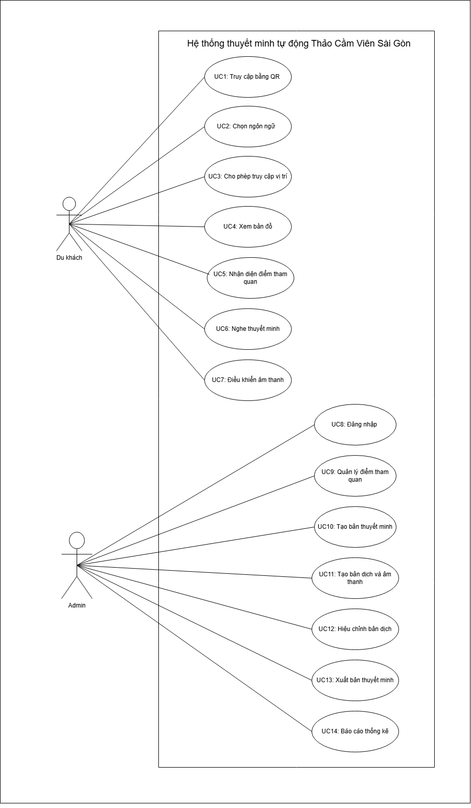
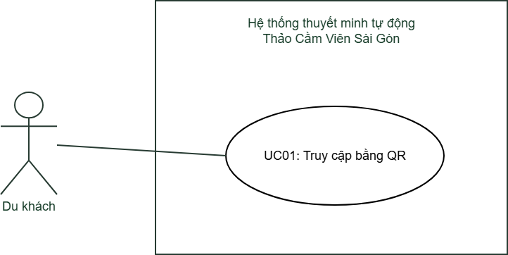
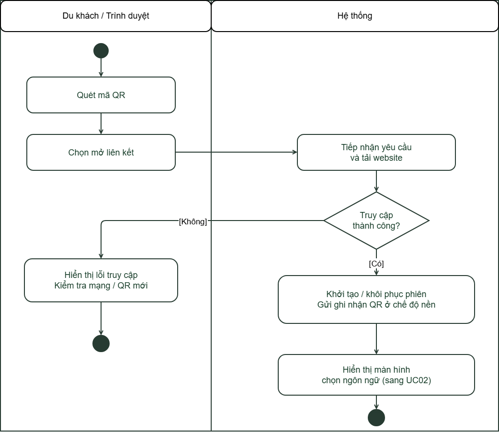
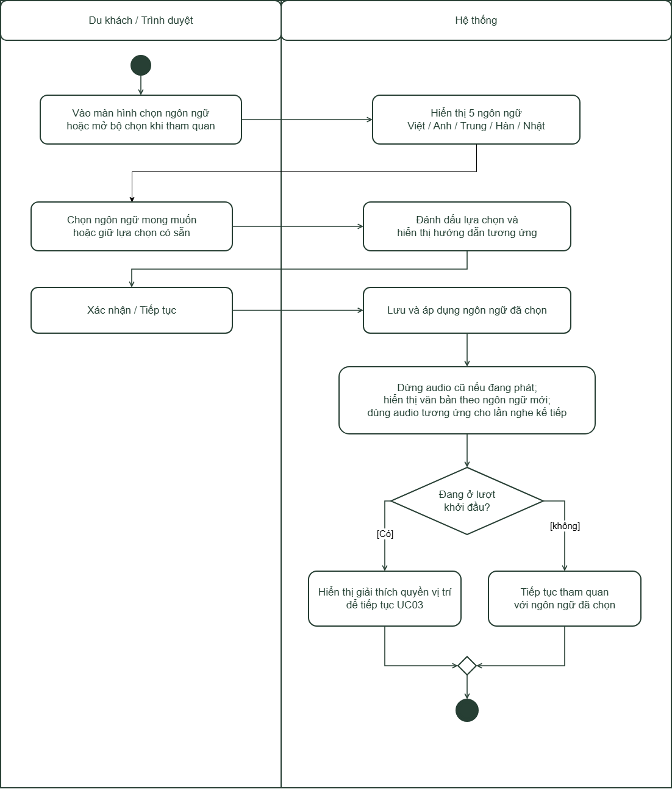

# TÀI LIỆU YÊU CẦU SẢN PHẨM (PRD)
## Hệ thống thuyết minh tự động Thảo Cầm Viên Sài Gòn

| Thuộc tính | Nội dung |
|---|---|
| Mã tài liệu | PRD-TCV-001 |
| Phiên bản | 1.0 - Bản dự thảo để nhóm và giảng viên duyệt |
| Ngày cập nhật | 25/10/2026 |
| Nhóm thực hiện |<br>Dương Quan Đạt - 3124411063</br><br>Nguyễn Hồng Khương - 3124411140</br><br>Trần Trung Hậu - 3124411</br>|
| Người duyệt | Giảng viên phụ trách - bổ sung họ tên |
| Căn cứ | PRD Markdown mẫu; mẫu Focused Use Cases; PRD tham khảo GPS – Chùa Linh Ứng; hình Use Case tổng của nhóm; ZIP feature-be (2) và các thay đổi đã trao đổi |
| Phạm vi xác minh | Chưa đối chiếu repository GitHub mới nhất; tài liệu xác định yêu cầu mục tiêu, không thay thế biên bản nghiệm thu |


## Mục lục

1. [Tổng quan sản phẩm](#1-tổng-quan-sản-phẩm)
2. [Mục tiêu sản phẩm](#2-mục-tiêu-sản-phẩm)
3. [Đối tượng người dùng](#3-đối-tượng-người-dùng)
4. [Kiến trúc chức năng](#4-kiến-trúc-chức-năng)
5. [Đặc tả chi tiết chức năng](#5-đặc-tả-chi-tiết-chức-năng)
6. [User Stories](#6-user-stories)
7. [Luồng người dùng](#7-luồng-người-dùng)
8. [Yêu cầu phi chức năng](#8-yêu-cầu-phi-chức-năng)
9. [Công nghệ sử dụng và thiết kế hệ thống](#9-công-nghệ-sử-dụng-và-thiết-kế-hệ-thống)
10. [Phương pháp phát triển](#10-phương-pháp-phát-triển)
11. [Kế hoạch kiểm thử](#11-kế-hoạch-kiểm-thử)
12. [Lộ trình và mức độ ưu tiên](#12-lộ-trình-và-mức-độ-ưu-tiên)
13. [Định nghĩa hoàn thành](#13-định-nghĩa-hoàn-thành)
14. [Phụ lục](#phụ-lục)

## 1. Tổng quan sản phẩm

### 1.1. Tên sản phẩm

**Hệ thống thuyết minh tự động Thảo Cầm Viên Sài Gòn**, gọi tắt là **TCV Audio Guide**.

### 1.2. Mô tả ngắn gọn

Ứng dụng web giúp du khách tiếp cận thông tin về các khu động vật, thực vật và tiện ích trong Thảo Cầm Viên bằng văn bản và âm thanh. Du khách quét mã QR, chọn một trong năm ngôn ngữ, được hỏi quyền truy cập vị trí, sau đó theo dõi vị trí trên bản đồ. Khi đi vào vùng thuyết minh của một điểm tham quan, hệ thống xác định điểm phù hợp và phát nội dung đã xuất bản theo ngôn ngữ đã chọn.

Admin quản lý điểm tham quan, tọa độ và bán kính; nhập nội dung gốc tiếng Việt; yêu cầu Azure dịch và tạo audio; kiểm tra, hiệu chỉnh và xuất bản. Nội dung bản nháp không xuất hiện trên giao diện du khách. Chức năng báo cáo nhằm phản ánh lượt truy cập từ QR và khung giờ có nhiều lượt truy cập nhất.

### 1.3. Vấn đề cần giải quyết — Problem Alignment

- Du khách tự tham quan khó tiếp cận đầy đủ thông tin tại từng khu, đặc biệt khi không có hướng dẫn viên.
- Nội dung chỉ bằng tiếng Việt hạn chế trải nghiệm của khách quốc tế.
- Việc tìm và chọn bài thuyết minh thủ công ở mỗi điểm làm gián đoạn hành trình.
- Nội dung, bản dịch và audio dễ lệch phiên bản khi quản lý rời rạc.
- Nhân viên chưa có số liệu đáng tin cậy về lượt mở website từ QR và thời gian truy cập cao điểm.

### 1.4. Giải pháp đề xuất — High Level Approach

Xây dựng một website ưu tiên thiết bị di động, sử dụng định vị trình duyệt, bản đồ số và vùng kích hoạt dạng hình tròn. Thông tin được quản lý tập trung qua backend và SQL Server. Azure xử lý dịch văn bản và tổng hợp giọng nói trước khi xuất bản; khi khách nghe, hệ thống phục vụ file đã tạo thay vì gọi Azure để sinh mới ở từng lượt nghe.

### 1.5. Tình huống sử dụng — Narrative

Một du khách tới cổng Thảo Cầm Viên và quét QR. Website hiển thị lựa chọn ngôn ngữ trước. Sau khi chọn tiếng Anh, khách được giải thích mục đích sử dụng vị trí và đồng ý cấp quyền. Bản đồ hiển thị các khu đang phục vụ cùng vị trí của khách. Khi khách đi vào vùng của khu voi, hệ thống xác nhận vị trí và phát thuyết minh tiếng Anh. Khách có thể tạm dừng, nghe tiếp hoặc chọn một điểm khác. Sau đó, Admin xem báo cáo để biết trong ngày có bao nhiêu lượt mở web từ QR và khung giờ nào có lượng truy cập cao nhất.

### 1.6. Phạm vi sản phẩm

| Trong phạm vi | Ngoài phạm vi phiên bản này |
|---|---|
| Website cho du khách và Admin; tối đa 5 ngôn ngữ VI/EN/ZH/KO/JA | Ứng dụng native Android/iOS |
| Quản lý điểm, GPS, bán kính, hình ảnh và mức ưu tiên | Định vị chính xác trong nhà bằng beacon/UWB |
| Nháp, dịch, tạo audio, hiệu chỉnh, xuất bản | Thanh toán, bán vé, đặt tour |
| Bản đồ, nghe tự động và nghe thủ công | Chatbot/RAG, đề xuất lộ trình tối ưu |
| QR truy cập; báo cáo lượt truy cập và giờ cao điểm | Đếm số người thực tế hoặc mọi lần camera nhận diện QR |
| Giả lập vị trí để kiểm thử và demo | Cam kết chạy nền khi khóa màn hình hoặc nghe offline toàn bộ |

Dữ liệu ban đầu dự kiến gồm **7 khu** do nhóm chuẩn bị; số khu hiển thị phụ thuộc trạng thái hoạt động và phiên bản đã xuất bản. Không hard-code giao diện chỉ có đúng 7 khu.

### 1.7. Giả định và phụ thuộc

- Du khách có trình duyệt hỗ trợ định vị và kết nối Internet; quyền vị trí do người dùng quyết định.
- Có ít nhất một tài khoản Admin hoạt động và có nội dung được người phụ trách duyệt về tính chính xác.
- Máy chủ truy cập được SQL Server, Azure và kho media; dịch vụ nền bản đồ sẵn sàng.
- Quyền phát âm thanh phụ thuộc trình duyệt; giao diện có thao tác chủ động để bắt đầu và có cách nghe thủ công khi tự phát bị chặn.
- QR public phải chứa địa chỉ HTTPS truy cập được từ thiết bị khác, không dùng localhost.

## 2. Mục tiêu sản phẩm

Các ngưỡng dưới đây là **mục tiêu nghiệm thu đề xuất**, chưa phải số đo thực tế.

| Mã | Mục tiêu | Tiêu chí thành công |
|---|---|---|
| OBJ-01 | Truy cập nhanh bằng QR | Điện thoại mở đúng website công khai; không yêu cầu tài khoản khách |
| OBJ-02 | Thống nhất luồng tiếp cận | Lượt truy cập mới chọn ngôn ngữ trước khi hệ thống yêu cầu quyền vị trí |
| OBJ-03 | Phát đúng điểm tham quan | Vị trí ngoài vùng không tự phát; vị trí hợp lệ trong vùng chọn đúng khu theo quy tắc ưu tiên |
| OBJ-04 | Đồng nhất nội dung đa ngôn ngữ | Một phiên bản xuất bản có nội dung và audio hợp lệ cho 5 ngôn ngữ; không dùng audio của văn bản cũ |
| OBJ-05 | Kiểm soát xuất bản | User không truy cập bản nháp qua danh sách, chi tiết hoặc URL audio công khai |
| OBJ-06 | Có báo cáo sử dụng | Tổng lượt và biểu đồ theo giờ khớp bộ dữ liệu kiểm thử QR; không đếm trùng khi tải lại cùng phiên |
| OBJ-07 | Demo được trên thiết bị khác | Kiểm thử quét QR, tải bản đồ, nghe audio trên ít nhất một iPhone và một Android được ghi rõ phiên bản |
| OBJ-08 | Dễ sử dụng | Ít nhất 4/5 người thử hoàn thành quét QR → chọn ngôn ngữ → mở bản đồ → nghe nội dung mà không cần hướng dẫn trực tiếp |

## 3. Đối tượng người dùng

### 3.1. Du khách nội địa

- **Mục tiêu:** Tìm hiểu thông tin khu tham quan bằng tiếng Việt, không phải đọc văn bản dài khi di chuyển.
- **Khó khăn:** Không biết khu nào có nội dung, không rõ cách cấp quyền GPS.
- **Nhu cầu:** Quét QR dễ dàng, hướng dẫn ngắn, chữ dễ đọc, bản đồ và nút nghe rõ ràng.
- **Bối cảnh:** Điện thoại, ngoài trời, mạng và GPS có thể không ổn định.

### 3.2. Du khách quốc tế

- **Mục tiêu:** Nghe và đọc đúng ngôn ngữ đã chọn trong suốt hành trình.
- **Khó khăn:** Không hiểu tiếng Việt; tên khu hoặc bản dịch có thể khó hiểu.
- **Nhu cầu:** Chọn ngôn ngữ ngay khi vào, thay đổi ngôn ngữ dễ dàng, nội dung đã được kiểm tra.

Hai persona trên cùng sử dụng tác nhân **Du khách** trong sơ đồ Use Case, không tạo hai vai trò phân quyền riêng.

### 3.3. Admin / nhân viên quản trị nội dung

- **Mục tiêu:** Cập nhật khu, tạo thuyết minh đa ngôn ngữ và kiểm soát nội dung public.
- **Khó khăn:** Dịch và thu âm thủ công tốn thời gian; không biết bản nào đã được công bố.
- **Nhu cầu:** Nhập tiếng Việt, tạo bản dịch/audio, nghe thử, sửa, xuất bản có kiểm tra; xem báo cáo QR theo thời gian.

### 3.4. Hệ thống và dịch vụ hỗ trợ

Azure Translator, Azure Speech, dịch vụ bản đồ và API định vị trình duyệt là các thành phần hỗ trợ. SQL Server và kho file thuộc hạ tầng hệ thống, không phải tác nhân người dùng. Khi bổ sung tác nhân hệ thống vào Use Case Diagram, chỉ nối tới UC thực sự tương tác với dịch vụ đó.

## 4. Kiến trúc chức năng

### 4.1. Nhóm chức năng

| Phân hệ | Nội dung | Use Case |
|---|---|---|
| Tiếp cận và thiết lập | QR, ngôn ngữ, quyền vị trí | UC01–UC03 |
| Trải nghiệm tham quan | Bản đồ, nhận diện vùng, nghe và điều khiển audio | UC04–UC07 |
| Quản trị nội dung | Đăng nhập, khu tham quan, bản thuyết minh, bản dịch, audio, xuất bản | UC08–UC13 |
| Báo cáo | Lượt truy cập QR, khách ước tính và khung giờ cao điểm | UC14 |
| Hỗ trợ demo và vận hành | Giả lập vị trí, script khởi động, tunnel và QR trong website | Tính năng hỗ trợ; không tự thêm UC nghiệp vụ mới |

**CHÈN HÌNH 01 — SƠ ĐỒ PHÂN RÃ CHỨC NĂNG (BFD): THỂ HIỆN CÁC PHÂN HỆ TIẾP CẬN, THAM QUAN, QUẢN TRỊ VÀ BÁO CÁO; TÁCH CHỨC NĂNG DEMO KHỎI NGHIỆP VỤ CHÍNH.**

### 4.2. Use Case tổng quan




### 4.3. Danh mục Use Case

| Mã | Tên theo hình tổng | Tác nhân chính | Ưu tiên |
|---|---|---|---|
| UC01 | Truy cập bằng QR | Du khách | P0 |
| UC02 | Chọn ngôn ngữ | Du khách | P0 |
| UC03 | Cho phép truy cập vị trí | Du khách | P0 |
| UC04 | Xem bản đồ | Du khách | P0 |
| UC05 | Nhận diện điểm tham quan | Du khách; hệ thống thực hiện tự động | P0 |
| UC06 | Nghe thuyết minh | Du khách | P0 |
| UC07 | Điều khiển âm thanh | Du khách | P0 |
| UC08 | Đăng nhập | Admin | P0 |
| UC09 | Quản lý điểm tham quan | Admin | P0 |
| UC10 | Tạo bản thuyết minh | Admin | P0 |
| UC11 | Tạo bản dịch và âm thanh | Admin; Azure hỗ trợ | P0 |
| UC12 | Hiệu chỉnh bản dịch | Admin | P0 |
| UC13 | Xuất bản thuyết minh | Admin | P0 |
| UC14 | Báo cáo thống kê | Admin | P1 — bắt buộc trước nghiệm thu phiên bản có báo cáo |

P0: luồng cốt lõi cần hoàn thiện trước; P1: hoàn thiện sau khi P0 ổn định; P2: cải tiến tùy chọn.

## 5. Đặc tả chi tiết chức năng

### 5.1. Quy tắc nghiệp vụ chung

| Mã | Quy tắc |
|---|---|
| BR-01 | Du khách không cần đăng nhập. Admin phải được backend xác thực và kiểm tra vai trò với mọi thao tác quản trị. |
| BR-02 | Lượt truy cập mới phải chọn ngôn ngữ trước bước đề nghị cấp quyền vị trí. Ngôn ngữ đã lưu có thể được chọn sẵn nhưng phải có bước xác nhận/tiếp tục trước khi bắt đầu định vị. |
| BR-03 | Hỗ trợ vi, en, zh, ko, ja. Không âm thầm phát audio ngôn ngữ khác khi bản được chọn thiếu hoặc lỗi. |
| BR-04 | Chỉ khu đang hoạt động có PublishedRevisionId hợp lệ, thuộc chính khu đó và trỏ tới bản Published được xuất hiện trong danh sách công khai. |
| BR-05 | Vĩ độ trong [-90,90], kinh độ trong [-180,180], bán kính >0 và ≤500 m. Giao diện/API/database cần thống nhất giới hạn; không mặc định mọi khu cùng bán kính. |
| BR-06 | Mã khu được sinh duy nhất khi tạo; người quản trị không phải tự nhập mã. Ảnh được chọn từ thiết bị, file lưu tại kho media và database lưu đường dẫn/thông tin liên quan. |
| BR-07 | Vị trí dùng tự phát phải còn mới (mục tiêu ≤15 giây), sai số ≤25 m và các giá trị hữu hạn/hợp lệ. Từ chối quyền GPS không ngăn nghe thủ công. |
| BR-08 | Trong vùng khi khoảng cách Haversine tới tâm ≤ bán kính. Vùng chồng nhau: Priority cao hơn được chọn; cùng Priority chọn khoảng cách nhỏ hơn; nếu vẫn bằng nhau dùng mã/ID ổn định để tránh dao động (quy tắc cuối cần bổ sung nếu code chưa có). |
| BR-09 | GPS thật kiểm tra tuần tự khoảng 5 giây/lần, cần 2 kết quả liên tiếp cùng khu. Thời gian thực tế còn gồm độ trễ API. Giả lập có thể dùng 0,5 giây/lần và 1 xác nhận, phải hiển thị rõ chế độ. |
| BR-10 | Một bộ phát audio dùng chung; không phát chồng hai bài. Không tự ngắt bài đang phát để chen bài của khu khác; sau khi bài kết thúc đánh giá lại vị trí mới nhất. |
| BR-11 | Không tự phát lại cùng tổ hợp khu + ngôn ngữ + phiên bản/audio trong một phiên tham quan phía trình duyệt. Nghe lại thủ công được phép. Tải lại trang có thể bắt đầu phiên nghe mới nếu chưa triển khai lưu lịch sử nghe. |
| BR-12 | Mỗi khu có nhiều revision với cặp (PlaceId, Version) duy nhất; một thời điểm chỉ có tối đa một revision được chọn công khai. |
| BR-13 | Chỉ chỉnh sửa bản Draft. Muốn thay nội dung đã công bố phải tạo bản nháp mới. |
| BR-14 | Sửa văn bản làm audio tương ứng hết hiệu lực; sửa tiếng Việt làm các kết quả dịch/audio phụ thuộc cần được tạo hoặc duyệt lại. Không coi audio cũ là Ready cho script mới. |
| BR-15 | Không ghi đè bản dịch được Admin đánh dấu hiệu chỉnh thủ công trong lần sinh lại mặc định; thao tác ghi đè phải được Admin chủ động xác nhận. |
| BR-16 | Chỉ xuất bản khi 5 ngôn ngữ có tiêu đề, nội dung và audio hợp lệ, hash audio khớp script, file tồn tại và không rỗng. |
| BR-17 | Xuất bản cập nhật trạng thái revision và con trỏ PublishedRevisionId nhất quán; bản public cũ chuyển Archived. Lỗi không được để trạng thái cập nhật dở dang. |
| BR-18 | User lấy nội dung và audio từ cùng phiên bản; public API không trả audio nháp. Cập nhật public được frontend nhận trong lần làm mới dữ liệu kế tiếp. |
| BR-19 | Chỉ ghi “lượt truy cập từ QR” khi website mở bằng nguồn QR hợp lệ và sự kiện được backend lưu thành công. Không tính lần camera nhìn thấy mã nhưng khách chưa mở web. |
| BR-20 | Cặp (QrCodeId, SessionId) là khóa chống trùng lượt trong phiên. Một phiên QR hết hạn sau 30 phút không hoạt động; refresh và gửi lại yêu cầu trong phiên không tăng lượt. Đây là yêu cầu cần triển khai. |
| BR-21 | VisitorId là mã ngẫu nhiên ẩn danh lưu trên trình duyệt; số ID phân biệt là khách ước tính, không phải số người thật. Không bắt buộc thu tên, số điện thoại hoặc lịch sử GPS cho báo cáo QR. |
| BR-22 | Thời gian sự kiện do server ghi UTC; báo cáo quy đổi Asia/Ho_Chi_Minh. Khoảng lọc theo dạng [bắt đầu, kết thúc). |
| BR-23 | Giờ cao điểm là khung một giờ có số lượt QR cao nhất trong khoảng lọc; nếu bằng nhau liệt kê các khung đồng hạng; không có dữ liệu thì không kết luận giờ cao điểm. |
| BR-24 | Chế độ demo/giả lập và lượt từ QR đánh dấu demo không được lẫn vào báo cáo vận hành mặc định. Bỏ qua đăng nhập chỉ là cấu hình trình diễn, phải tắt khi vận hành. |

### 5.2. Cách đọc đặc tả

Mỗi UC gồm mục tiêu, tác nhân, kích hoạt, giả định, tiền điều kiện, luồng chính theo hai phía, luồng thay thế A, ngoại lệ E, hậu điều kiện và tham chiếu nghiệp vụ. Bước trong A/E chỉ rõ vị trí quay lại hoặc điều kiện kết thúc. Các điểm liên quan không mặc nhiên là quan hệ UML `extend`.


### 5.3. UC01 — Truy cập bằng QR




| Thuộc tính | Đặc tả |
|---|---|
| Mã / mức chi tiết | UC01 / Focused |
|Tên|Truy cập bằng QR|
| Tác nhân | Du khách |
| Mục tiêu / tóm tắt | Mở đúng website tham quan từ mã QR. |
| Kích hoạt | Du khách chọn mở liên kết do camera/ứng dụng quét nhận diện. |
| Giả định | QR hợp lệ trỏ tới website HTTPS; thiết bị có Internet. |
| Tiền điều kiện | Không cần tài khoản; hệ thống cung cấp endpoint công khai. |


**Luồng chính**

| **Bước** | **Hành động tác nhân** | **Phản hồi hệ thống** |
| :---: | :--- | :--- |
| 1 | Quét mã QR bằng điện thoại. | — |
| 2 | Chọn mở liên kết từ mã QR. | Tiếp nhận yêu cầu truy cập và tải website.[E1] |
| 3 | — | Tạo hoặc khôi phục phiên truy cập.<br>Gửi sự kiện truy cập qua QR với khóa chống trùng. |
| 4 | — | Hiển thị màn hình chọn ngôn ngữ, chưa yêu cầu quyền GPS.<br>Kết thúc UC01 và sẵn sàng cho UC02. |


**Luồng thay thế**

none

**Luồng ngoại lệ**

- E1 - Nếu truy cập website không thành công, trình duyệt hiển thị thông báo lỗi. Du khách kiểm tra kết nối Internet hoặc sử dụng mã QR mới nếu liên kết cũ không còn hoạt động. UC01 kết thúc mà chưa hiển thị màn hình chọn ngôn ngữ.


**Hậu điều kiện:** Website được mở; sự kiện chỉ được coi là đã ghi nhận sau phản hồi lưu thành công.

**Quy tắc nghiệp vụ:** BR-02, BR-19–BR-22.

**Điểm liên quan:** UC02; sự kiện đầu vào UC14. Các nhánh A/E ở trên là điểm phân nhánh nghiệp vụ; chưa quy định thêm quan hệ UML `extend`.


### 5.4. UC02 — Chọn ngôn ngữ


| Thuộc tính | Đặc tả |
|---|---|
| Mã / mức chi tiết | UC02 / Focused |
| Tác nhân | Du khách |
| Mục tiêu / tóm tắt | Sử dụng văn bản và audio theo ngôn ngữ mong muốn. |
| Kích hoạt | Khách vào lần đầu hoặc mở bộ chọn ngôn ngữ. |
| Giả định | Có 5 lựa chọn vi/en/zh/ko/ja. |
| Tiền điều kiện | Website tải được giao diện lựa chọn. |


**Luồng chính**

| **Bước** | **Hành động tác nhân** | **Phản hồi hệ thống** |
| :---: | :--- | :--- |
| 1 | Vào màn hình chọn ngôn ngữ hoặc mở bộ chọn khi đang tham quan. | Hiển thị 5 ngôn ngữ: Việt, Anh, Trung, Hàn, Nhật. |
| 2 | Chọn ngôn ngữ mong muốn hoặc giữ lựa chọn có sẵn. | Đánh dấu lựa chọn và hiển thị hướng dẫn tương ứng. |
| 3 | Nhấn “Xác nhận / Tiếp tục”. | Lưu và áp dụng ngôn ngữ đã chọn. |
| 4 | — | Dừng audio cũ nếu đang phát.<br>Hiển thị văn bản theo ngôn ngữ đã chọn và sử dụng audio tương ứng cho lần nghe kế tiếp. |
| 5 | — | Hiển thị giải thích quyền vị trí để tiếp tục UC03. **[A1]** |
| 6 | — | Kết thúc UC02. |

**Luồng thay thế**

**A1 – Đổi ngôn ngữ khi đang tham quan (bước 5)**  
Nếu du khách không ở lượt khởi đầu, hệ thống cho phép tiếp tục tham quan với ngôn ngữ đã chọn, không chuyển sang phần giải thích quyền vị trí. Tiếp tục bước 6.

**Quy tắc liên quan**

Việc đổi ngôn ngữ không tải lại toàn bộ trang và không làm mất trạng thái GPS, điểm đang chọn, danh sách điểm đã đi qua hoặc lịch sử nghe thuyết minh.

**Hậu điều kiện:** Ngôn ngữ hiện hành được xác định; nội dung và audio dùng cùng lựa chọn.

**Quy tắc nghiệp vụ:** BR-02, BR-03, BR-10, BR-18.

**Điểm liên quan:** UC03, UC06. Các nhánh A/E ở trên là điểm phân nhánh nghiệp vụ; chưa quy định thêm quan hệ UML `extend`.



### 5.5. UC03 — Cho phép truy cập vị trí

| Thuộc tính | Đặc tả |
|---|---|
| Mã / mức chi tiết | UC03 / Focused |
| Tác nhân | Du khách; trình duyệt hỗ trợ |
| Mục tiêu / tóm tắt | Quyết định cho phép định vị để sử dụng thuyết minh tự động. |
| Kích hoạt | Khách hoàn tất chọn ngôn ngữ và chọn bắt đầu định vị. |
| Giả định | Thiết bị hỗ trợ Geolocation; website truy cập qua secure context phù hợp. |
| Tiền điều kiện | Đã chọn/xác nhận ngôn ngữ theo UC02. |


**Luồng chính**

| Bước | Hành động tác nhân | Phản hồi hệ thống |
|---|---|---|
| 1 | Đọc giải thích và bấm bật vị trí. | Gọi API định vị; trình duyệt hỏi quyền nếu chưa có quyết định trước. |
| 2 | Chọn Cho phép. | Bắt đầu theo dõi vị trí, hiển thị trạng thái đang xác định. |
| 3 | Chờ kết quả. | Nhận tọa độ, sai số, thời điểm; hiển thị vị trí trên bản đồ và chuyển UC04. |


**Luồng thay thế**

- A1 — Bước 2 khách từ chối: hiển thị hướng dẫn bật lại trong cài đặt; vẫn vào UC04 và nghe thủ công UC06.
- A2 — Quyền đã được cấp trước: không ép hiện lại hộp hỏi của trình duyệt; sau thao tác bắt đầu của khách tiếp tục bước 3.
- A3 — Khách tắt GPS trong quá trình dùng: dừng watch, dừng đánh giá tự động và xóa vị trí đang theo dõi; bản đồ vẫn sử dụng được.


**Luồng ngoại lệ**

- E1 — Bước 1 trình duyệt không hỗ trợ hoặc môi trường không hợp lệ: thông báo và chuyển chế độ thủ công.
- E2 — Bước 3 hết thời gian hoặc sai số quá lớn: hiển thị trạng thái, không tự phát; cho phép thử lại bước 1 hoặc nghe thủ công.


**Hậu điều kiện:** Có vị trí hợp lệ để dùng tự động hoặc đã chuyển rõ sang trải nghiệm không GPS.

**Quy tắc nghiệp vụ:** BR-02, BR-07, BR-09.

**Điểm liên quan:** UC04, UC05. Các nhánh A/E ở trên là điểm phân nhánh nghiệp vụ; chưa quy định thêm quan hệ UML `extend`.


### 5.6. UC04 — Xem bản đồ

| Thuộc tính | Đặc tả |
|---|---|
| Mã / mức chi tiết | UC04 / Focused |
| Tác nhân | Du khách |
| Mục tiêu / tóm tắt | Xem vị trí các khu và thông tin tham quan đã công bố. |
| Kích hoạt | Khách mở mục Bản đồ. |
| Giả định | Có dịch vụ nền bản đồ; dữ liệu khu được lấy từ public API. |
| Tiền điều kiện | Đã chọn ngôn ngữ; GPS không phải tiền điều kiện bắt buộc. |


**Luồng chính**

| Bước | Hành động tác nhân | Phản hồi hệ thống |
|---|---|---|
| 1 | Mở Bản đồ. | Tải các khu đang hoạt động có bản xuất bản hợp lệ. |
| 2 | Quan sát bản đồ. | Vẽ marker, vùng bán kính; chỉ vẽ vị trí khách nếu có vị trí thực hoặc giả lập được ghi nhãn rõ. |
| 3 | Chạm một khu. | Hiển thị tên, mô tả, ảnh và nút nghe theo ngôn ngữ hiện hành. |
| 4 | Tiếp tục xem hoặc quay lại trang. | Làm mới dữ liệu khi đến chu kỳ hoặc trở lại tab; phản ánh nội dung public mới. |


**Luồng thay thế**

- A1 — Bước 2 không có GPS: hiển thị bản đồ các khu, không giả mạo vị trí thật.
- A2 — Bước 1 danh sách trả [] thành công: hiện “Chưa có khu đã xuất bản”, không dựng khu mẫu thay thế.


**Luồng ngoại lệ**

- E1 — Bước 1 API lỗi: hiển thị lỗi kết nối và thử lại; không diễn giải thành database không có khu.
- E2 — Bước 2 nền bản đồ lỗi: thông báo nền bản đồ chưa tải, giữ nội dung khu đã lấy được để nghe thủ công nếu có.


**Hậu điều kiện:** Khách xem được dữ liệu public hoặc thông báo đúng nguyên nhân không tải được.

**Quy tắc nghiệp vụ:** BR-04, BR-05, BR-18.

**Điểm liên quan:** UC05, UC06. Các nhánh A/E ở trên là điểm phân nhánh nghiệp vụ; chưa quy định thêm quan hệ UML `extend`.


### 5.7. UC05 — Nhận diện điểm tham quan

| Thuộc tính | Đặc tả |
|---|---|
| Mã / mức chi tiết | UC05 / Focused |
| Tác nhân | Du khách hưởng lợi; hệ thống tự động thực hiện |
| Mục tiêu / tóm tắt | Xác định khu phù hợp khi khách đi vào vùng kích hoạt. |
| Kích hoạt | Có vị trí mới hoặc đến chu kỳ đánh giá khi tự phát đang bật. |
| Giả định | Dữ liệu tọa độ khu đã được kiểm tra; backend và public API hoạt động. |
| Tiền điều kiện | Có vị trí đạt điều kiện, chế độ tự phát bật và có khu đã xuất bản. |


**Luồng chính**

| Bước | Hành động tác nhân | Phản hồi hệ thống |
|---|---|---|
| 1 | Di chuyển trong khuôn viên; không cần chọn khu mỗi lần. | Kiểm tra timestamp, sai số và tính hợp lệ của vị trí. |
| 2 | Tiếp tục hành trình. | Gửi tọa độ tới API; tính khoảng cách với các khu public đang hoạt động. |
| 3 | Đi vào một hoặc nhiều vùng. | Lọc theo bán kính, chọn khu ưu tiên và xác nhận ổn định theo chế độ. |
| 4 | Ở trong vùng đã nhận diện. | Nếu bài chưa nghe và bộ phát rảnh, chọn khu và chuyển yêu cầu phát sang UC06. |


**Luồng thay thế**

- A1 — Bước 2 ngoài mọi vùng: không phát; chờ chu kỳ tiếp theo quay lại bước 1.
- A2 — Bước 3 vùng chồng nhau: áp dụng BR-08; tiếp tục bước 4 với một khu duy nhất.
- A3 — Bước 4 đang phát bài khác hoặc đã nghe trong phiên: không phát chồng/lặp; tiếp tục đánh giá vị trí mới.


**Luồng ngoại lệ**

- E1 — Bước 1 vị trí cũ hoặc sai số >25 m: bỏ kết quả, xóa chuỗi xác nhận ổn định, chờ vị trí hợp lệ.
- E2 — Bước 2 API lỗi: tạm dừng tự phát, không dùng kết quả cũ để kích hoạt; thử lại chu kỳ sau.
- E3 — Bước 3 nguồn vị trí/ngôn ngữ thay đổi hoặc khách tắt tự phát khi request đang chờ: bỏ kết quả cũ, đánh giá lại theo trạng thái mới.


**Hậu điều kiện:** Có tối đa một khu được chọn để phát hoặc tiếp tục chờ vị trí; chưa đánh dấu đã nghe trước khi audio phát thành công.

**Quy tắc nghiệp vụ:** BR-04, BR-07–BR-11.

**Điểm liên quan:** UC06; chế độ giả lập tại 7.4. Các nhánh A/E ở trên là điểm phân nhánh nghiệp vụ; chưa quy định thêm quan hệ UML `extend`.


### 5.8. UC06 — Nghe thuyết minh

| Thuộc tính | Đặc tả |
|---|---|
| Mã / mức chi tiết | UC06 / Focused |
| Tác nhân | Du khách |
| Mục tiêu / tóm tắt | Nghe đúng nội dung, ngôn ngữ và phiên bản của khu. |
| Kích hoạt | UC05 nhận diện khu hoặc khách bấm Nghe thuyết minh. |
| Giả định | Khu có audio public hợp lệ; kết nối tải được file. |
| Tiền điều kiện | Đã có ngôn ngữ và khu được chọn; nghe thủ công không bắt buộc GPS. |


**Luồng chính**

| Bước | Hành động tác nhân | Phản hồi hệ thống |
|---|---|---|
| 1 | Bấm nghe hoặc đi vào vùng với tự phát bật. | Xác định URL audio của revision đang public và ngôn ngữ hiện hành. |
| 2 | Chờ tải bài. | Dừng/thay bài theo lựa chọn thủ công, dùng bộ phát duy nhất và tải file tương ứng. |
| 3 | Nghe nội dung. | Phát audio, cập nhật trạng thái và tiến độ; chỉ đánh dấu đã nghe sau khi phát thành công. |
| 4 | Nghe hết hoặc điều khiển. | Kết thúc bài hoặc chuyển UC07; không tự lặp bài đã nghe trong phiên. |


**Luồng thay thế**

- A1 — Bước 1 khách chọn nghe lại: cho phép phát thủ công dù bài đã được đánh dấu đã nghe.
- A2 — Bước 1 có bài khác đang phát và yêu cầu là tự động: giữ bài hiện tại, chờ đánh giá lại sau; không chen ngang.


**Luồng ngoại lệ**

- E1 — Bước 2 trình duyệt chặn autoplay: hiện nút Chạm để nghe; khi khách bấm thử lại bước 2, chưa đánh dấu đã nghe.
- E2 — Bước 2 file mất, URL hết hợp lệ hoặc mạng lỗi: hiện lỗi/thử lại; không gọi Azure sinh mới trên thiết bị khách.
- E3 — Bản public bị ẩn/thay đổi trong khi phát: khi nhận dữ liệu cập nhật, dừng track không còn phù hợp; tải lại thông tin trước lần nghe mới.


**Hậu điều kiện:** Bài được phát đúng hoặc lỗi được thể hiện rõ, không phát thay bằng ngôn ngữ khác.

**Quy tắc nghiệp vụ:** BR-03, BR-10, BR-11, BR-18.

**Điểm liên quan:** UC07, UC13. Các nhánh A/E ở trên là điểm phân nhánh nghiệp vụ; chưa quy định thêm quan hệ UML `extend`.


### 5.9. UC07 — Điều khiển âm thanh

| Thuộc tính | Đặc tả |
|---|---|
| Mã / mức chi tiết | UC07 / Focused |
| Tác nhân | Du khách |
| Mục tiêu / tóm tắt | Chủ động tạm dừng, tiếp tục, tua và dừng bài đang nghe. |
| Kích hoạt | Khách thao tác trên thanh phát. |
| Giả định | Chỉ có một bộ phát toàn ứng dụng. |
| Tiền điều kiện | Có bài đã được chọn hoặc đang tải/phát. |


**Luồng chính**

| Bước | Hành động tác nhân | Phản hồi hệ thống |
|---|---|---|
| 1 | Bấm Tạm dừng. | Dừng phát và giữ thời điểm hiện tại. |
| 2 | Bấm Tiếp tục. | Phát tiếp từ thời điểm đã giữ. |
| 3 | Kéo thanh tiến độ tới vị trí hợp lệ. | Giới hạn thời điểm trong [0, duration] và tua khi media sẵn sàng. |
| 4 | Bấm Dừng. | Dừng bài, đưa trạng thái bộ phát về nghỉ và dọn tài nguyên cần thiết. |


**Luồng thay thế**

- A1 — Khách chọn nghe lại từ đầu: đặt tiến độ 0 rồi phát; không tạo thêm một player.
- A2 — Khách đổi ngôn ngữ: dừng bài cũ và dùng ngôn ngữ mới cho lần nghe tiếp theo.


**Luồng ngoại lệ**

- E1 — Bước 3 duration chưa xác định hoặc file không hỗ trợ tua: vô hiệu hóa thanh tua, giữ nút phát/dừng phù hợp.
- E2 — Bước 2 phát tiếp bị chặn hoặc mất kết nối: hiện lỗi và cho phép khách thử lại.


**Hậu điều kiện:** Trạng thái giao diện khớp bộ phát; không có audio chạy chồng.

**Quy tắc nghiệp vụ:** BR-03, BR-10, BR-11.

**Điểm liên quan:** UC06. Các nhánh A/E ở trên là điểm phân nhánh nghiệp vụ; chưa quy định thêm quan hệ UML `extend`.


### 5.10. UC08 — Đăng nhập

| Thuộc tính | Đặc tả |
|---|---|
| Mã / mức chi tiết | UC08 / Focused |
| Tác nhân | Admin |
| Mục tiêu / tóm tắt | Truy cập các chức năng quản trị theo quyền. |
| Kích hoạt | Admin mở trang quản trị khi chưa có phiên hợp lệ. |
| Giả định | Tài khoản đã được tạo, hoạt động; mật khẩu lưu bằng PasswordHasher. |
| Tiền điều kiện | Backend và SQL Server sẵn sàng. |


**Luồng chính**

| Bước | Hành động tác nhân | Phản hồi hệ thống |
|---|---|---|
| 1 | Nhập username và mật khẩu. | Nhận yêu cầu có mã CSRF hợp lệ; kiểm tra dữ liệu đầu vào. |
| 2 | Bấm Đăng nhập. | Tìm tài khoản, xác minh hash mật khẩu và trạng thái hoạt động. |
| 3 | Chờ xác thực. | Tạo phiên cookie với danh tính và vai trò Admin; chuyển giao diện quản trị. |


**Luồng thay thế**

- A1 — Đã có phiên hợp lệ: bỏ qua nhập lại và vào trang quản trị.
- A2 — Admin chọn Đăng xuất sau khi dùng: hủy phiên; lần mở Admin kế tiếp cần đăng nhập.


**Luồng ngoại lệ**

- E1 — Bước 2 username/mật khẩu sai hoặc tài khoản vô hiệu: thông báo chung không tiết lộ tài khoản tồn tại; quay lại bước 1.
- E2 — Thiếu/sai CSRF, phiên hết hạn hoặc truy cập không đủ quyền: từ chối yêu cầu; yêu cầu xác thực lại phù hợp.
- E3 — Database lỗi: thông báo dịch vụ chưa sẵn sàng; không cấp phiên quản trị giả.


**Hậu điều kiện:** Thành công có phiên Admin hợp lệ; thất bại không cấp quyền.

**Quy tắc nghiệp vụ:** BR-01, BR-24.

**Điểm liên quan:** UC09–UC14; chế độ bỏ đăng nhập demo không phải luồng vận hành chuẩn. Các nhánh A/E ở trên là điểm phân nhánh nghiệp vụ; chưa quy định thêm quan hệ UML `extend`.


### 5.11. UC09 — Quản lý điểm tham quan

| Thuộc tính | Đặc tả |
|---|---|
| Mã / mức chi tiết | UC09 / Focused |
| Tác nhân | Admin |
| Mục tiêu / tóm tắt | Tạo, cập nhật hoặc ẩn điểm cùng tọa độ và vùng thuyết minh. |
| Kích hoạt | Admin mở danh sách điểm tham quan. |
| Giả định | Ảnh định dạng được hỗ trợ; dữ liệu GPS do nhóm xác minh. |
| Tiền điều kiện | Phiên Admin hợp lệ. |


**Luồng chính**

| Bước | Hành động tác nhân | Phản hồi hệ thống |
|---|---|---|
| 1 | Mở danh sách và chọn Thêm mới hoặc Sửa. | Hiển thị form tên/mô tả tiếng Việt, loại, tọa độ, bán kính, ưu tiên và ảnh. |
| 2 | Nhập dữ liệu và chọn file ảnh. | Kiểm tra định dạng, giới hạn và hiển thị lỗi theo trường nếu có. |
| 3 | Bấm Lưu. | Sinh mã duy nhất khi thêm; lưu thông tin khu, file ảnh và đường dẫn; xử lý nội dung theo revision nháp. |
| 4 | Xem kết quả. | Hiển thị khu và trạng thái; khu chưa có bản xuất bản không tự xuất hiện public. |


**Luồng thay thế**

- A1 — Chọn Ẩn tại bước 1 và xác nhận: đặt khu không hoạt động, loại khỏi public/nhận diện vùng ở lần làm mới kế tiếp; giữ dữ liệu lịch sử.
- A2 — Hủy form trước bước 3: không ghi thay đổi.
- A3 — Sửa tọa độ/bán kính/ảnh là thuộc tính khu: hiệu lực sau lưu và public refresh; sửa nội dung thuyết minh phải qua bản nháp/xuất bản.


**Luồng ngoại lệ**

- E1 — Bước 2 tọa độ/bán kính/ảnh không hợp lệ: từ chối lưu, giữ dữ liệu form để sửa.
- E2 — Bước 3 lỗi kho file hoặc SQL: không báo thành công khi mới lưu một phần; có cơ chế dọn file thừa nếu cần.
- E3 — Xung đột thao tác quản trị: thông báo đang được xử lý, tải lại trước khi ghi tiếp.


**Hậu điều kiện:** Khu được lưu hoặc ẩn nhất quán; không xóa mất phiên bản thuyết minh khi chỉ ẩn khu.

**Quy tắc nghiệp vụ:** BR-04–BR-06, BR-12, BR-13.

**Điểm liên quan:** UC10, UC13. Các nhánh A/E ở trên là điểm phân nhánh nghiệp vụ; chưa quy định thêm quan hệ UML `extend`.


### 5.12. UC10 — Tạo bản thuyết minh

| Thuộc tính | Đặc tả |
|---|---|
| Mã / mức chi tiết | UC10 / Focused |
| Tác nhân | Admin |
| Mục tiêu / tóm tắt | Soạn nội dung gốc tiếng Việt dưới dạng bản nháp có phiên bản. |
| Kích hoạt | Admin chọn một khu và tạo/sửa bản nháp. |
| Giả định | Khu đã tồn tại; có thông tin tham quan đáng tin cậy. |
| Tiền điều kiện | Phiên Admin hợp lệ; revision được sửa có trạng thái Draft. |


**Luồng chính**

| Bước | Hành động tác nhân | Phản hồi hệ thống |
|---|---|---|
| 1 | Chọn khu và tạo bản thuyết minh. | Tạo bản nháp với số phiên bản mới và ghi tác giả/thời điểm. |
| 2 | Nhập tiêu đề, mô tả và nội dung tiếng Việt. | Hiển thị form và kiểm tra trường bắt buộc, độ dài theo cấu hình API. |
| 3 | Bấm Lưu nháp. | Lưu script; nếu script thay đổi, vô hiệu hóa các kết quả dịch/audio phụ thuộc không còn phù hợp. |
| 4 | Kiểm tra nội dung nháp. | Hiển thị trạng thái cần dịch/tạo audio; bản public hiện có vẫn được phục vụ. |


**Luồng thay thế**

- A1 — Chọn bản đã Published: chỉ xem; muốn sửa tạo bản nháp mới rồi quay lại bước 2.
- A2 — Hủy thay đổi chưa lưu: giữ nội dung đã lưu trước đó.


**Luồng ngoại lệ**

- E1 — Bước 2 nội dung rỗng/quá giới hạn: báo lỗi, quay lại bước 2.
- E2 — Bước 3 lỗi lưu hoặc xung đột phiên bản: giữ form để xử lý, không thay đổi con trỏ public.


**Hậu điều kiện:** Bản nháp được lưu, chưa công khai; audio cũ không được coi là hợp lệ cho văn bản đã thay đổi.

**Quy tắc nghiệp vụ:** BR-12–BR-14.

**Điểm liên quan:** UC11, UC13. Các nhánh A/E ở trên là điểm phân nhánh nghiệp vụ; chưa quy định thêm quan hệ UML `extend`.


### 5.13. UC11 — Tạo bản dịch và âm thanh

| Thuộc tính | Đặc tả |
|---|---|
| Mã / mức chi tiết | UC11 / Focused |
| Tác nhân | Admin; Azure Translator và Azure Speech hỗ trợ |
| Mục tiêu / tóm tắt | Sinh nội dung và audio cho đủ 5 ngôn ngữ từ bản nháp. |
| Kích hoạt | Admin chọn Tạo bản dịch và âm thanh. |
| Giả định | Azure được cấu hình ở backend; kho media ghi được; hạn mức dịch vụ còn đáp ứng. |
| Tiền điều kiện | Có bản Draft và script tiếng Việt hợp lệ; phiên Admin hợp lệ. |


**Luồng chính**

| Bước | Hành động tác nhân | Phản hồi hệ thống |
|---|---|---|
| 1 | Chọn bản nháp và bấm tạo. | Kiểm tra revision, quyền, dữ liệu và ngăn tác vụ ghi trùng. |
| 2 | Theo dõi trạng thái xử lý. | Dịch các trường nội dung cần thiết sang en/zh/ko/ja; giữ bản hiệu chỉnh thủ công theo quy tắc. |
| 3 | Chờ tạo âm thanh. | Gửi script từng ngôn ngữ tới Azure Speech với voice phù hợp; nhận file audio. |
| 4 | Xem kết quả từng ngôn ngữ. | Lưu file và metadata/hash/trạng thái; đánh dấu Ready chỉ khi kết quả hợp lệ. |
| 5 | Nghe thử hoặc xem lỗi. | Cho phép preview nội dung nháp qua API có xác thực; hiển thị lỗi từng phần nếu có. |


**Luồng thay thế**

- A1 — Bước 2 có bản dịch thủ công: giữ nguyên bản đó và tạo audio từ nội dung đã hiệu chỉnh.
- A2 — Chạy lại sau lỗi: xử lý phần lỗi hoặc đã hết hiệu lực; tái dùng kết quả còn hợp lệ, tránh nhân bản tác vụ không cần thiết.


**Luồng ngoại lệ**

- E1 — Bước 2/3 Azure 400/401/403/429 hoặc timeout: ghi trạng thái lỗi và thông báo dễ hiểu; không để lộ khóa/bản ghi nhạy cảm ra GUI.
- E2 — Bước 4 file rỗng hoặc không lưu được: không đánh dấu Ready, không cho xuất bản.
- E3 — Nội dung đổi trong khi đang sinh: khóa ghi hoặc kiểm tra version/hash trước khi chấp nhận kết quả; không gắn audio cũ vào script mới.


**Hậu điều kiện:** Có các kết quả hợp lệ theo ngôn ngữ hoặc lỗi cụ thể để chạy lại; chưa tự xuất bản.

**Quy tắc nghiệp vụ:** BR-03, BR-14–BR-16.

**Điểm liên quan:** UC12, UC13. Các nhánh A/E ở trên là điểm phân nhánh nghiệp vụ; chưa quy định thêm quan hệ UML `extend`.


### 5.14. UC12 — Hiệu chỉnh bản dịch

| Thuộc tính | Đặc tả |
|---|---|
| Mã / mức chi tiết | UC12 / Focused |
| Tác nhân | Admin |
| Mục tiêu / tóm tắt | Sửa bản dịch trước khi công bố để bảo đảm ý nghĩa phù hợp. |
| Kích hoạt | Admin mở bản dịch của revision nháp. |
| Giả định | Admin/người duyệt có khả năng đánh giá nội dung; bản dịch tự động không được xem là luôn đúng. |
| Tiền điều kiện | Phiên Admin hợp lệ và bản Draft có nội dung dịch. |


**Luồng chính**

| Bước | Hành động tác nhân | Phản hồi hệ thống |
|---|---|---|
| 1 | Chọn ngôn ngữ cần hiệu chỉnh. | Hiển thị văn bản hiện tại cùng trạng thái audio. |
| 2 | Sửa tiêu đề, mô tả hoặc script rồi lưu. | Kiểm tra dữ liệu, lưu chỉnh sửa và đánh dấu bản dịch thủ công. |
| 3 | Yêu cầu tạo lại audio cho script đã sửa. | Vô hiệu hóa audio cũ và tạo audio tương ứng nội dung mới. |
| 4 | Nghe thử và xác nhận nội dung. | Hiển thị kết quả mới để chuẩn bị xuất bản. |


**Luồng thay thế**

- A1 — Bước 2 hủy chỉnh sửa: giữ bản dịch đã lưu.
- A2 — Muốn dùng lại bản dịch tự động: Admin chủ động xác nhận thay thế nội dung thủ công; thực hiện UC11 trước khi xuất bản.


**Luồng ngoại lệ**

- E1 — Bước 2 bản đã xuất bản hoặc nội dung không hợp lệ: chặn lưu; yêu cầu tạo Draft mới hoặc sửa trường lỗi.
- E2 — Bước 3 tạo audio lỗi: giữ văn bản mới nhưng trạng thái chưa sẵn sàng; chặn xuất bản cho tới khi khắc phục.


**Hậu điều kiện:** Văn bản hiệu chỉnh được lưu; chỉ audio khớp script mới được chấp nhận.

**Quy tắc nghiệp vụ:** BR-13–BR-16.

**Điểm liên quan:** UC11, UC13. Các nhánh A/E ở trên là điểm phân nhánh nghiệp vụ; chưa quy định thêm quan hệ UML `extend`.


### 5.15. UC13 — Xuất bản thuyết minh

| Thuộc tính | Đặc tả |
|---|---|
| Mã / mức chi tiết | UC13 / Focused |
| Tác nhân | Admin |
| Mục tiêu / tóm tắt | Đưa một revision hoàn chỉnh thành nội dung công khai của khu. |
| Kích hoạt | Admin chọn Xuất bản. |
| Giả định | Admin đã kiểm tra tính đúng đắn và nghe thử các bản cần công bố. |
| Tiền điều kiện | Phiên Admin hợp lệ; revision thuộc khu và có trạng thái Draft. |


**Luồng chính**

| Bước | Hành động tác nhân | Phản hồi hệ thống |
|---|---|---|
| 1 | Chọn bản nháp và bấm Xuất bản. | Kiểm tra đủ 5 ngôn ngữ, script, trạng thái/hash và file audio thực tế. |
| 2 | Xác nhận công bố. | Trong thao tác nhất quán, chuyển bản public cũ sang Archived, bản mới sang Published và cập nhật PublishedRevisionId. |
| 3 | Xem kết quả. | Hiển thị phiên bản/thời điểm xuất bản. |
| 4 | Mở giao diện User kiểm tra. | Public API trả revision mới của khu đang hoạt động; frontend nhận qua lần tải/làm mới kế tiếp. |


**Luồng thay thế**

- A1 — Bước 1 còn thiếu bản dịch/audio: hiển thị rõ ngôn ngữ thiếu; quay lại UC11/UC12, chưa thay bản public.
- A2 — Khu đang ẩn: cho biết bản có thể hoàn chỉnh nhưng không hiển thị User đến khi khu được bật lại.


**Luồng ngoại lệ**

- E1 — Bước 2 lỗi SQL hoặc xung đột: rollback thay đổi publication; bản public trước đó vẫn phục vụ được.
- E2 — Bước 1 file mất hoặc hash không khớp: chặn xuất bản và yêu cầu tạo lại.
- E3 — Bước 4 User chưa tải được dữ liệu mới do mạng: hiện trạng thái thử lại; không báo rằng bản nháp đã được public.


**Hậu điều kiện:** Một revision hợp lệ được trỏ làm public hoặc hệ thống giữ nguyên trạng thái công khai trước lỗi.

**Quy tắc nghiệp vụ:** BR-04, BR-12–BR-18.

**Điểm liên quan:** UC04, UC06. Các nhánh A/E ở trên là điểm phân nhánh nghiệp vụ; chưa quy định thêm quan hệ UML `extend`.


### 5.16. UC14 — Báo cáo thống kê

| Thuộc tính | Đặc tả |
|---|---|
| Mã / mức chi tiết | UC14 / Focused |
| Tác nhân | Admin |
| Mục tiêu / tóm tắt | Biết lượng truy cập từ QR và khung giờ có lượng truy cập cao nhất. |
| Kích hoạt | Admin mở báo cáo và chọn khoảng thời gian. |
| Giả định | Đã triển khai ghi nhận QR và quy tắc chống trùng; dữ liệu demo được đánh dấu. |
| Tiền điều kiện | Phiên Admin hợp lệ; có quyền đọc báo cáo. |


**Luồng chính**

| Bước | Hành động tác nhân | Phản hồi hệ thống |
|---|---|---|
| 1 | Mở Báo cáo thống kê. | Hiển thị bộ lọc ngày/giờ Việt Nam, mã QR và lựa chọn dữ liệu demo. |
| 2 | Chọn khoảng thời gian và xem báo cáo. | Kiểm tra khoảng lọc; quy đổi sang UTC và truy vấn sự kiện hợp lệ. |
| 3 | Xem tổng quan. | Trả tổng lượt truy cập QR, số VisitorId phân biệt và giải thích “khách ước tính”. |
| 4 | Xem biểu đồ theo giờ. | Nhóm lượt theo từng khoảng một giờ, hiển thị các khung đông nhất và đồng hạng. |
| 5 | Đổi bộ lọc khi cần. | Tính lại toàn bộ chỉ số từ cùng tập dữ liệu và hiển thị thời điểm cập nhật. |


**Luồng thay thế**

- A1 — Bước 3 không có dữ liệu: hiển thị 0 lượt, khách ước tính 0 và “Chưa có khung giờ cao điểm”; không tự tạo dữ liệu mẫu.
- A2 — Bước 4 nhiều giờ cùng lớn nhất: liệt kê tất cả khung đồng hạng.
- A3 — Admin chủ động bật bộ lọc demo: hiển thị rõ đang xem dữ liệu thử nghiệm.


**Luồng ngoại lệ**

- E1 — Bước 2 ngày kết thúc trước ngày bắt đầu hoặc quá giới hạn cho phép: báo lỗi và quay lại bước 2.
- E2 — Bước 2 API/SQL lỗi: hiện lỗi tải báo cáo; không trình bày 0 lượt như kết quả thành công.
- E3 — Phiên hết hạn: từ chối truy vấn quản trị và yêu cầu đăng nhập lại UC08.


**Hậu điều kiện:** Báo cáo hiển thị đúng bộ lọc, có đơn vị/múi giờ và giới hạn diễn giải.

**Quy tắc nghiệp vụ:** BR-19–BR-24.

**Điểm liên quan:** UC01; yêu cầu mới, chưa xác nhận có trong code hiện tại. Các nhánh A/E ở trên là điểm phân nhánh nghiệp vụ; chưa quy định thêm quan hệ UML `extend`.


### 5.17. Yêu cầu hỗ trợ giả lập và quản lý trạng thái

Giả lập là công cụ trình diễn UC05–UC07, không phải dữ liệu định vị thật. Người dùng chọn nguồn giả lập, điểm xuất phát, khu đích và tốc độ. Hệ thống tắt theo dõi GPS thật, cập nhật chấm di chuyển và gửi vị trí giả lập qua cùng API đánh giá vùng. Không giả định đường thẳng mô phỏng là đường đi bộ hợp lệ.

- Bắt đầu: bật tự phát, di chuyển tới đích; chỉ phát khi điều kiện vùng được đáp ứng.
- Tạm dừng di chuyển: giữ vị trí, tắt tự phát; việc tạm dừng audio có điều khiển riêng.
- Làm lại: dừng audio, về điểm xuất phát, xóa lịch sử đã nghe trong lượt demo và bỏ kết quả request cũ.
- Thoát: dừng vị trí giả lập; không tự xin GPS thật khi chưa có thao tác của khách.
- Mất API/audio: hiện lỗi thật, không thông báo demo thành công khi chưa phát được.
- Không dùng giả lập để chứng minh độ chính xác GPS ngoài thực địa.

## 6. User Stories

| Mã | Câu chuyện người dùng | UC | Tiêu chí chấp nhận |
|---|---|---|---|
| US-01 | Là du khách, tôi muốn quét QR để mở web mà không cài ứng dụng. | UC01 | Link HTTPS mở từ điện thoại khác; không hỏi đăng nhập khách. |
| US-02 | Là khách quốc tế, tôi muốn chọn ngôn ngữ trước khi bắt đầu. | UC02–UC03 | Có đủ 5 lựa chọn; không gọi GPS trước khi chọn/xác nhận và chủ động bắt đầu. |
| US-03 | Là khách từ chối GPS, tôi vẫn muốn xem khu và nghe thủ công. | UC03–UC04, UC06 | Không có vị trí giả; có danh sách/marker và nút nghe hợp lệ. |
| US-04 | Là du khách đang di chuyển, tôi muốn bài tương ứng phát khi vào vùng. | UC05–UC06 | Ngoài vùng không phát; trong vùng ổn định chọn đúng khu; không lặp cùng bài trong phiên. |
| US-05 | Là du khách, tôi muốn tạm dừng hoặc nghe tiếp khi cần. | UC07 | Tiến độ được giữ khi pause; không xuất hiện hai bài phát đồng thời. |
| US-06 | Là Admin, tôi muốn chọn ảnh và thiết lập vùng cho khu mới. | UC09 | Mã tự sinh; ảnh tải lên hợp lệ; tọa độ/bán kính lưu đúng; khu chưa xuất bản chưa public. |
| US-07 | Là Admin, tôi muốn nhập tiếng Việt một lần để sinh đủ bản dịch/audio. | UC10–UC11 | Có kết quả từng ngôn ngữ, trạng thái lỗi/thành công, nghe thử và chạy lại phần lỗi. |
| US-08 | Là Admin, tôi muốn sửa bản dịch trước khi công bố. | UC12–UC13 | Sửa script làm audio cũ hết hiệu lực; chỉ xuất bản khi audio mới hợp lệ. |
| US-09 | Là Admin, tôi muốn xem lượt truy cập QR và giờ cao điểm. | UC14 | Tổng số khớp dữ liệu; refresh không đếm trùng; giờ Việt Nam; đồng hạng hiển thị đúng. |

## 7. Luồng người dùng

### 7.1. Luồng khởi đầu của du khách

1. Du khách quét QR và mở web.
2. Website nhận diện nguồn QR, ghi nhận sự kiện theo phiên nhưng không chặn trải nghiệm nếu thống kê lỗi.
3. Hiển thị màn hình chọn ngôn ngữ; khách chọn hoặc xác nhận ngôn ngữ đã lưu.
4. Giải thích nhu cầu vị trí, khách chủ động chọn bắt đầu.
5. Trình duyệt yêu cầu quyền hoặc trả trạng thái quyền đã có.
6. Nếu đồng ý và có vị trí: bản đồ hiển thị vị trí, cho phép bật tự phát. Nếu từ chối/lỗi: bản đồ và nghe thủ công vẫn dùng được.
7. Vào vùng hợp lệ: nhận diện khu, tải audio public đúng ngôn ngữ và phát; nếu bị chặn có nút nghe thủ công.

**CHÈN HÌNH 03 — USER FLOW DU KHÁCH: QUÉT QR → CHỌN NGÔN NGỮ → ĐỀ NGHỊ QUYỀN VỊ TRÍ → BẢN ĐỒ → NHẬN DIỆN VÙNG → NGHE; CÓ NHÁNH TỪ CHỐI GPS VÀ NGHE THỦ CÔNG.**

### 7.2. Luồng xử lý GPS và âm thanh

Hệ thống đánh giá vị trí tuần tự, không gửi nhiều yêu cầu đánh giá chồng nhau. Kết quả cũ phải bị loại khi đổi nguồn vị trí, đặt lại lượt demo hoặc thay trạng thái khiến kết quả không còn phù hợp. Việc nhận diện vùng và việc phát audio là hai bước khác nhau: nhận diện được khu không có nghĩa trình duyệt chắc chắn cho phát.

**CHÈN HÌNH 04 — ACTIVITY DIAGRAM NHẬN DIỆN VÙNG VÀ PHÁT AUDIO: CÓ ĐIỀU KIỆN VỊ TRÍ HỢP LỆ, TRONG/NGOÀI VÙNG, ƯU TIÊN VÙNG CHỒNG, XÁC NHẬN ỔN ĐỊNH, ĐÃ NGHE VÀ TRÌNH DUYỆT CHẶN PHÁT.**

### 7.3. Luồng quản trị nội dung

Admin đăng nhập, chọn hoặc tạo khu, soạn bản nháp tiếng Việt, tạo bản dịch/audio, kiểm tra kết quả, hiệu chỉnh nếu cần, tạo lại audio đã hết hiệu lực và xuất bản. Bản đang public vẫn được phục vụ trong quá trình chuẩn bị bản mới.

**CHÈN HÌNH 05 — ACTIVITY DIAGRAM QUẢN TRỊ THUYẾT MINH: TẠO NHÁP → DỊCH → TẠO AUDIO → NGHE THỬ/HIỆU CHỈNH → KIỂM TRA ĐỦ ĐIỀU KIỆN → XUẤT BẢN; CÓ NHÁNH AZURE LỖI VÀ TẠO LẠI.**

### 7.4. Luồng demo giả lập

Mở bản đồ → bật giả lập (tắt GPS thật) → chọn khu đích → đặt điểm xuất phát ngoài vòng xanh → chọn tốc độ → bắt đầu → API nhận diện vùng → nghe đúng audio. “Làm lại” khởi tạo lượt demo mới; “Thoát giả lập” quay lại trạng thái không theo dõi vị trí cho đến khi khách bật GPS.

### 7.5. Luồng báo cáo QR

Khách mở URL có nguồn QR → GUI tạo khóa sự kiện/phiên → backend kiểm tra mã QR và chống trùng → DAL lưu UTC → Admin lọc khoảng ngày → BUS tổng hợp theo giờ Việt Nam → GUI hiển thị lượt và cao điểm. Không dùng việc tải ảnh QR hoặc tải trang hiển thị QR của người trình bày làm sự kiện khách truy cập.

**CHÈN HÌNH 06 — ACTIVITY DIAGRAM THỐNG KÊ QR: GHI NHẬN MỞ LINK, CHỐNG TRÙNG PHIÊN, LƯU UTC, LỌC NGÀY, TỔNG HỢP THEO GIỜ VIỆT NAM VÀ HIỂN THỊ GIỜ CAO ĐIỂM.**

## 8. Yêu cầu phi chức năng

### 8.1. Hiệu năng và khả năng chịu tải

| Mã | Yêu cầu / mục tiêu | Cách đo |
|---|---|---|
| NFR-P01 | Trang thiết lập ban đầu tương tác được trong ≤3 giây ở điều kiện kiểm thử 4G ổn định | Ghi cấu hình thiết bị, mạng, cache; đo ít nhất 20 lần và báo p95 |
| NFR-P02 | Public API đọc/đánh giá vùng có p95 ≤1 giây ở tải 20 khách đồng thời | Kiểm thử cả DB; tách thời gian tunnel và Azure; không tính sinh audio vào CRUD |
| NFR-P03 | Dữ liệu public mới xuất hiện trong ≤15 giây khi tab hoạt động và mạng bình thường | Đo từ lúc publish thành công đến lúc User tải được revision mới |
| NFR-P04 | Sau xác nhận vùng, yêu cầu phát được khởi tạo trong ≤1 giây phía GUI | Đo riêng thời gian xác nhận GPS và thời gian tải audio; không hứa phát ngay tại mép vùng |
| NFR-P05 | Sinh audio dài hiển thị trạng thái và không bị hiểu nhầm là thành công sớm | Kiểm thử timeout, tạo lại và từng ngôn ngữ; không đặt thời gian cố định khi chưa đo Azure |

20 khách đồng thời là mức mục tiêu ban đầu để nhóm xác minh, không phải công suất đã chứng minh. Báo cáo phải ghi rõ giới hạn máy demo và Quick Tunnel.

### 8.2. Bảo mật

| Mã | Yêu cầu |
|---|---|
| NFR-S01 | Hash mật khẩu bằng PasswordHasher của ASP.NET Core Identity, thống nhất tạo và xác minh; không lưu mật khẩu rõ. |
| NFR-S02 | API quản trị yêu cầu vai trò Admin; GUI ẩn nút không thay thế phân quyền backend. |
| NFR-S03 | Cookie phiên HttpOnly, cấu hình Secure phù hợp môi trường; thao tác ghi dùng CSRF khi xác thực bằng cookie. |
| NFR-S04 | Azure key, connection string nhạy cảm nằm ở cấu hình server/User Secrets hoặc biến môi trường; không commit hoặc trả về trình duyệt. |
| NFR-S05 | Kiểm tra đầu vào, loại file/kích thước/nội dung ảnh; chặn path traversal; hiển thị văn bản Admin nhập bằng cơ chế escape an toàn. |
| NFR-S06 | Public audio endpoint xác minh khu/revision đang public; preview bản nháp yêu cầu Admin. |
| NFR-S07 | Chế độ bỏ qua đăng nhập demo bị tắt trong vận hành; không coi cảnh báo trên GUI là biện pháp phân quyền. |
| NFR-S08 | Đề xuất giới hạn tần suất đăng nhập, sinh nội dung và ghi nhận QR; cần kiểm thử cấu hình trước triển khai công khai. |

### 8.3. Tương thích và khả dụng

- Kiểm thử ít nhất Chrome/Edge trên Windows, Safari trên iPhone và Chrome trên Android; ghi phiên bản thực tế vào biên bản thay vì khẳng định mọi phiên bản đều hỗ trợ.
- Giao diện thích ứng từ 360 px; nút chạm rõ, menu/bảng điều khiển không che toàn bộ bản đồ hoặc nút nghe.
- HTTPS trên thiết bị khách; mở ngoài trình duyệt nhúng nếu định vị/audio bị hạn chế.
- Cho phép dùng bàn phím với các nút/form; nhãn input và trạng thái lỗi phải rõ; không dùng màu làm tín hiệu duy nhất.
- Khi mất mạng, phân biệt lỗi tải với danh sách rỗng; không hiển thị dữ liệu giả như dữ liệu SQL thật.
- Không cam kết GPS/audio liên tục khi trình duyệt bị hệ điều hành treo nền hoặc điện thoại khóa màn hình.

### 8.4. Quyền riêng tư và dữ liệu thống kê

Chỉ thu dữ liệu cần cho chức năng. Tọa độ phục vụ đánh giá vùng, không mặc định lưu lịch sử hành trình. QR analytics dùng VisitorId và SessionId ẩn danh; cần thông báo việc dùng bộ nhớ trình duyệt. Không ghi vị trí chính xác vào bảng truy cập QR nếu không có mục đích riêng đã thống nhất. Khi trình duyệt không cho lưu định danh, chỉ thống kê lượt theo phiên khả dụng và ghi rõ giới hạn số khách ước tính.

Thời hạn lưu sự kiện QR thô đề xuất là 90 ngày; nhóm/đơn vị cần phê duyệt trước vận hành. Dữ liệu tổng hợp có thể lưu lâu hơn theo chính sách được xác nhận. Đây là quyết định thiết kế, không phải kết luận tuân thủ pháp lý.

### 8.5. Độ tin cậy và bảo trì

- Có log lỗi theo tác vụ/ngôn ngữ/revision nhưng không lộ bí mật cấu hình.
- Sinh lại nội dung phải kiểm tra kết quả còn hợp lệ, tránh tạo nhiều bản không cần thiết.
- Backup SQL và kho media cùng thời điểm phù hợp để khôi phục được liên kết dữ liệu–file.
- Tách cấu hình Development và vận hành; migration có hướng dẫn áp dụng và khôi phục.
- Quy tắc nghiệp vụ không nên nằm rải rác trong GUI; mục tiêu tập trung ở BUS và dùng DAL qua interface.

## 9. Công nghệ sử dụng và thiết kế hệ thống

### 9.1. Tech Stack

| Thành phần | Công nghệ định hướng / đang dùng | Ghi chú |
|---|---|---|
| GUI | React, TypeScript, Vite, CSS | Dùng phiên bản khóa trong package-lock.json |
| Bản đồ | Leaflet và nguồn tile OpenStreetMap hiện cấu hình | Giữ attribution; kiểm tra điều kiện dịch vụ khi vận hành |
| QR | qrcode.react | Mã hóa URL public; không tự ghi lịch sử quét |
| Backend | C#, ASP.NET Core Web API | Phiên bản SDK theo csproj của dự án |
| BUS | Class library Zoo.BUS | DTO, kiểm tra vùng, quy tắc nội dung/xuất bản |
| DAL | Zoo.DAL, Entity Framework Core | DbContext, repositories, integrations, storage |
| Database | SQL Server | Khu, revision, bản dịch, job, tài khoản; bổ sung analytics |
| Dịch và TTS | Azure Translator, Azure Speech | Gọi phía server, sinh trước khi public |
| Kho media | File trên máy chủ hiện tại | DB lưu đường dẫn/metadata; có thể chuyển object storage sau |
| Quản lý mã nguồn | Git và GitHub | Nhóm thống nhất nhánh và review trước merge |
| Demo HTTPS | Cloudflare Quick Tunnel | Địa chỉ tạm, phụ thuộc máy demo đang chạy |

### 9.2. Kiến trúc ba lớp

- **GUI — thư mục web:** tương tác người dùng, hiển thị dữ liệu, chọn ngôn ngữ, định vị/giả lập, bộ phát và báo cáo.
- **BUS — Zoo.BUS:** xác định khu, lựa chọn phiên bản public, validation nghiệp vụ, dịch/sinh nội dung theo quy tắc, xuất bản và tổng hợp thống kê.
- **DAL — Zoo.DAL:** truy cập SQL, repository, lưu file và adapter gọi dịch vụ ngoài.
- **Zoo.Api:** lớp tiếp nhận HTTP của backend, xác thực/phân quyền, ánh xạ request/response và gọi BUS. Không coi API là một database hoặc là GUI.

**CHÈN HÌNH 07 — SƠ ĐỒ KIẾN TRÚC BA LỚP: GUI GỌI ZOO.API, API GỌI BUS, BUS GỌI DAL; DAL KẾT NỐI SQL SERVER, KHO MEDIA VÀ CÁC DỊCH VỤ AZURE.**

Hiện một số controller trong bản nguồn còn gọi DbContext trực tiếp. Hình kiến trúc ba lớp là định hướng cần hoàn thiện; phần hiện thực phải được đối chiếu và ghi nhận chênh lệch, không trình bày là đã tách lớp tuyệt đối.

### 9.3. Component Diagram

Các component cần thể hiện: User UI, Admin UI, Language Context, Geolocation/Simulation, Audio Player, API client, Auth API, Places API, Narration API, Visit API, Reporting API (bổ sung), BUS services, repositories, Azure adapters và MediaStorage. Các mũi tên thể hiện dependency/interface, không dùng để mô tả thứ tự thời gian.

**CHÈN HÌNH 08 — COMPONENT DIAGRAM: THỂ HIỆN THÀNH PHẦN GUI/API/BUS/DAL, INTERFACE GIỮA CÁC THÀNH PHẦN, CÙNG ADAPTER AZURE VÀ KHO FILE; ĐÁNH DẤU REPORTING LÀ PHẦN BỔ SUNG.**

### 9.4. Deployment Diagram

Bản demo gồm thiết bị khách, Internet, Cloudflare, tiến trình cloudflared trên máy demo, Vite cổng 5173, API cổng 5230, SQL Server và kho file. Public request đi qua HTTPS của tunnel; proxy Vite chuyển /api về backend. Azure và nguồn tile bản đồ là dịch vụ ngoài, không chạy trong SQL Server.

**CHÈN HÌNH 09 — DEPLOYMENT DIAGRAM BẢN DEMO: ĐIỆN THOẠI/TRÌNH DUYỆT, CLOUDFLARE, MÁY DEMO CHẠY TUNNEL + VITE + API, SQL SERVER, KHO FILE VÀ AZURE; GHI GIAO THỨC/CỔNG TRÊN KẾT NỐI.**

Vận hành chính thức cần frontend build tĩnh, backend host ổn định, HTTPS và tên miền cố định; không dùng Vite dev server/Quick Tunnel như cam kết triển khai lâu dài. SQL không được mở trực tiếp cho điện thoại khách. Script start-demo chỉ khởi động các thành phần, không thay thế kiểm thử truy cập đầu-cuối.

### 9.5. Thiết kế dữ liệu và ERD

| Thực thể | Vai trò | Khóa / thuộc tính quan trọng | Trạng thái |
|---|---|---|---|
| AdminUsers | Tài khoản quản trị | Id, Username unique, PasswordHash, Role, IsActive | Có trong cấu trúc đã xem |
| Places | Điểm tham quan | Id, Code unique, Latitude, Longitude, RadiusMeters, Priority, IsActive, ImageUrl, PublishedRevisionId | Có |
| NarrationRevisions | Phiên bản nội dung | Id, PlaceId, Version, Status, CreatedByAdminId, CreatedAt, PublishedAt | Có |
| NarrationTranslations | Nội dung theo ngôn ngữ | Id, RevisionId, Language; tiêu đề/mô tả/script, đường dẫn/hash/trạng thái audio | Có; dùng đúng tên property khi vẽ lược đồ vật lý |
| GenerationJobs | Theo dõi tác vụ sinh nội dung | Id, RevisionId, Language, Stage, Status, AttemptCount, LastError | Có; không suy ra đã có background worker chỉ vì có bảng job |
| SiteTexts | Văn bản giao diện theo khóa | Id, Key, Language | Có; cần kiểm tra phần GUI thực sự sử dụng |
| QrCodes | Danh mục QR nguồn | Id, Code unique, Label, IsActive, IsDemo | Đề xuất bổ sung |
| QrVisits | Sự kiện mở link QR | Id, QrCodeId, VisitorId nullable, SessionId, VisitedAtUtc, IsDemo | Đề xuất bổ sung |

Quan hệ chính:

- Places 1 — 0..N NarrationRevisions qua PlaceId; unique (PlaceId, Version).
- Places có 0..1 PublishedRevision qua PublishedRevisionId. Revision phải thuộc cùng Place; FK đơn lẻ chưa đủ bảo đảm điều kiện này, BUS phải kiểm tra.
- NarrationRevisions 1 — 0..N NarrationTranslations; unique (RevisionId, Language).
- NarrationRevisions 1 — 0..N GenerationJobs.
- CreatedByAdminId biểu diễn người tạo; entity hiện có trường này nhưng DbContext đã xem chưa khai báo FK tới AdminUsers. ERD mục tiêu đề xuất AdminUsers 1 — 0..N NarrationRevisions, cho phép null nếu giữ dữ liệu cũ; cần migration trước khi gọi là FK hiện hữu.
- QrCodes 1 — 0..N QrVisits; unique (QrCodeId, SessionId) chống trùng và index VisitedAtUtc phục vụ báo cáo.
- SiteTexts độc lập với Places trong mô hình hiện tại.

**CHÈN HÌNH 10 — ERD LOGIC MỤC TIÊU: THỂ HIỆN CÁC THỰC THỂ, KHÓA, BỘI SỐ QUAN HỆ, HAI LIÊN KẾT PLACE–REVISION; PHÂN BIỆT BẢNG QR VÀ QUAN HỆ TÁC GIẢ ĐỀ XUẤT VỚI CẤU TRÚC ĐÃ CÓ.**

**CHÈN HÌNH 11 — LƯỢC ĐỒ CƠ SỞ DỮ LIỆU VẬT LÝ: DÙNG ĐÚNG TÊN BẢNG/CỘT, KIỂU DỮ LIỆU, PK, FK, UNIQUE, NULL VÀ INDEX CỦA MIGRATION ĐƯỢC CHỐT; KHÔNG VẼ FK CHƯA TỒN TẠI NHƯ ĐÃ ÁP DỤNG.**

File audio/ảnh lưu trong kho media theo triển khai hiện tại; SQL lưu thông tin liên kết. Không mô tả mặc định rằng toàn bộ byte âm thanh đã được lưu trong SQL.

### 9.6. Hợp đồng API và dữ liệu GUI

| Nhóm | Hợp đồng cần có | Ghi chú |
|---|---|---|
| Auth | Login, me, logout, csrf | Theo endpoint đang có trong Zoo.Api |
| Places public | Danh sách/chi tiết khu public | Thống nhất id là string GUID, lat/lng, radiusMeters, name/desc/script theo ngôn ngữ, revisionId/version, audioUrl |
| Places admin | Danh sách, thêm/sửa ảnh và khu, ẩn | FormData khi upload ảnh; phân quyền Admin |
| Narration admin | Tạo/sửa Draft, generate, preview, publish, trạng thái job | Chặn sửa Published; kết quả theo revision/ngôn ngữ |
| Visit | POST /api/visit/evaluate | Nhận lat/lng/accuracy; trả accepted, reasonCode, placeId, distanceMeters khi phù hợp |
| Audio | Public audio và preview riêng | Public kiểm tra revision đang công bố; preview có xác thực |
| QR analytics (đề xuất) | POST /api/qr-visits | Code, SessionId, VisitorId; thời gian server; gửi trùng trả kết quả idempotent |
| Reporting (đề xuất) | GET /api/admin/reports/qr-visits | Khoảng thời gian, QrCode, includeDemo; tổng lượt, khách ước tính, buckets và peakIntervals |

Không đổi tên lat/lng thành latitude/longitude ở một phía mà không sửa mapping. Các endpoint đề xuất cần được nhóm chốt trước khi lập trình. Response lỗi có mã và thông báo; không dùng HTTP thành công với dữ liệu giả để che lỗi server.

### 9.7. Các sơ đồ tương tác và trạng thái cần có

**CHÈN HÌNH 12 — SEQUENCE DIAGRAM GPS/AUDIO: DU KHÁCH, GUI, VISIT API/BUS, DAL/SQL VÀ AUDIO ENDPOINT; CÓ NHÁNH NGOÀI VÙNG, TRONG VÙNG VÀ AUDIO BỊ CHẶN/LỖI.**

**CHÈN HÌNH 13 — SEQUENCE DIAGRAM DỊCH VÀ TẠO AUDIO: ADMIN, API/BUS, AZURE TRANSLATOR, AZURE SPEECH, DAL/KHO MEDIA; CÓ LƯU TRẠNG THÁI VÀ XỬ LÝ KẾT QUẢ LỖI TỪNG NGÔN NGỮ.**

**CHÈN HÌNH 14 — STATE DIAGRAM PHIÊN BẢN THUYẾT MINH: DRAFT → PUBLISHED → ARCHIVED; CHỈ DRAFT ĐƯỢC SỬA, SỬA NỘI DUNG ĐÃ CÔNG BỐ PHẢI TẠO DRAFT MỚI; TRẠNG THÁI JOB/AUDIO KHÔNG TRỘN VỚI TRẠNG THÁI REVISION.**

### 9.8. Yêu cầu giao diện

- Màu chủ đạo xanh lá, điểm nhấn tím; độ tương phản đủ cho nội dung và nút điều khiển.
- Menu trái cho Trang chủ, Bản đồ, QR; Admin có khu, thuyết minh, media và báo cáo theo phạm vi được triển khai.
- Thiết lập ngôn ngữ/quyền vị trí dễ hiểu; không đặt hộp GPS che toàn bộ nội dung trên điện thoại.
- Nháp, đã xuất bản, đang tạo, lỗi có nhãn rõ; không chỉ phân biệt bằng màu.
- Báo cáo có đơn vị “lượt truy cập từ QR”, “khách ước tính”, múi giờ và khoảng lọc.

**CHÈN HÌNH 15 — WIREFRAME/GIAO DIỆN DU KHÁCH: CHỌN NGÔN NGỮ, GIẢI THÍCH QUYỀN GPS, BẢN ĐỒ VỚI VÙNG KÍCH HOẠT VÀ THANH AUDIO TRÊN ĐIỆN THOẠI.**

**CHÈN HÌNH 16 — WIREFRAME/GIAO DIỆN ADMIN: FORM KHU VÀ ẢNH, NỘI DUNG TIẾNG VIỆT, BẢN DỊCH NĂM NGÔN NGỮ, TRẠNG THÁI AUDIO, PREVIEW VÀ NÚT XUẤT BẢN.**

**CHÈN HÌNH 17 — WIREFRAME BÁO CÁO QR: BỘ LỌC THỜI GIAN/MÃ QR, TỔNG LƯỢT, KHÁCH ƯỚC TÍNH, BIỂU ĐỒ THEO GIỜ VÀ CÁC KHUNG GIỜ CAO ĐIỂM; GHI RÕ LÀ THIẾT KẾ NẾU CHƯA HIỆN THỰC.**

## 10. Phương pháp phát triển

### 10.1. Phương pháp luận

Áp dụng phân tích hướng đối tượng kết hợp phát triển lặp theo chức năng. Bắt đầu từ vấn đề và tác nhân, mô hình hóa UC, xác định quy tắc và dữ liệu, thiết kế thành phần/API, hiện thực một luồng đầu-cuối, kiểm thử rồi điều chỉnh. UML dùng cho hành vi và cấu trúc; ERD dùng cho dữ liệu; black-box và kiểm thử tích hợp dùng để kiểm chứng yêu cầu.

Không sao chép mô hình Waterfall từ mẫu nếu nhóm thực tế đang lặp và sửa sau demo. Nhóm cần xác nhận cách làm và ghi nhận bằng commit, checklist, biên bản họp và kết quả test.

### 10.2. Quy trình làm việc

1. Chốt yêu cầu và mã UC; ghi các quyết định chưa thống nhất.
2. Chốt DTO, endpoint, tên cột, quy tắc trạng thái và điều kiện publish.
3. Lập trình trên nhánh chức năng, giữ secret ngoài Git.
4. Review thay đổi, kiểm tra build và test liên quan trước merge.
5. Demo trên máy tính và điện thoại; ghi lỗi theo bước tái hiện.
6. Cập nhật code, PRD, sơ đồ và test theo cùng phiên bản.

### 10.3. Phân công nhóm 3 người

| Thành viên theo vai trò | Trách nhiệm chính | Điểm phối hợp |
|---|---|---|
| TV1 — GUI | User/Admin, ngôn ngữ, QR, bản đồ, player, báo cáo | Chốt DTO với TV2; kiểm thử điện thoại |
| TV2 — API/BUS | Auth, validation, vùng GPS, version/publish, điều phối Azure, thống kê | Chốt hợp đồng repository và transaction với TV3 |
| TV3 — DAL/Database | SQL, migration, repository, media, dữ liệu mẫu, truy vấn báo cáo | Đồng bộ schema và khóa với TV2; hỗ trợ dữ liệu cho TV1 |

Ghi tên thật sau khi nhóm xác nhận; không suy ra tên người chịu trách nhiệm chỉ từ lịch sử trao đổi.

### 10.4. Sản phẩm thiết kế và CI/CD

PRD.md, bộ sơ đồ Hình 01–17, đặc tả API, migration/SQL khởi tạo, bộ dữ liệu demo, test case và hướng dẫn chạy. CI mục tiêu gồm restore/install, build frontend/backend, chạy test, kiểm tra cấu hình không chứa secret. CD là bước triển khai sau khi nhóm duyệt môi trường; script demo và Cloudflare tunnel không đồng nghĩa có pipeline CD. Chưa xác nhận workflow GitHub Actions hiện tại đã tồn tại.

## 11. Kế hoạch kiểm thử

### 11.1. Phạm vi và môi trường

- Unit test: khoảng cách, ngưỡng vùng, ưu tiên, hiệu lực audio/script, tổng hợp QR.
- Integration test: SQL thật/migration, repository, publish nhất quán, auth/CSRF, API media và ghi QR idempotent.
- Black-box GUI: thực hiện các luồng UC với dữ liệu hợp lệ/lỗi.
- End-to-end: Admin tạo → dịch/audio → publish → điện thoại tải đúng khu và nghe.
- GPS thực địa và giả lập phải có kết quả riêng; mock Azure không chứng minh Azure thật chạy thành công.

### 11.2. Danh sách kiểm thử chấp nhận

| TC | UC / yêu cầu | Kịch bản | Kết quả mong đợi |
|---|---|---|---|
| TC01 | UC01 | Quét QR từ điện thoại khác máy host | Mở đúng web HTTPS, không dùng localhost |
| TC02 | UC02–03 | Lượt truy cập mới | Chọn/xác nhận ngôn ngữ trước khi gọi GPS |
| TC03 | UC03 | Từ chối quyền vị trí | Không tự phát, vẫn xem và nghe thủ công |
| TC04 | UC04 | API lỗi và API trả [] | Hai thông báo khác nhau; không hiển thị lỗi là 0 khu thành công |
| TC05 | UC04 | Khu Draft hoặc bị ẩn | Không xuất hiện public |
| TC06 | UC05 | Vị trí ngoài bán kính | Không kích hoạt bài |
| TC07 | UC05 | Điểm đúng biên và ngay trong vùng | So sánh ≤ bán kính; ổn định theo số lần xác nhận |
| TC08 | UC05 | Sai số >25 m / vị trí quá 15 giây | Bỏ vị trí, không phát |
| TC09 | UC05 | Hai vùng chồng nhau | Chọn Priority cao hơn; nếu bằng chọn gần hơn |
| TC10 | UC06–07 | Vào lại vùng đã nghe / chọn nghe lại | Không tự lặp; nghe lại thủ công được |
| TC11 | UC06 | Autoplay bị trình duyệt chặn | Có nút nghe; chưa đánh dấu đã nghe trước khi play thành công |
| TC12 | UC02, UC06 | Đổi ngôn ngữ lúc đang nghe | Dừng bài cũ; lần nghe mới đúng ngôn ngữ |
| TC13 | UC08 | Mật khẩu đúng/sai, account inactive | Chỉ phiên hợp lệ được quyền; không tiết lộ thông tin nhạy cảm |
| TC14 | UC09 | Upload ảnh sai loại, tọa độ/bán kính sai | Chặn lưu; lỗi đúng trường |
| TC15 | UC10–12 | Sửa script sau khi đã tạo audio | Audio cũ mất hiệu lực; yêu cầu sinh lại |
| TC16 | UC11 | Một ngôn ngữ lỗi Azure | Lưu lỗi riêng, chạy lại được, không báo đủ điều kiện publish |
| TC17 | UC12 | Sinh lại sau hiệu chỉnh thủ công | Không tự ghi đè bản dịch thủ công |
| TC18 | UC13 | Thiếu audio/file mất/hash lệch | Không xuất bản |
| TC19 | UC13 | Publish thành công rồi SQL lỗi ở lần khác | Bản thành công nhất quán; lần lỗi không để public cập nhật một phần |
| TC20 | UC04, UC06 | Admin xuất bản revision mới | User nhận đúng revision/audio sau refresh; không dùng bản nháp |
| TC21 | UC14 | Gửi lại sự kiện QR cùng phiên | Một bản ghi hợp lệ; không cộng trùng |
| TC22 | UC14 | Lọc qua ranh giới ngày Việt Nam | Sự kiện UTC được xếp đúng ngày/giờ |
| TC23 | UC14 | Hai khung giờ đồng hạng và bộ dữ liệu rỗng | Hiện đủ đồng hạng; dữ liệu rỗng không có cao điểm |
| TC24 | UC14 | Hai trình duyệt/cùng người | Diễn giải là khách ước tính; không cam kết người duy nhất |
| TC25 | Giả lập | Chạy, pause, reset, thoát khi request đang chờ | Không nhận kết quả cũ; không chạy GPS và giả lập đồng thời |
| TC26 | Triển khai | Tắt backend hoặc tunnel | Thông báo kết nối lỗi; QR không được coi là đảm bảo dịch vụ luôn chạy |
| TC27 | Bảo mật | Gọi API admin/preview khi chưa đăng nhập | Từ chối; public không trả bản nháp |
| TC28 | QR demo | Lượt có cờ demo | Bị loại khỏi báo cáo vận hành mặc định |

Trạng thái ban đầu của mọi TC là **CHƯA NGHIỆM THU**. Nhóm bổ sung: người chạy, ngày, thiết bị, dữ liệu, kết quả thực tế, ảnh/log và mã lỗi.

### 11.3. Bộ dữ liệu kiểm thử đề xuất

- 7 khu với tọa độ đã kiểm tra; ít nhất một cặp vùng chồng nhau, một khu ẩn, một khu chỉ có Draft.
- Một khu có revision Published và Draft mới, để kiểm tra phân tách public/preview.
- Mỗi ngôn ngữ có một bài ngắn đã duyệt; một trường hợp audio mất file, một trường hợp script thay đổi.
- QR analytics: sự kiện trùng phiên, khách lặp lại, hai mã QR khác nhau, lượt demo và thời điểm sát 00:00 giờ Việt Nam.
- Ví dụ báo cáo: ngày kiểm thử có 3 lượt lúc 09:00–10:00 và 3 lượt lúc 14:00–15:00; cả hai khung phải được báo đồng hạng cao điểm.

### 11.4. Đánh giá tính dễ sử dụng

Thử với ít nhất 5 người, ghi khả năng hoàn thành các tác vụ cốt lõi và lỗi gặp phải. Nếu giảng viên yêu cầu SUS, dùng bảng hỏi chuẩn, ghi số người và cách tính, không tự ghi điểm đạt khi chưa khảo sát. Mục tiêu hoàn thành tác vụ tại OBJ-08 là điều kiện nghiệm thu đề xuất.

## 12. Lộ trình và mức độ ưu tiên

### 12.1. Các mốc hoàn thiện

Không gán ngày lịch cụ thể khi chưa chốt hạn nộp. Ba mốc dưới đây dùng làm ba lần họp tổng kết, phù hợp nhóm 3 người.

| Mốc | Nội dung phải rà soát | Đầu ra cuộc họp |
|---|---|---|
| M1 — Hợp đồng và luồng cốt lõi | UC, quyền truy cập, DTO, schema, khởi tạo DB, public map | Danh sách endpoint/schema đã chốt; lỗi chặn tích hợp |
| M2 — Nội dung và GPS | Draft, Azure, hiệu chỉnh, publish, audio, GPS/giả lập | Demo đầu-cuối; kết quả TC trọng tâm và lỗi còn lại |
| M3 — Báo cáo và nghiệm thu | QR analytics, cao điểm, responsive, bảo mật, tài liệu/sơ đồ | Biên bản test, giới hạn còn tồn tại, PRD và sơ đồ đồng bộ |

Nếu vẫn áp dụng kế hoạch tăng tốc 3 ngày × 12 giờ/người, mỗi ngày kết thúc bằng một mốc họp; phải giảm phạm vi hoặc kéo dài lịch khi P0 chưa qua test, không tự đánh dấu đã hoàn thành vì hết thời gian.

### 12.2. Trạng thái đối chiếu

| Nhóm yêu cầu | Cơ sở hiện có | Công việc còn phải xác minh/hoàn thiện |
|---|---|---|
| Auth và quản trị | Có GUI/API cookie, tài khoản và các controller | Kiểm thử đủ quyền/CSRF; tắt demo bypass khi vận hành |
| Khu, phiên bản và Azure | Có cấu trúc Place/Revision/Translation/Job | Test Azure thật, file/hash, publication và truy cập bản nháp |
| Bản đồ/GPS/audio | Có nền tảng API và GUI; có bản vá giả lập | GPS thực địa, autoplay trên điện thoại, race khi đổi chế độ |
| QR | Có trang QR và script tunnel | Luồng ngôn ngữ trước GPS phải rà lại theo yêu cầu mới |
| Báo cáo QR | Mới thống nhất yêu cầu trong trao đổi | Tạo schema, API ghi nhận/chống trùng và GUI báo cáo |
| Kiến trúc ba lớp | Có 3 project và web | Rà các controller truy cập DbContext trực tiếp |
| Sơ đồ/tài liệu | Có UC tổng và PRD mẫu | Hoàn thiện Hình 01–17, migration/API và biên bản test |

### 12.3. Phần mở rộng sau nghiệm thu

P2: xuất báo cáo PDF/Excel; dashboard health; deployment có tên miền cố định; cache media có kiểm soát. Chatbot, thanh toán, định tuyến đi bộ tối ưu và hơn 5 ngôn ngữ thuộc phiên bản tương lai, không tự mở rộng phạm vi vì có trong mẫu giảng viên.

## 13. Định nghĩa hoàn thành

Một chức năng chỉ hoàn thành khi thỏa toàn bộ điều kiện liên quan:

- [ ] Luồng chính, thay thế và ngoại lệ đã được hiện thực hoặc giới hạn được chấp nhận bằng văn bản.
- [ ] GUI, API, BUS, DAL thống nhất DTO và quy tắc; migration/dữ liệu mẫu tái lập được.
- [ ] Build frontend/backend thành công và test liên quan đạt.
- [ ] Không còn lỗi chặn hoặc lỗi làm sai dữ liệu/phiên bản public.
- [ ] Thao tác Admin được kiểm tra quyền ở backend; không đưa secret lên GitHub.
- [ ] Luồng QR → ngôn ngữ → GPS → bản đồ → nghe được kiểm tra trên điện thoại thật.
- [ ] Kiểm thử GPS thực tế được tách khỏi demo giả lập.
- [ ] Audio đúng ngôn ngữ và script/revision; bản nháp không lộ qua public endpoint.
- [ ] Báo cáo QR có chống trùng, giờ Việt Nam, đồng hạng và chú thích khách ước tính.
- [ ] PRD, Use Case tổng, ERD, component/deployment diagram và hướng dẫn chạy thống nhất với phiên bản nộp.
- [ ] Tất cả dòng CHÈN HÌNH đã được thay bằng hình hoặc có lý do hoãn được giảng viên/nhóm chấp nhận.
- [ ] Có biên bản demo và danh sách giới hạn còn tồn tại, không dùng kết quả mock thay kết quả thật.

## Phụ lục

### A. Ma trận quyền

| Chức năng | Du khách | Admin |
|---|---|---|
| Mở web, chọn ngôn ngữ, xem bản đồ public | Có | Có như khách |
| GPS/giả lập và nghe audio public | Có | Có như khách |
| Xem/sửa bản nháp, preview audio nháp | Không | Có |
| Thêm/sửa/ẩn khu | Không | Có |
| Dịch, tạo audio, hiệu chỉnh, xuất bản | Không | Có |
| Gửi sự kiện truy cập QR hợp lệ | Có, có kiểm tra/chống trùng | Có khi truy cập như khách; demo phải đánh dấu |
| Đọc báo cáo QR chi tiết/tổng hợp | Không | Có |

### B. Thuật ngữ và quyết định cần chốt

| Thuật ngữ | Ý nghĩa |
|---|---|
| POI / điểm tham quan | Một khu được quản lý với tọa độ, bán kính và nội dung |
| Geofence / vùng kích hoạt | Vùng tròn xác định bởi tâm và bán kính |
| Revision | Phiên bản thuyết minh của một khu |
| Draft / Published / Archived | Nháp / công bố / lưu trữ |
| TTS | Tổng hợp âm thanh từ văn bản |
| QR visit | Lượt mở web từ link QR đã được backend ghi nhận |
| VisitorId | Mã trình duyệt ẩn danh để ước tính khách, không phải danh tính người |
| SessionId | Mã phiên dùng chống trùng sự kiện QR |
| PID | Mã tiến trình; không phải tài liệu yêu cầu sản phẩm |
| PRD | Tài liệu yêu cầu sản phẩm |

Các quyết định cần xác nhận trước khi chốt phiên bản: danh sách 7 khu/tọa độ thực; giới hạn độ dài script và upload ảnh thống nhất API/GUI; chính sách 30 phút cho phiên QR; thời hạn lưu QR 90 ngày; quy tắc tie-break cuối của vùng; nơi host và domain vận hành; bộ test hiệu năng; người duyệt chất lượng bản dịch; deadline và người phụ trách thật.

### C. Danh mục toàn bộ hình cần bổ sung

Danh sách này là bộ hình cho bản PRD mở rộng theo yêu cầu, không khẳng định mọi PRD đều bắt buộc có đủ các loại sơ đồ. Không cần vẽ thêm 14 Activity Diagram giống nhau cho từng UC; ưu tiên các luồng trọng tâm ở mục 7.

| Hình | Loại / tên | Vị trí | Tên file đề nghị | Nguồn / lưu ý |
|---|---|---|---|---|
| 01 | BFD | 4.1 | `01-bfd.png` | Vẽ từ các phân hệ đã chốt |
| 02 | Use Case tổng quan | 4.2 | `02-use-case-tong.png` | Đã có ảnh nhóm gửi; kiểm tra font và mã UC |
| 03 | User Flow du khách | 7.1 | `03-user-flow.png` | Ngôn ngữ trước quyền GPS; có nhánh từ chối |
| 04 | Activity GPS/audio | 7.2 | `04-activity-gps.png` | Tách nhận diện và phát; xử lý lỗi |
| 05 | Activity quản trị nội dung | 7.3 | `05-activity-noi-dung.png` | Nháp, Azure, duyệt và xuất bản |
| 06 | Activity QR/report | 7.5 | `06-activity-qr-report.png` | Yêu cầu mới, không ghi đã triển khai |
| 07 | Kiến trúc ba lớp | 9.2 | `07-kien-truc-ba-lop.png` | Định hướng và chênh lệch code phải ghi rõ |
| 08 | Component Diagram | 9.3 | `08-component.png` | Thành phần, interface và dependency |
| 09 | Deployment Diagram demo | 9.4 | `09-deployment.png` | Node, artifact, cổng và giao thức |
| 10 | ERD logic mục tiêu | 9.5 | `10-erd.png` | Bội số và quan hệ, đánh dấu đề xuất |
| 11 | Lược đồ vật lý | 9.5 | `11-database-schema.png` | Theo migration/schema thật cuối cùng |
| 12 | Sequence GPS/audio | 9.7 | `12-sequence-gps.png` | Request/response và các nhánh alt |
| 13 | Sequence dịch/TTS | 9.7 | `13-sequence-azure.png` | Dịch vụ ngoài, file và trạng thái lỗi |
| 14 | State revision | 9.7 | `14-state-revision.png` | Draft, Published, Archived |
| 15 | UI du khách | 9.8 | `15-ui-user.png` | Wireframe hoặc ảnh chụp có ghi nhãn |
| 16 | UI Admin | 9.8 | `16-ui-admin.png` | Khu, bản dịch, audio và publish |
| 17 | UI báo cáo | 9.8 | `17-ui-report.png` | Thiết kế nếu chức năng chưa có |

Các hình cần thống nhất tên tác nhân, mã UC, tên bảng và luồng với tài liệu. Mũi tên association Use Case không dùng làm mũi tên tiến trình. Deployment không thay thế Component Diagram; ERD logic không thay thế lược đồ vật lý.

### D. Hướng dẫn chèn hình vào PRD.md — ví dụ UC tổng

1. Đặt `PRD.md` ở thư mục gốc repository. Tạo thư mục `docs/images` trong cùng repository.
2. Sao chép hình `usecasetong.drawio(1).png` vào thư mục đó và đổi tên thành `02-use-case-tong.png`. Chỉ đổi tên, không cần đổi nội dung ảnh. Nên giữ file `.drawio` gốc riêng để chỉnh sửa.
3. Mở `PRD.md`, tìm dòng **CHÈN HÌNH 02** ở mục 4.2.
4. Xóa riêng dòng giữ chỗ đó và thay bằng đoạn sau (không giữ hàng rào code khi dán vào nội dung thật):

```markdown


*Hình 02. Sơ đồ Use Case tổng quan hệ thống thuyết minh tự động Thảo Cầm Viên Sài Gòn.*
```

5. Trong VS Code nhấn `Ctrl + Shift + V` để xem Markdown Preview. Nếu ảnh chưa hiện, kiểm tra tên, chữ hoa/thường và vị trí file.
6. Commit cả Markdown lẫn ảnh lên **cùng nhánh** GitHub; ảnh chỉ có trên máy tính sẽ không hiện trên GitHub.
7. Mở file `PRD.md` trên GitHub để kiểm tra lại ảnh và chú thích.

Đường dẫn hình được tính từ vị trí của file Markdown. Nếu chuyển PRD vào `docs/PRD.md`, đường dẫn ảnh đổi thành `images/02-use-case-tong.png`. Không dán đường dẫn ổ đĩa như `D:\...` vào Markdown. Tên file không dấu, không khoảng trắng giúp tránh sai đường dẫn.

Nếu muốn giới hạn chiều rộng ảnh UC tổng vốn rất cao, có thể dùng HTML trong Markdown GitHub:

```html
<p align="center">
  
</p>

<p align="center"><em>Hình 02. Sơ đồ Use Case tổng quan.</em></p>
```

Không dùng cả hai cách cùng lúc nếu không muốn ảnh xuất hiện hai lần. Với hình PNG nền trong suốt có nét đen, nên kiểm tra chế độ sáng/tối của GitHub; nếu khó đọc, xuất lại từ draw.io với nền trắng và độ phân giải đủ rõ, không chụp màn hình bị cắt chữ.

Các hình còn lại làm tương tự, theo tên file ở Phụ lục C. Khi chưa có hình, giữ nguyên dòng IN HOA để nhóm nhận biết phần chưa hoàn thiện; không chèn liên kết tới file chưa tồn tại rồi coi như đã xong.

### E. Tài liệu tham khảo và cách sử dụng

- PRD hệ thống thông tin học đường tiếng Việt: tham khảo cấu trúc 13 mục; không sử dụng nghiệp vụ học vụ cho dự án này.
- Focused Use Cases — Course Cast: tham khảo cấu trúc tác nhân/phản hồi, luồng thay thế, ngoại lệ, tiền/hậu điều kiện; không sao chép quy tắc đăng nhập cũ của mẫu.
- PRD GPS – Chùa Linh Ứng: tham khảo Problem Alignment, Approach, Narrative, Goals, Key Features/Flows/Logic và Launch Plan. Thanh toán, chatbot, 15+ ngôn ngữ và “chỉ tải dữ liệu một lần” không áp dụng tự động cho dự án Thảo Cầm Viên.
- Hình Use Case tổng của nhóm: nguồn mã/tên UC01–UC14 và hai tác nhân.
- ZIP feature-be (2), bản vá giả lập và trao đổi triển khai: cơ sở tham khảo hiện trạng, không thay thế kiểm tra phiên bản GitHub cuối cùng.

### F. Lịch sử chỉnh sửa

| Phiên bản | Ngày | Nội dung | Trạng thái |
|---|---|---|---|
| 1.0 | 25/10/2026 | Viết lại theo cấu trúc PRD mẫu, bổ sung 14 UC, quy tắc nghiệp vụ, yêu cầu QR analytics, thiết kế hệ thống và 17 vị trí hình | Chờ nhóm/giảng viên rà soát |

Tài liệu được cập nhật khi có thay đổi yêu cầu đã thống nhất. Khi sửa một UC hoặc quy tắc, cần kiểm tra lại User Story, API/dữ liệu, sơ đồ liên quan và test case tương ứng.
