# PRODUCT REQUIREMENTS DOCUMENT — PRD

## Saigon Zoo and Botanical Gardens Automated Audio Guide

| Attribute | Details |
|---|---|
| Document ID | PRD-TCV-001 |
| Version | 1.1 — Updated for team review |
| Last Updated | 29/10/2026 |
| Project Team | Dương Quan Đạt — 3124411063 Nguyễn Hồng Khương — 3124411140 Trần Trung Hậu — 3124411088|
| Reviewer | Nguyễn Quốc Huy |
| Scope | Multilingual audio guide website, GPS, content administration, and QR access analytics |
| Status | Requirements and target design. Implementation outcomes are verified through testing |

## Table of Contents

1. Product Overview.
2. Product Objectives.
3. User Groups.
4. Functional Architecture.
5. Detailed Functional Specification.
6. User Stories.
7. User Flows.
8. Nonfunctional Requirements.
9. Technology and System Design.
10. Development Method and Responsibilities.
11. Test Plan.
12. Roadmap and Priorities.
13. Definition of Done.
14. Appendices.

---

# 1. Product Overview

## 1.1. Product Name

The **Saigon Zoo and Botanical Gardens Automated Audio Guide**, referred to as **TCV Audio Guide**.

## 1.2. Product Description

TCV Audio Guide is a web application that helps visitors learn about animal exhibits, plant areas, and facilities through text and audio.

Visitors scan a QR code to open the website, choose a language, set location permissions, and use the visitor map. With autoplay enabled, when a visitor enters an eligible trigger zone, the system selects the appropriate point and plays the narration in the current language.

Visitors who decline location access can still view information and choose to listen manually.

Admins manage points of interest, enter Vietnamese source content, use Azure to generate translations and audio, edit and preview content, and publish it. Visitors can access only published content.

The system records website visits from QR links to report visit totals and peak hours.

## 1.3. Problems to Solve

- Visitors on self-guided tours may have difficulty finding complete information about each area.
- Vietnamese-only content limits access for international visitors.
- Finding and selecting narration manually at each point can interrupt the visit.
- Content, translations, and audio can fall out of sync when managed separately.
- Zoo management lacks data on system visits and peak usage times.

## 1.4. Solution

Build a mobile-first website that combines:

- A digital map and browser-provided location.
- A circular trigger zone for each point of interest.
- Versioned multilingual content.
- Azure Translator for text translation.
- Azure Speech for generating audio files before publication.
- SQL Server for storing application data.
- Media storage for images and audio.
- Reporting based on QR access events.

Playback uses prerecorded audio. The system does not call Azure to generate audio for each listen.

## 1.5. Usage Scenario

A visitor scans a QR code at Saigon Zoo and Botanical Gardens, opens the website, and chooses English. The website explains how location is used, and the visitor grants permission and enables autoplay.

When the visitor enters the elephant exhibit's zone, the system checks location and playback conditions, then plays the published English narration. The visitor can pause, resume, replay, or change languages.

An Admin can edit draft content while the existing narration remains public. Once the translations and audio are ready, the Admin publishes the new revision.

## 1.6. Scope

| In Scope | Out of Scope for This Release |
|---|---|
| Visitor and Admin website | Native Android/iOS apps |
| Five languages: vi, en, zh, ko, ja | Support for languages outside the listed set |
| Map, GPS location, and trigger zones | Indoor positioning with beacons/UWB |
| Automatic and manual playback | Guaranteed continuous operation with the screen locked |
| Management of points, images, coordinates, and radii | Ticket sales, payments, and tour reservations |
| Drafts, translation, audio, and publication | Chatbot and optimized itinerary recommendations |
| QR access and visit reporting | Exact counts of individual visitors |
| Location simulation for testing and demos | Guaranteed full offline operation |

The initial dataset is expected to contain seven areas. The system imposes no fixed limit of seven points of interest.

## 1.7. Assumptions and Dependencies

- In the project's usage scenario, visitors access the website through QR codes.
- Visitor devices have a browser and an Internet connection.
- GPS depends on permission and the device's positioning capabilities.
- Audio depends on the browser's playback policy.
- An Admin account is available, and content is reviewed before publication.
- The backend can connect to SQL Server, Azure, and media storage.
- The QR URL must be reachable from other devices. Do not use localhost.
- The demo URL may change. Regenerate the QR code using the active URL.

---

# 2. Product Objectives

The following criteria are acceptance targets. Measured results are reported after testing.

| ID | Objective | Acceptance Criteria |
|---|---|---|
| OBJ-01 | Easy access | Scanning the QR code opens the correct HTTPS website without requiring a visitor account |
| OBJ-02 | Correct setup order | Select a language before requesting GPS permission |
| OBJ-03 | Playback in the correct zone | No autoplay outside a zone. Select the correct point inside an eligible zone |
| OBJ-04 | Multilingual consistency | Text and audio match in language and revision |
| OBJ-05 | Public access control | Drafts are inaccessible through the public API and public audio |
| OBJ-06 | Preserve the visitor experience | Changing languages does not reload the page or clear visit state |
| OBJ-07 | Access analytics | Total visits and peak hours match the test data |
| OBJ-08 | Demo on another device | A phone can open the map and play audio through the public URL |

---

# 3. User Groups

## 3.1. Visitors

Includes domestic and international visitors.

Needs:

- Open the website quickly through a QR code.
- Choose an appropriate language.
- View information, location, and visitor zones.
- Listen automatically upon entering a zone or choose manual playback.
- Control audio and change languages during the visit.

Visitors do not need to sign in.

## 3.2. Admin

The system has one administrative role: Admin. All Admin accounts have access to the same functions.

Needs:

- Manage points of interest.
- Draft Vietnamese content.
- Generate, check, and edit translations and audio.
- Publish content.
- View access reports.

Admins must sign in before using administrative functions.

## 3.3. Supporting Services

- Azure Translator: Translates text.
- Azure Speech: Generates audio.
- Map service: Provides the base map.
- Browser Geolocation API: Provides the device location.

SQL Server and media storage are part of the system infrastructure.

---

# 4. Functional Architecture

## 4.1. Functional Groups

| Group | Group Name | Actor | Detailed Use Cases |
|---|---|---|---|
| 01 | Start a Visit | Visitor | UC01.1–UC01.3 |
| 02 | View the Visitor Map | Visitor | UC02.1–UC02.2 |
| 03 | Listen to Narration | Visitor | UC03.1–UC03.6 |
| 04 | Admin Sign-In | Admin | UC04.1 |
| 05 | Manage Points of Interest | Admin | UC05.1–UC05.4 |
| 06 | Manage Narration | Admin | UC06.1–UC06.7 |
| 07 | View Analytics Reports | Admin | UC07.1–UC07.3 |

Groups organize functionality. Do not use `include` or `extend` relationships solely to show group membership.

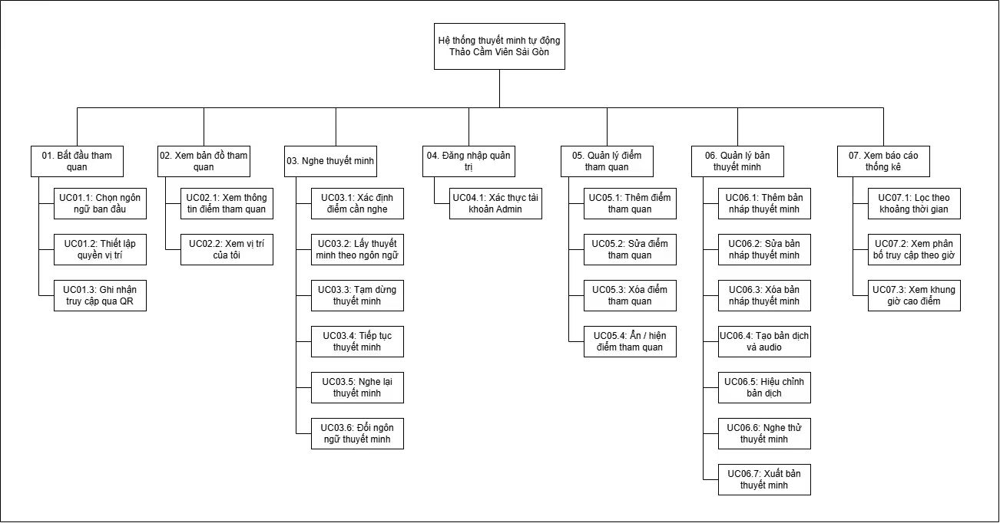

## 4.2. Overall Use Case Diagram

The diagram shows the two actors, Visitor and Admin, and their functions. Use frames or packages for functional groups where needed to organize the diagram.

Access checking is covered by the sign-in preconditions of the administrative use cases. It has no separate use case.

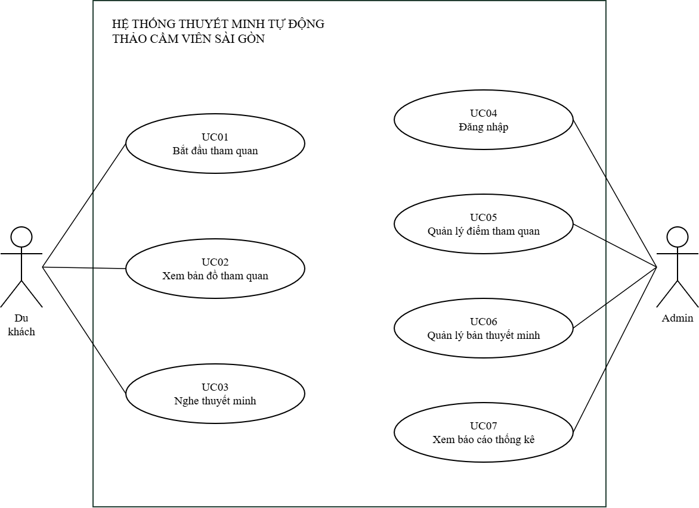

## 4.3. Use Case Catalog

| ID | Function Name |
|---|---|
| UC01.1 | Select the Initial Language |
| UC01.2 | Set Location Permission |
| UC01.3 | Record QR Access |
| UC02.1 | View Point-of-Interest Information |
| UC02.2 | View My Location |
| UC03.1 | Identify the Point for Playback |
| UC03.2 | Retrieve Narration by Language |
| UC03.3 | Pause Narration |
| UC03.4 | Resume Narration |
| UC03.5 | Replay Narration |
| UC03.6 | Change Narration Language |
| UC04.1 | Authenticate an Admin Account |
| UC05.1 | Add a Point of Interest |
| UC05.2 | Edit a Point of Interest |
| UC05.3 | Delete a Point of Interest |
| UC05.4 | Hide or Show a Point of Interest |
| UC06.1 | Add a Narration Draft |
| UC06.2 | Edit a Narration Draft |
| UC06.3 | Delete a Narration Draft |
| UC06.4 | Generate Translations and Audio |
| UC06.5 | Edit a Translation |
| UC06.6 | Preview Narration |
| UC06.7 | Publish Narration |
| UC07.1 | Filter by Date Range |
| UC07.2 | View Hourly Visit Distribution |
| UC07.3 | View Peak Hours |

---

# 5. Detailed Functional Specification

## 5.1. General Business Rules

| ID | Rules |
|---|---|
| BR-01 | Visitors do not sign in. Administrative functions require a valid Admin session. The backend must authenticate administrative requests. |
| BR-02 | In the visit setup flow, choose a language before requesting GPS permission. |
| BR-03 | Support vi, en, zh, ko, and ja. If the matching audio is unavailable, do not autoplay audio in another language. |
| BR-04 | The public list contains only active points with a valid public revision belonging to that same point. |
| BR-05 | Latitude is in [-90,90] and longitude in [-180,180]. The radius must be greater than 0 and no more than 500 m. |
| BR-06 | Point codes are autogenerated and unique. Images are uploaded to media storage. The database stores their paths and related information. |
| BR-07 | A position used for autoplay must be valid, recent, and accurate enough for the configured thresholds. Initial targets are a position age of at most 15 seconds and an accuracy value of at most 25 m. |
| BR-08 | A position is inside a zone when its distance from the center does not exceed the radius. If multiple zones qualify, prefer higher priority, then shorter distance, then use a stable ID as the tie-breaker. |
| BR-09 | Real GPS must be confirmed stable before autoplay. The target is to evaluate roughly every 5 seconds and obtain two consecutive results for the same point. Simulation has separate settings and an identifying label. |
| BR-10 | Only one track may play at a time. Autoplay does not interrupt the current track. |
| BR-11 | Do not autoplay the same point, language, and revision again during one visit session. Manual replay is allowed. |
| BR-12 | Changing languages does not reload the page. Preserve the location, selected point, visited points, and listening history. Visited and listened are separate states. |
| BR-13 | Each point can have multiple revisions. The PlaceId and Version pair is unique. Each point has at most one current public revision. |
| BR-14 | Admins may edit content only in a Draft. While a translation or audio generation job for the revision is Running, block edits and deletion of the draft. The backend and SQL protect Published and Archived content and records from content edits and deletion. To update published content, the Admin works on a Draft. |
| BR-15 |	When the Vietnamese source of a Draft changes, retain existing translations and mark those based on the old source as Needs Review. The Admin confirms that each translation may stay as it is or updates it to match the new source. If the narration script for a language changes, its audio becomes invalid. |
| BR-16 | Preserve translations manually edited by an Admin during regeneration or retries. If only audio needs regenerating, use the current script for that language. |
| BR-17 | 	Publish a Draft only when valid content and audio are available for `vi`, `en`, `zh`, `ko`, and `ja`, the audio matches the current scripts, the relevant jobs have finished, and the Admin has addressed every translation that needs review. |
| BR-18 | On successful publication, the system marks the draft Published, marks the old public revision of the same point Archived if one exists, and updates PublishedRevisionId in one transaction. SQL blocks assignment of a public revision belonging to another point. |
| BR-19 | Public text and audio must come from the same revision. Drafts can be viewed or previewed only through Admin functions. |
| BR-20 | Record a QR visit only when the website opens from a link marked as a QR source and the backend successfully saves the event. |
| BR-21 | Record at most one QR visit per SessionId. Reloading the page or resending the same event during the session does not increase the count. |
| BR-22 | When a visitor opens the website from a QR link, reuse the SessionId if the browser already has one. Otherwise, create a new session ID. |
| BR-23 | The server records event times in UTC. Reports display Vietnam time. Filter intervals are [start, end). |
| BR-24 | Reports aggregate visits across the 24 hours of the day within the filtered range. The hour with the highest total is the peak hour. Show all ties. If there are no visits, report no peak hour. |
| BR-25 | The backend and SQL block deletion of points with any narration revisions, including Drafts. Admins can hide a point to remove it from the visitor website. Deleting an eligible Draft also deletes its translation and job records. |
| BR-26 | Operational reports exclude data marked as demo by default. A tunnel URL alone does not mark a visit as demo. |
| BR-27 | Each revision and language pair has one GenerationJob. Job states are Pending, Running, Succeeded, and Failed. Save Running and the current stage before calling Azure. On retry, update the existing job and increment its attempt count. |
| BR-28 | SiteTexts stores interface text by key and language. Narration for individual points is stored separately. |

## 5.2. Specification and Diagram Conventions

- Main flows are written as actor actions and system responses.
- [A1] and [A2] identify alternative flows.
- [E1] and [E2] identify business exceptions.
- Rounded rectangles represent actions.
- Diamonds represent branching decisions or flow merges.
- Actions in alternative or exception branches still use rounded rectangles.
- Add a diamond only when a branch condition is needed.
- Infrastructure failures are covered in the nonfunctional and testing sections without repeating them as exceptions in every use case.

---

## 5.3. Group 01 — Start a Visit

This group covers opening the website through QR, recording access, selecting a language, and setting location permission.

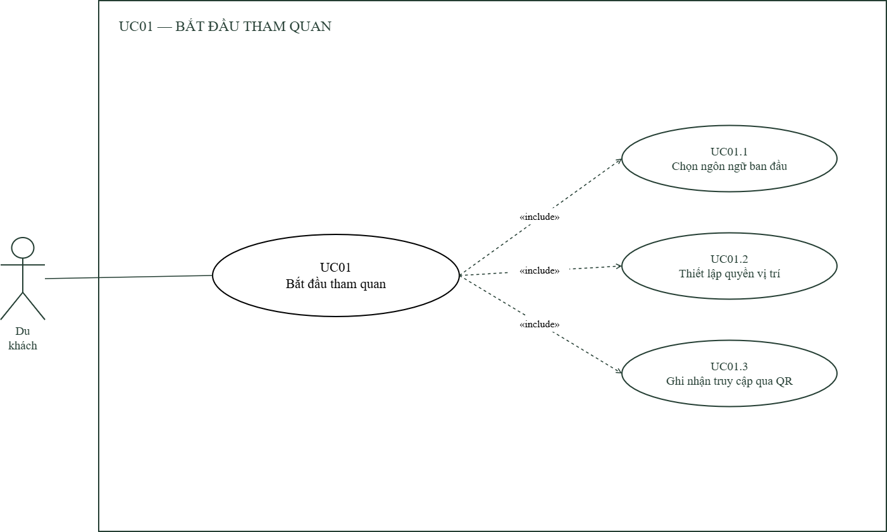

### UC01.1 — Select the Initial Language

| Attribute | Details |
|---|---|
| Actor | Visitor |
| Objective | Select the language to use during the visit |
| Trigger | Open the website through a QR code |
| Preconditions | The language selection interface has loaded |
| Postconditions | The language is saved and applied, and the user proceeds to location setup |
| Rules | BR-02, BR-03 |

**Main Flow**

| Step | Actor Action | System Response |
|---|---|---|
| 1 | View the language choices. | Show Vietnamese, English, Chinese, Korean, and Japanese. |
| 2 | Select a language. | Highlight the selection. |
| 3 | Press Continue to have the selection checked [E1] | Save and apply the language, then proceed to UC01.2. |

**Alternative Flows and Exceptions:** 

E1: If no language is selected, display a message and remain on the current screen.

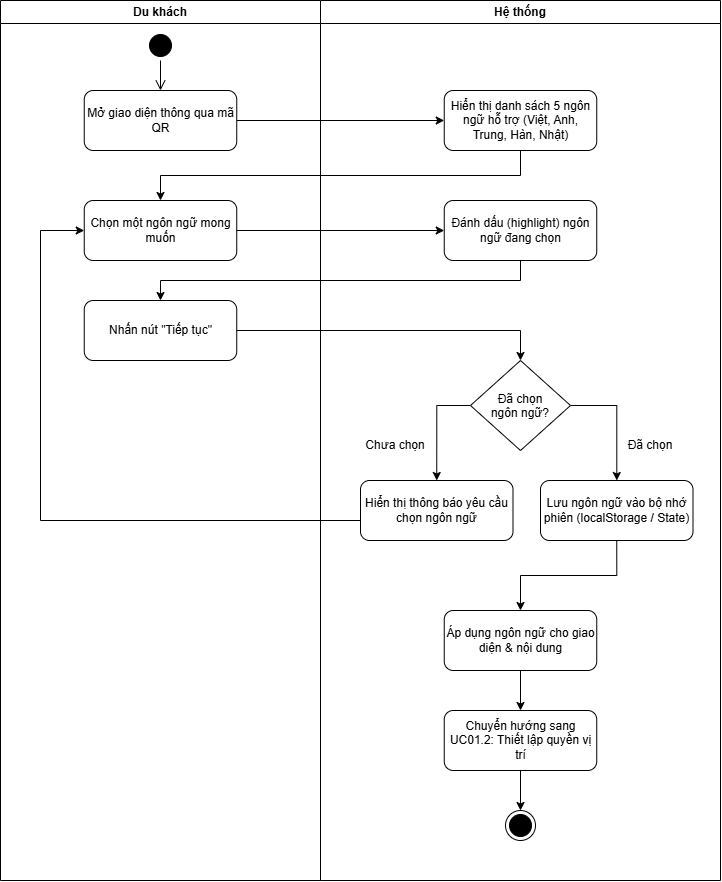

### UC01.2 — Set Location Permission

| Attribute | Details |
|---|---|
| Actor | Visitor |
| Objective | Decide whether to use location to support the visit |
| Trigger | Complete language selection |
| Preconditions | The website has applied the selected language |
| Postconditions | The map opens with GPS functionality available as permitted |
| Rules | BR-02, BR-07 |

**Main Flow**

| Step | Actor Action | System Response |
|---|---|---|
| 1 | View GPS guidance. | Explain why location is used. |
| 2 | Choose to enable GPS. | Request location permission through the browser when needed. |
| 3 | Grant location access. | Record permission and start acquiring coordinates. [A1] |
| 4 | Continue the visit. | Open the map and show the current location when valid coordinates are available. |

**A1 — Permission Denied at Step 3**

Open the map and allow the visitor to select points and listen manually. Do not display a simulated location or autoplay based on GPS. End the use case.

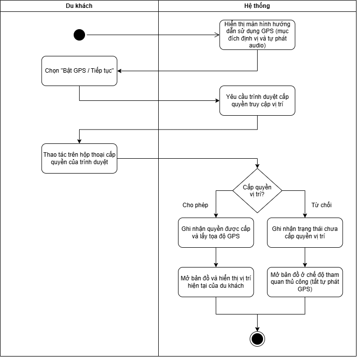

### UC01.3 — Record QR Access

| Attribute | Details |
|---|---|
| Actor | Visitor |
| Objective | Record website visits originating from QR links |
| Trigger | The visitor opens a QR link |
| Preconditions | The link reaches the website and carries a QR source marker |
| Postconditions | A valid visit is recorded or a duplicate is skipped |
| Rules | BR-20–BR-23, BR-26 |

**Main Flow**

| Step | Actor Action | System Response |
|---|---|---|
| 1 | Scan a QR code and open the link. | Detect the QR source and create or restore the SessionId. |
| 2 | Wait for the website to load. | Check whether a visit with the SessionId already exists. [A1] |
| 3 | Continue using the website. | Save the SessionId, UTC timestamp, and appropriate demo flag. |

**A1 — A Record Already Exists at Step 2**

Do not create another visit. Return an already-recorded result and let the visitor continue.

Recording analytics does not block language selection.

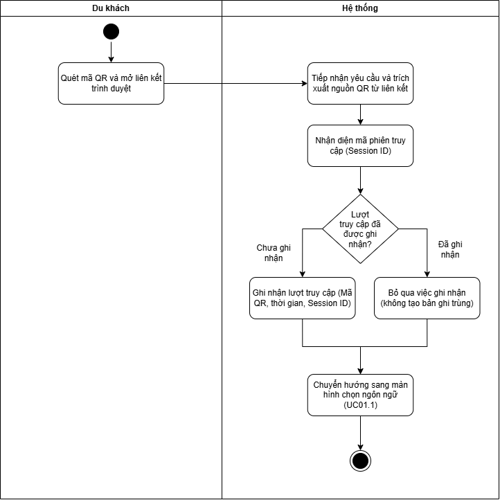

---

## 5.4. Group 02 — View the Visitor Map

This group covers viewing public points, their details, and the current location.

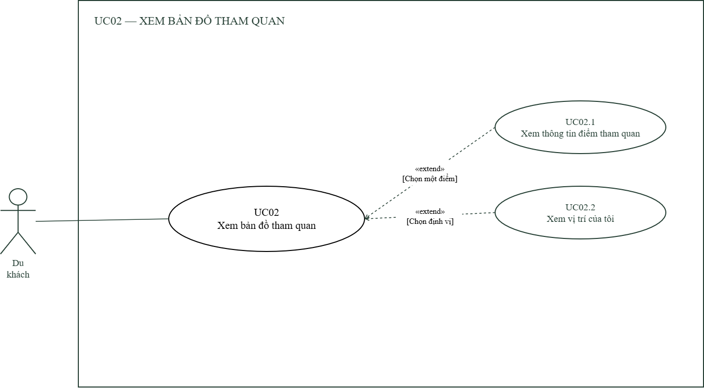

### UC02.1 — View Point-of-Interest Information

| Attribute | Details |
|---|---|
| Actor | Visitor |
| Objective | View information for the selected point |
| Trigger | Select a point on the map or in the list |
| Preconditions | The point is eligible for public display |
| Postconditions | Information is displayed in the current language |
| Rules | BR-03, BR-04, BR-19 |

**Main Flow**

| Step | Actor Action | System Response |
|---|---|---|
| 1 | View the map or list. | Display public points. |
| 2 | Select a point. | Highlight the point and its trigger zone. |
| 3 | View the information. | Show the name, image, description, and playback option. |

**Alternative Flows and Exceptions:** None.

Selecting a point to view does not mark it as visited or listened to.

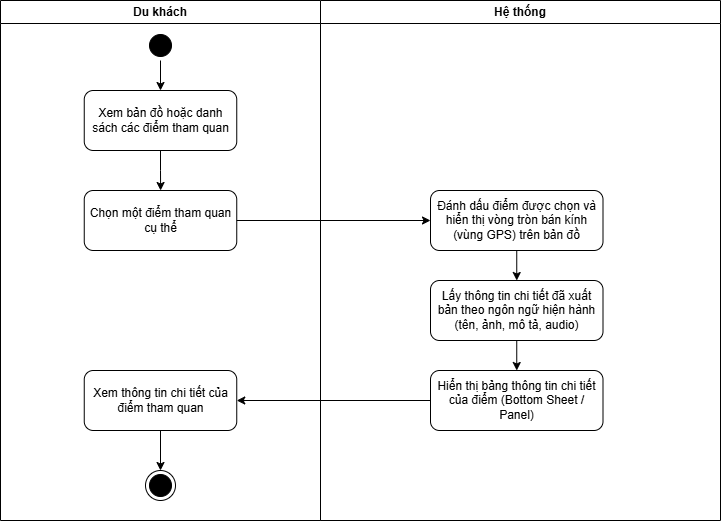

### UC02.2 — View My Location

| Attribute | Details |
|---|---|
| Actor | Visitor |
| Objective | Identify the current location on the map |
| Trigger | Press “My Location” |
| Preconditions | The map is open |
| Postconditions | The location is displayed when valid coordinates are available |
| Rules | BR-07 |

**Main Flow**

| Step | Actor Action | System Response |
|---|---|---|
| 1 | Press “My Location”. | Check location permission. [A1] |
| 2 | Wait for the location to be determined. | Obtain and validate the coordinates. [A2] |
| 3 | View the location. | Show the location marker and bring it into the visible map area. |

**A1 — Permission Missing at Step 1**

Explain how to enable location permission. If granted, proceed to step 2. Otherwise, leave the map as it is and end the use case.

**A2 — No Valid Coordinates Yet at Step 2**

Show that location is being determined. Proceed to step 3 when valid data is available. Invalid coordinates must not trigger a zone.

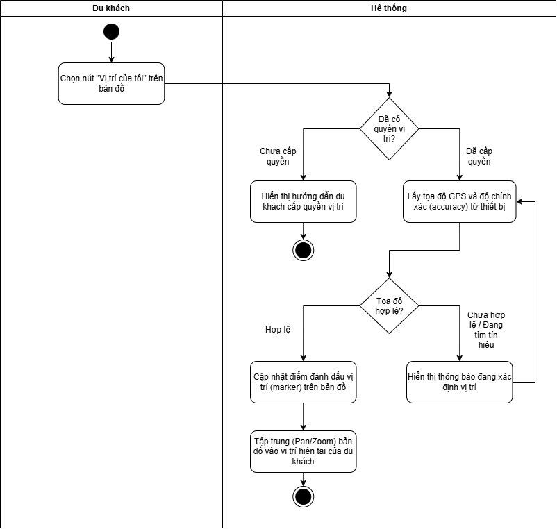

---

## 5.5. Group 03 — Listen to Narration

This group covers selecting a point, retrieving the appropriate content and audio, and controlling playback.

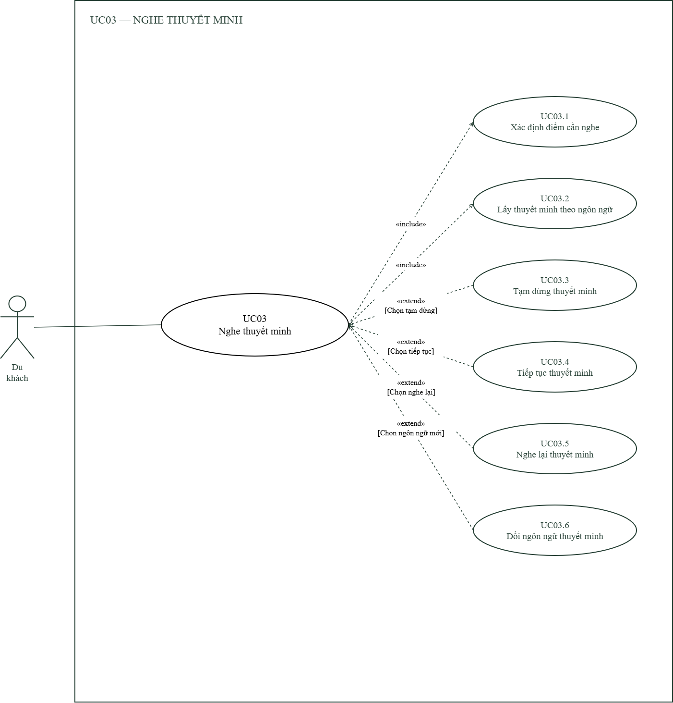

### UC03.1 — Identify the Point for Playback

| Attribute | Details |
|---|---|
| Actor | Visitor |
| Objective | Identify the point for a playback request |
| Trigger | Manual playback or a location update while autoplay is enabled |
| Preconditions | Public points are available. Autoplay requires a valid GPS position |
| Postconditions | A point is passed to UC03.2, or the system continues monitoring |
| Rules | BR-07–BR-11 |

**Main Flow**

| Step | Actor Action | System Response |
|---|---|---|
| 1 | Enable autoplay and move around. | Receive a valid position. [A1] |
| 2 | Continue moving. | Compare the position with the trigger zones. [A2] |
| 3 | Enter an eligible zone. | Select the appropriate point and check for repeat or overlapping playback. [A3] |
| 4 | Continue the visit. | Pass the identified point to UC03.2. |

**A1 — Manual Playback at Step 1**

The visitor selects a point and presses Play. Use the selected point without requiring the visitor to be inside the GPS zone, then go to step 4.

**A2 — Outside the Zone at Step 2**

Do not request autoplay. Continue monitoring the position and return to step 2 when fresh data arrives.

**A3 — Autoplay Conditions Not Met at Step 3**

If a track is already playing or the request is a repeat, hold off on autoplay. Continue monitoring location and playback state.

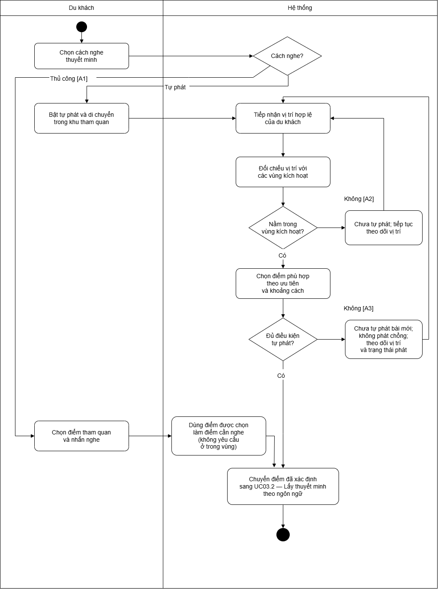

### UC03.2 — Retrieve Narration by Language

| Attribute | Details |
|---|---|
| Actor | Visitor |
| Objective | Use the correct text and audio for the current language |
| Trigger | The point for playback has been identified |
| Preconditions | The point has a public narration revision |
| Postconditions | The corresponding content and audio are loaded into the player |
| Rules | BR-03, BR-19 |

**Main Flow**

| Step | Actor Action | System Response |
|---|---|---|
| 1 | Request playback or continue in autoplay mode. | Identify the published revision of the point. |
| 2 | — | Select content and audio in the current language. [E1] |
| 3 | Listen to the narration. | Display the content and play the audio for a valid request. |

**E1 — No Valid Content or Audio at Step 2**

Indicate that matching narration is unavailable. Do not autoplay audio in another language. The visitor may change languages or select another point.

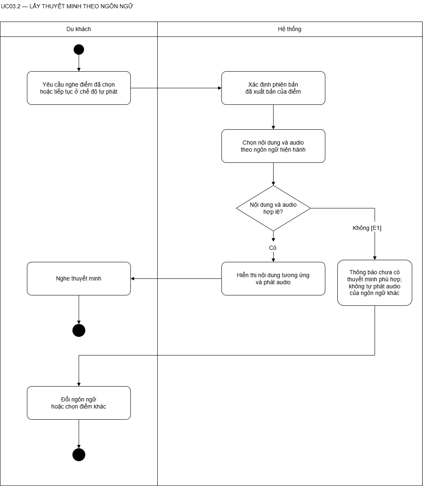

### UC03.3 — Pause Narration

| Attribute | Details |
|---|---|
| Actor | Visitor |
| Objective | Pause the track and keep the playback position |
| Trigger | Press Pause |
| Preconditions | A track is playing |
| Postconditions | The track is paused and can be resumed |
| Rules | BR-10 |

**Main Flow**

| Step | Actor Action | System Response |
|---|---|---|
| 1 | Press Pause. | Pause the audio and keep the current playback position. |
| 2 | View the player. | Display the paused state and the Resume button. |

**Alternative Flows and Exceptions:** None.

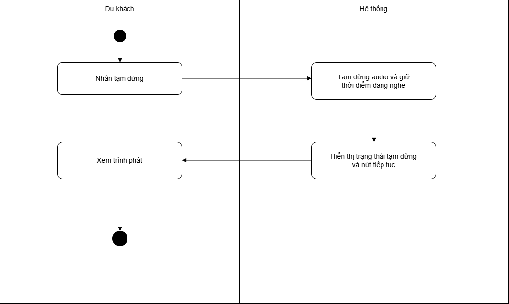

### UC03.4 — Resume Narration

| Attribute | Details |
|---|---|
| Actor | Visitor |
| Objective | Resume from the paused playback position |
| Trigger | Press Resume |
| Preconditions | A track is paused and still matches the current language |
| Postconditions | The track resumes from the saved playback position |
| Rules | BR-10 |

**Main Flow**

| Step | Actor Action | System Response |
|---|---|---|
| 1 | Press Resume. | Retrieve the paused playback position. |
| 2 | Continue listening. | Resume playback and update the state to playing. |

**Alternative Flows and Exceptions:** None.

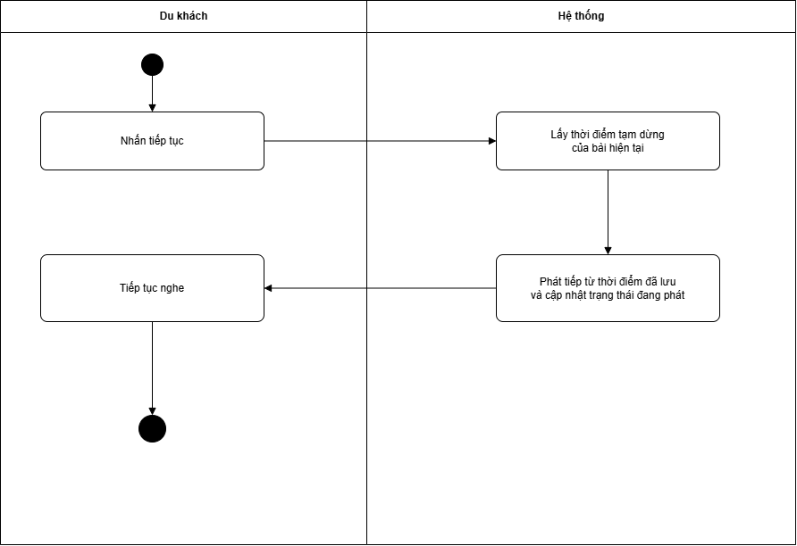

### UC03.5 — Replay Narration

| Attribute | Details |
|---|---|
| Actor | Visitor |
| Objective | Listen to the track again from the beginning |
| Trigger | Press Replay |
| Preconditions | A track is available in the current language |
| Postconditions | The track plays from the beginning |
| Rules | BR-10, BR-11 |

**Main Flow**

| Step | Actor Action | System Response |
|---|---|---|
| 1 | Press Replay. | Move the playback position to the start of the track. |
| 2 | Listen to the content again. | Play from the beginning and update progress. |

**Alternative Flows and Exceptions:** None.

Replaying does not clear visit history.

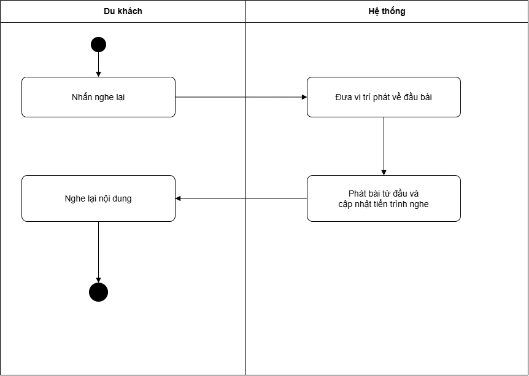

### UC03.6 — Change Narration Language

| Attribute | Details |
|---|---|
| Actor | Visitor |
| Objective | Change the language during the visit |
| Trigger | Select a new language |
| Preconditions | The visitor is using the website |
| Postconditions | Apply the new language and preserve the visit state |
| Rules | BR-03, BR-12 |

**Main Flow**

| Step | Actor Action | System Response |
|---|---|---|
| 1 | Open the language selector. | Display the five languages. |
| 2 | Select a new language. | Save the selection and stop the old audio if it is playing. |
| 3 | Continue using the website. | Update the interface and content while preserving location and visit history. |
| 4 | Request playback. | Use UC03.2 to retrieve the track in the new language. |

**Alternative Flows and Exceptions:** None.

Changing languages alone does not restart playback. Stopping the previous audio is part of normal processing, not an exception.

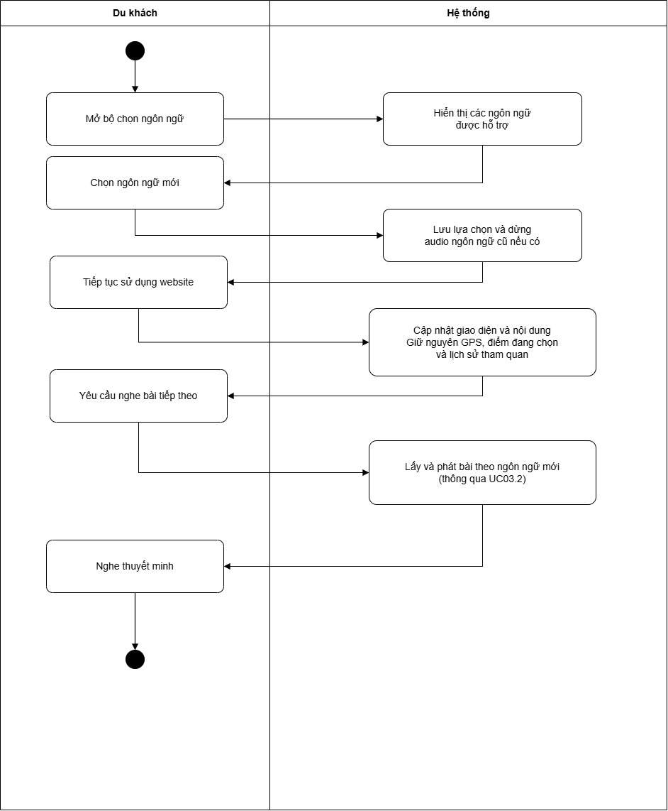

---

## 5.6. Group 04 — Admin Sign-In

This group authenticates accounts for access to the Admin area.

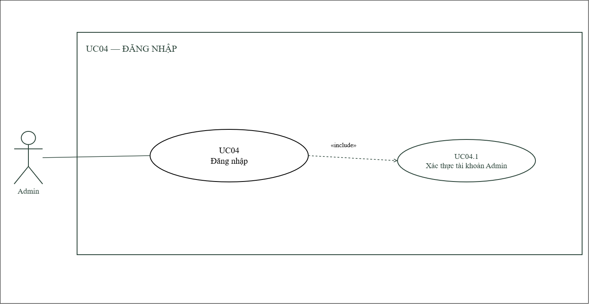

### UC04.1 — Authenticate an Admin Account

| Attribute | Details |
|---|---|
| Actor | Admin |
| Objective | Authenticate the account and open an administrative session |
| Trigger | Submit the sign-in form |
| Preconditions | An account has been provisioned |
| Postconditions | A valid session is created, or sign-in is denied |
| Rules | BR-01 |

**Main Flow**

| Step | Actor Action | System Response |
|---|---|---|
| 1 | Enter the username and password. | Receive the information. |
| 2 | Press Sign In. | Check the account, password, and active status. [E1] |
| 3 | Access the Admin area. | Establish the session and open the Admin interface. |

**E1 — Invalid Credentials at Step 2**

Deny sign-in and display an appropriate message. The Admin re-enters the information and repeats step 2.

Administrative API calls still require session authentication. Access checking has no separate use case.

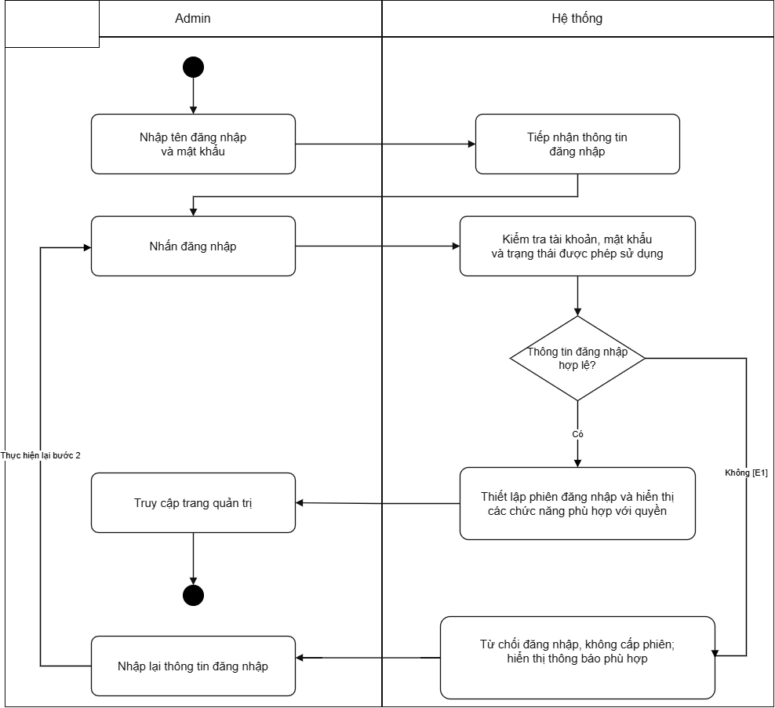

---

## 5.7. Group 05 — Manage Points of Interest

Admins manage the information, images, coordinates, radius, and status of points.

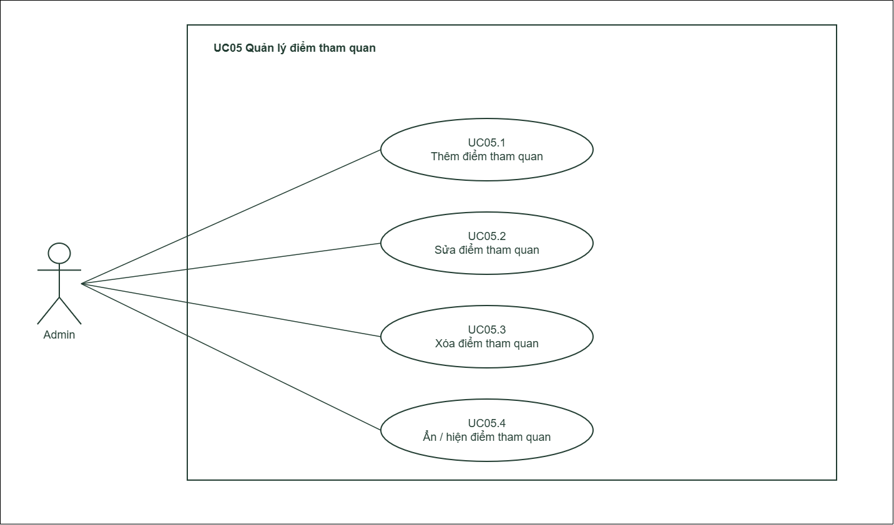

### UC05.1 — Add a Point of Interest

| Attribute | Details |
|---|---|
| Actor | Admin |
| Objective | Create a new point of interest |
| Trigger | Select Add Point |
| Preconditions | The Admin is signed in and the session is valid |
| Postconditions | The new point is saved and displayed in the Admin area |
| Rules | BR-01, BR-04–BR-06 |

**Main Flow**

| Step | Actor Action | System Response |
|---|---|---|
| 1 | Select Add Point. | Open the form. |
| 2 | Enter the Vietnamese name and description, type, GPS coordinates, radius, and priority, and choose an image. | Receive the information and display an image preview. |
| 3 | Press Save. | Validate the data and generate a unique code. [E1] |
| 4 | View the result. | Save the point and image. Unpublished content is not available to the public. |

**E1 — Invalid Data at Step 3**

Identify the fields to correct and retain the form data. The Admin makes corrections and saves again.

Manage multilingual introductory content through the point's draft workflow to avoid inconsistent public data sources.

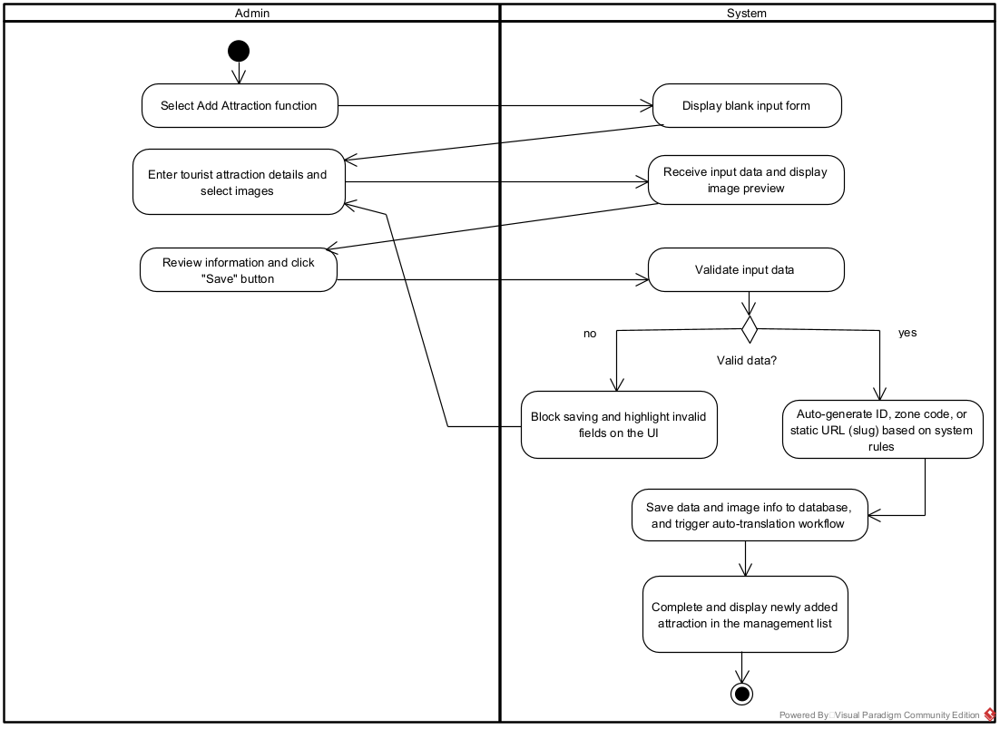

### UC05.2 — Edit a Point of Interest

| Attribute | Details |
|---|---|
| Actor | Admin |
| Objective | Update point information |
| Trigger | Select Edit |
| Preconditions | The Admin session is valid and the point exists |
| Postconditions | Update point attributes while preserving its identifier and revision links |
| Rules | BR-05, BR-06, BR-14 |

**Main Flow**

| Step | Actor Action | System Response |
|---|---|---|
| 1 | Select the point to edit. | Display the current information. |
| 2 | Edit point attributes or the image. | Accept the changes. |
| 3 | Press Save. | Validate and save the data. [E1] |
| 4 | View the result. | Update the information. GPS and image changes take effect the next time the data is loaded. |

**E1 — Invalid Data at Step 3**

Do not save the changes. Indicate the fields to correct and allow the Admin to save again.

Changes to published narration go through a draft. Do not overwrite the revision currently played to visitors.

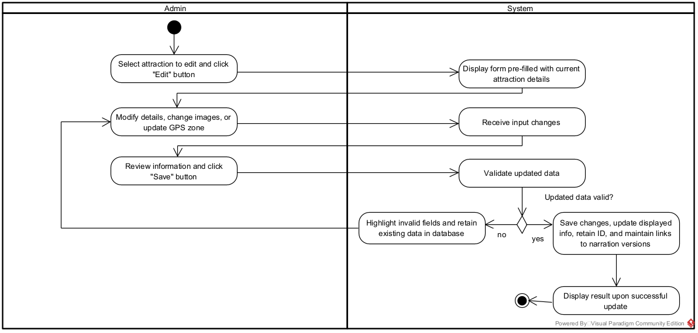

### UC05.3 — Delete a Point of Interest

| Attribute | Details |
|---|---|
| Actor | Admin |
| Objective | Delete a point that is no longer needed and is eligible for deletion |
| Trigger | Select Delete |
| Preconditions | The Admin session is valid and the point exists |
| Postconditions | Delete the eligible point without breaking data references |
| Rules | BR-25 |

**Main Flow**

| Step | Actor Action | System Response |
|---|---|---|
| 1 | Select Delete Point. | Check for references. [E1] |
| 2 | Confirm deletion. | Receive confirmation. [A1] |
| 3 | View the list. | Delete the point and refresh the list. |

**A1 — Cancel at Step 2**

Keep the point and close the confirmation dialog.

**E1 — The Point Has Referencing Revisions at Step 1**

Reject deletion, explain why, and direct the Admin to the hide function.

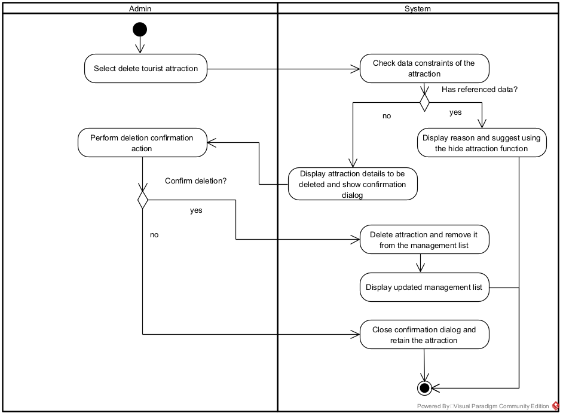

### UC05.4 — Hide or Show a Point of Interest

| Attribute | Details |
|---|---|
| Actor | Admin |
| Objective | Change visibility without deleting data |
| Trigger | Select Hide or Show |
| Preconditions | The Admin session is valid and the point exists |
| Postconditions | The status is updated and history is preserved |
| Rules | BR-04, BR-25 |

**Main Flow**

| Step | Actor Action | System Response |
|---|---|---|
| 1 | Select Hide for a visible point. | Show the status and request confirmation. [A1] |
| 2 | Confirm. | Change the point's status to hidden. |
| 3 | View the result. | Remove the point from the public list on the next update. |

**A1 — Select Show at Step 1**

Set the point to active. Display it on the visitor website only if it has a valid public revision. Activating the point does not publish a draft.

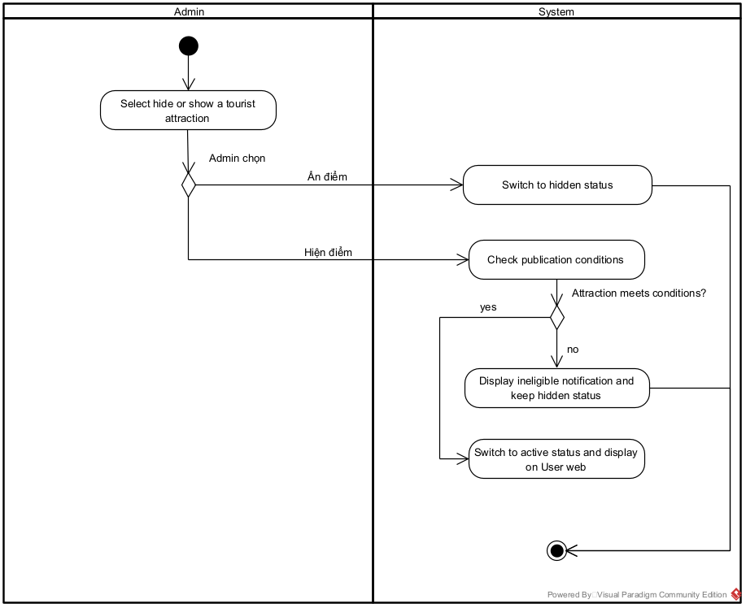

---

## 5.8. Group 06 — Manage Narration

This group manages content from the Vietnamese draft through translation, audio, and publication.

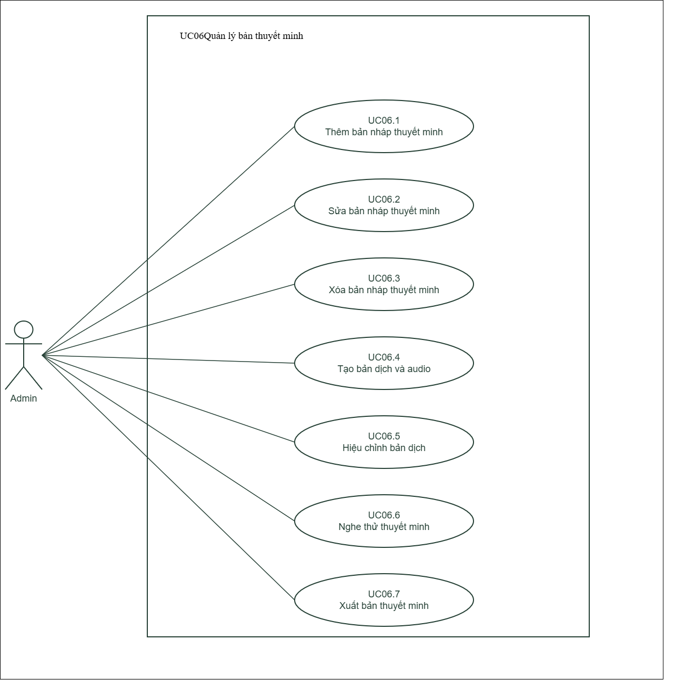

### UC06.1 — Add a Narration Draft

| Attribute | Details |
|---|---|
| Actor | Admin |
| Objective | Create a new content revision |
| Trigger | Select Add Draft |
| Preconditions | The Admin session is valid and the point exists |
| Postconditions | Save a Draft linked to the point |
| Rules | BR-13, BR-14 |

**Main Flow**

| Step | Actor Action | System Response |
|---|---|---|
| 1 | Select a point and add a draft. | Open the content form. |
| 2 | Enter the Vietnamese title, description, and script. | Receive the information. |
| 3 | Save the draft. | Validate the content, assign a revision number, and save the Draft. [E1] |

**E1 — Invalid Content at Step 3**

Indicate what is missing. The Admin corrects it and saves again.

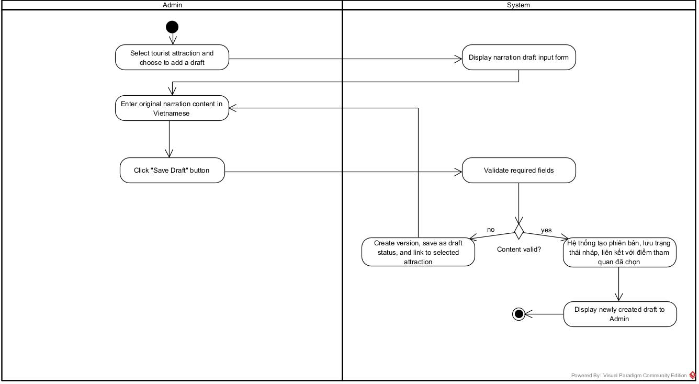

### UC06.2 — Edit a Narration Draft

| Attribute | Details |
|---|---|
| Actor | Admin |
| Objective | Revise content before publication |
| Trigger | Select Edit Revision |
| Preconditions | The Admin session is valid and the revision exists |
| Postconditions | Save the draft and update the validity of dependent data |
| Rules | BR-14, BR-15 |

**Main Flow**

| Step | Actor Action | System Response |
|---|---|---|
| 1 | Select the revision to edit. | Check whether its state allows editing. [E1] |
| 2 | Edit the Vietnamese content. | Accept the changes. |
| 3 | Press Save. | Validate, save, and flag translations or audio that need updating. [E2] |

**E1 — Revision Cannot Be Edited at Step 1**

Keep the published revision intact and direct the Admin to create a new draft.

**E2 — Invalid Content at Step 3**

Keep the saved version and indicate the fields to correct.

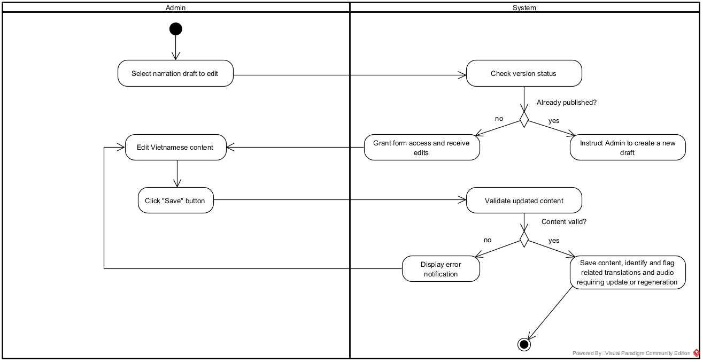

### UC06.3 — Delete a Narration Draft

| Attribute | Details |
|---|---|
| Actor | Admin |
| Objective | Remove an unused draft |
| Trigger | Select Delete Draft |
| Preconditions | The Admin session is valid and the revision exists |
| Postconditions | The eligible draft is deleted |
| Rules | BR-25, BR-27 |

**Main Flow**

| Step | Actor Action | System Response |
|---|---|---|
| 1 | Select Delete Draft. | Check the state and related jobs. [E1] |
| 2 | Confirm deletion. | Receive confirmation. [A1] |
| 3 | View the list. | Delete the draft and handle dependent data according to policy. |

**A1 — Cancel at Step 2**

Keep the draft.

**E1 — Draft Not Eligible for Deletion at Step 1**

Reject deletion if the revision is not a Draft or has a running job. Keep the public revision.

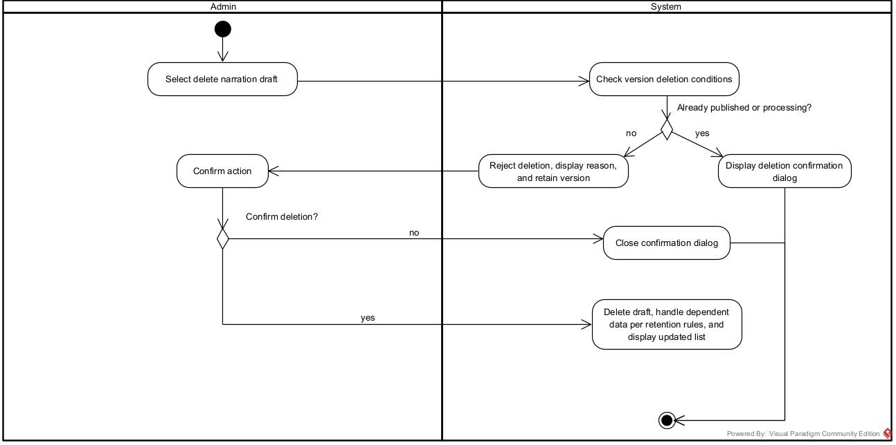

### UC06.4 — Generate Translations and Audio

| Attribute | Details |
|---|---|
| Primary Actor | Admin |
| Supporting Services | Azure Translator, Azure Speech |
| Objective | Generate content and audio for five languages |
| Trigger | Select Generate Translations and Audio |
| Preconditions | The Admin session is valid and a Draft with valid Vietnamese content is available |
| Postconditions | Save results and status for each language |
| Rules | BR-15–BR-17, BR-27 |

**Main Flow**

| Step | Actor Action | System Response |
|---|---|---|
| 1 | Select the draft and request generation. | Validate the data and create the appropriate GenerationJobs. [A1] |
| 2 | Monitor progress. | Translate into en, zh, ko, and ja. Preserve manually edited translations according to the business rules. [A2] |
| 3 | Continue monitoring progress. | Generate audio for vi and the four translations, then save the files and metadata. [E1] |
| 4 | View the result. | Update the job and per-language statuses, and enable preview. |

**A1 — A Matching Job Is Already Running at Step 1**

Show the existing job's status without creating a duplicate.

**A2 — A Manually Edited Translation Exists at Step 2**

Keep that translation and generate audio from its current content unless the Admin explicitly confirms replacing the translation.

**E1 — Some Results Are Invalid at Step 3**

Keep completed results, record failures, and allow regeneration. The revision is ineligible for publication while required results are missing or invalid.

GenerationJobs tracks processing and does not introduce a separate job management use case.

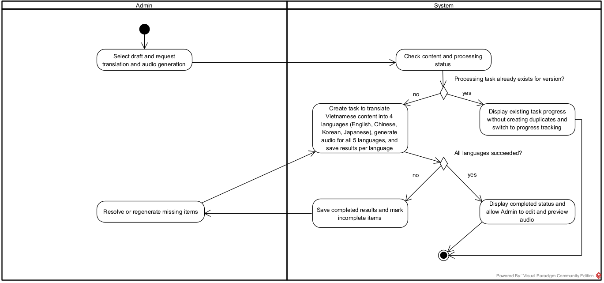

### UC06.5 — Edit a Translation

| Attribute | Details |
|---|---|
| Actor | Admin |
| Objective | Edit a translation before publication |
| Trigger | Select the translation to edit |
| Preconditions | The Admin session is valid and the translation belongs to a Draft |
| Postconditions | Save the translation and flag the audio for updating if the script changes |
| Rules | BR-15, BR-16 |

**Main Flow**

| Step | Actor Action | System Response |
|---|---|---|
| 1 | Choose a language. | Display the translation. |
| 2 | Edit the content. | Accept the changes. |
| 3 | Press Save. | Validate, save, and flag the translation as manually edited. [E1] |
| 4 | View the result. | Mark the audio as invalid if the script has changed. |

**E1 — Invalid Content at Step 3**

Display a message and allow corrections. Preserve the previously valid data.

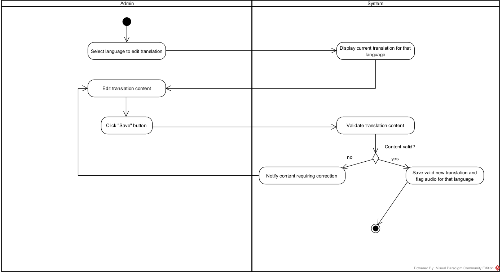

### UC06.6 — Preview Narration

| Attribute | Details |
|---|---|
| Actor | Admin |
| Objective | Check audio before publication |
| Trigger | Select Preview |
| Preconditions | The Admin session is valid and the revision exists |
| Postconditions | The Admin can listen to valid audio to check it |
| Rules | BR-15, BR-19 |

**Main Flow**

| Step | Actor Action | System Response |
|---|---|---|
| 1 | Select a revision and language. | Check the corresponding audio. [E1] |
| 2 | Press Preview. | Play the audio through the Admin preview function. |
| 3 | Listen and compare. | Display the text and playback controls. |

**E1 — Audio Is Missing or Does Not Match at Step 1**

Indicate that audio must be generated or regenerated. Do not present stale audio as valid.

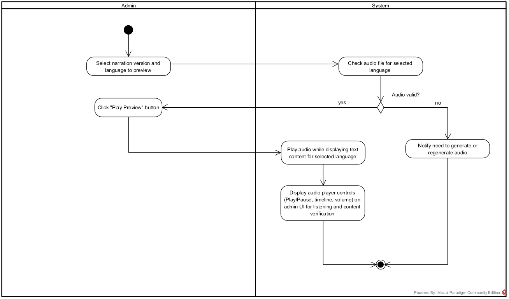

### UC06.7 — Publish Narration

| Attribute | Details |
|---|---|
| Actor | Admin |
| Objective | Make a completed revision publicly available |
| Trigger | Select Publish |
| Preconditions | The Admin session is valid and a Draft exists |
| Postconditions | Update the public revision consistently or retain the old one |
| Rules | BR-04, BR-17–BR-19 |

**Main Flow**

| Step | Actor Action | System Response |
|---|---|---|
| 1 | Select Publish. | Verify all five languages are present, audio matches the content, and related jobs are complete. [E1] |
| 2 | Confirm publication. | Receive confirmation. [A1] |
| 3 | View the result. | Update the statuses and PublishedRevisionId consistently. |
| 4 | Check the visitor website. | Serve the new revision if the point is active. [A2] |

**A1 — Cancel at Step 2**

Keep the draft and the existing public revision.

**A2 — The Point Is Hidden at Step 4**

Publish the revision, while keeping the point off the visitor website until it is activated.

**E1 — Publication Requirements Not Met at Step 1**

List the languages or audio that still need work. Leave the public revision as it is.

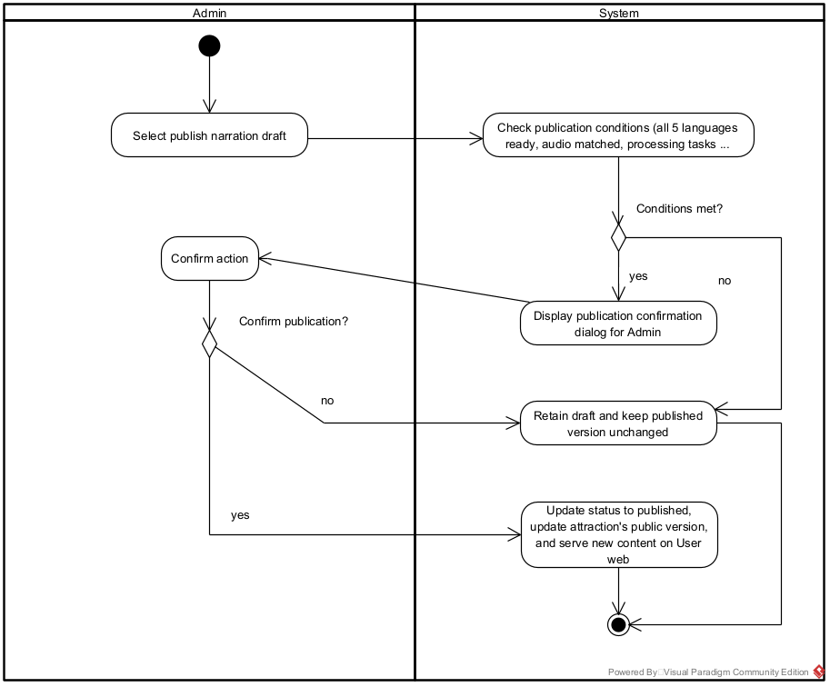

---

## 5.9. Group 07 — View Analytics Reports

Reports show recorded visits rather than a count of individual people.

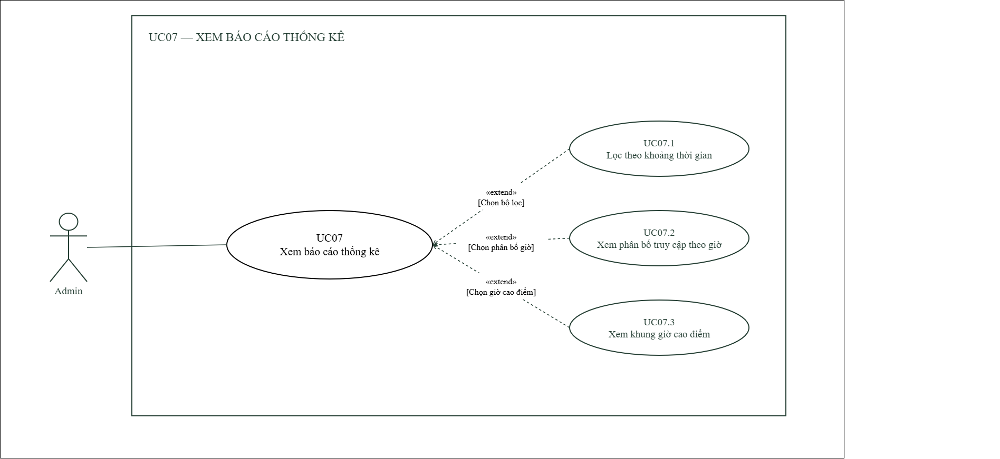

### UC07.1 — Filter by Date Range

| Attribute | Details |
|---|---|
| Actor | Admin |
| Objective | View a report for the requested date range |
| Trigger | Apply the filter |
| Preconditions | The Admin session is valid |
| Postconditions | The report uses the selected range |
| Rules | BR-21–BR-24, BR-26 |

**Main Flow**

| Step | Actor Action | System Response |
|---|---|---|
| 1 | Select the start and end dates. | Receive the filter criteria. |
| 2 | Press Apply. | Validate and convert the time range. [E1] |
| 3 | View the report. | Aggregate matching visits. [A1] |

**A1 — No Visits at Step 3**

Display zero visits and indicate that there is no data. Do not generate sample figures.

**E1 — Invalid Date Range at Step 2**

Display a message and ask for a correction. Do not apply the filter.

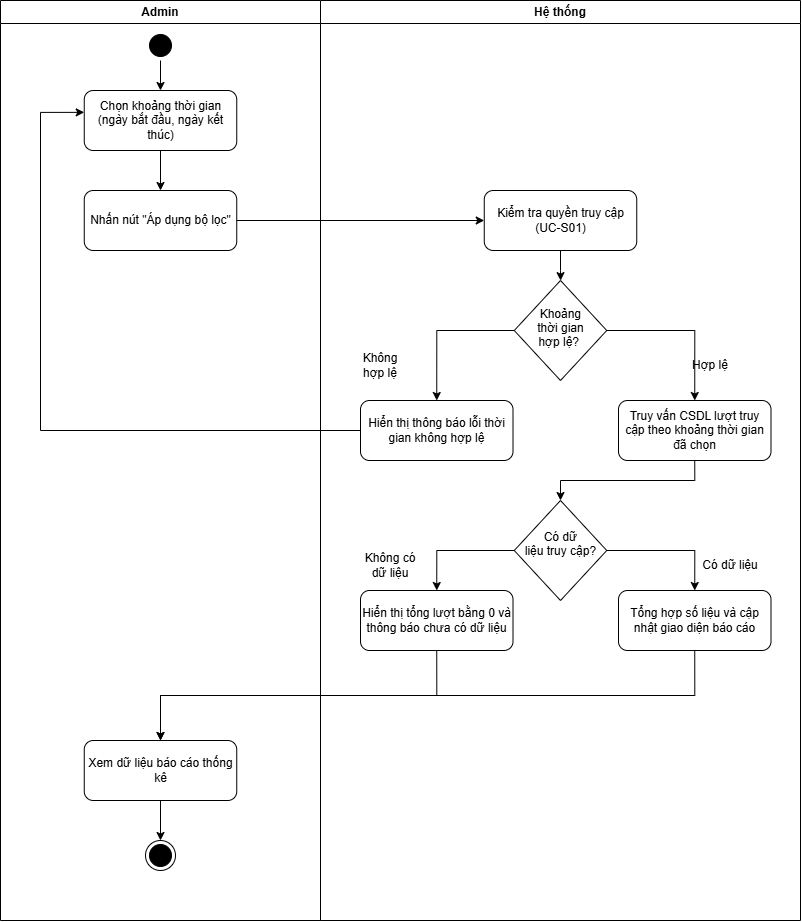

### UC07.2 — View Hourly Visit Distribution

| Attribute | Details |
|---|---|
| Actor | Admin |
| Objective | Compare visits across hours of the day |
| Trigger | Open the hourly distribution section |
| Preconditions | The Admin session is valid and a date range exists |
| Postconditions | Display visit counts for all 24 hourly buckets |
| Rules | BR-23, BR-24 |

**Main Flow**

| Step | Actor Action | System Response |
|---|---|---|
| 1 | Select View Hourly Distribution. | Retrieve data for the filtered range. |
| 2 | View the chart or table. | Convert timestamps to Vietnam time and aggregate visits into 24 hourly buckets. [A1] |
| 3 | Compare hourly buckets. | Display the hour labels and visit counts. |

**A1 — No Data at Step 2**

Display an empty state or show zero in every bucket.

When the filter spans several days, visits at the same hour on different days are added to the same bucket. The interface must explain this aggregation.

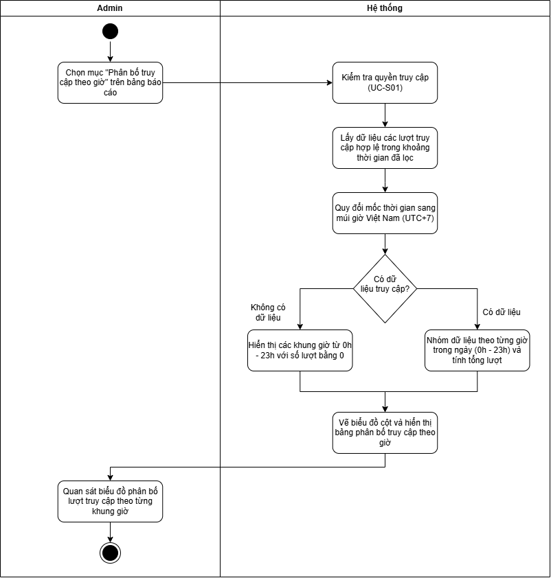

### UC07.3 — View Peak Hours

| Attribute | Details |
|---|---|
| Actor | Admin |
| Objective | Identify the hour with the most visits |
| Trigger | View peak-hour information |
| Preconditions | The Admin session is valid and a date range exists |
| Postconditions | Show the peak hours and counts, or a no-data message |
| Rules | BR-23, BR-24 |

**Main Flow**

| Step | Actor Action | System Response |
|---|---|---|
| 1 | Select View Peak Hours. | Retrieve visit counts for the 24 hourly buckets. [A1] |
| 2 | Wait for aggregation. | Find the highest count and the corresponding hours. [A2] |
| 3 | View the result. | Display peak hours, counts, and the filtered range. |

**A1 — No Visits at Step 1**

Indicate that there is insufficient data to identify peak hours. End the use case.

**A2 — Multiple Hours Tied at Step 2**

Display every hourly bucket with the highest visit count.

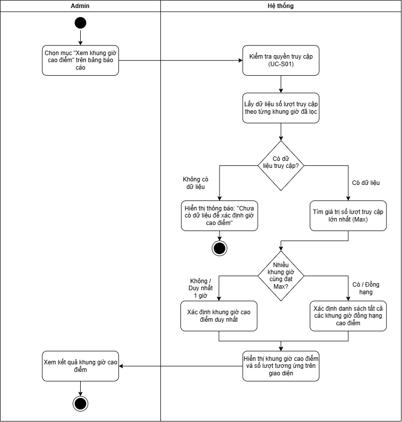

## 5.10. Location Simulation for Demos

Simulation supports testing Groups 02 and 03 and uses simulated rather than real GPS data.

- Selecting simulation stops real GPS tracking.
- Select a starting point, destination, and speed.
- Simulated positions pass through the same zone-evaluation process.
- Pausing movement and pausing audio are separate actions.
- Restart returns to the starting point, stops audio, and resets the demo visit history.
- Exiting simulation does not request GPS permission until the visitor takes action.
- Discard responses from earlier requests after changing modes or resetting.
- Do not use simulation as evidence of real-world GPS accuracy.

---

# 6. User Stories

| ID | User Story | Related Use Cases | Acceptance Criteria |
|---|---|---|---|
| US-01 | As a visitor, I want to open the website through a QR code so I can access it without installing an app. | UC01.3 | Open the correct public URL and avoid duplicate records |
| US-02 | As a visitor, I want to choose a language before starting my visit. | UC01.1, UC01.2 | Offer five languages and let visitors choose before requesting GPS permission |
| US-03 | As a visitor who declines GPS permission, I still want to browse and listen manually. | UC01.2, UC02.1, UC03.1–03.2 | Do not simulate the visitor's location. Let the visitor select a point and listen |
| US-04 | As a visitor, I want to see where the areas are and learn about them. | UC02.1–02.2 | Show the correct public points and valid coordinates |
| US-05 | As a visitor moving around the zoo, I want the correct narration to play when I enter a zone. | UC03.1–03.2 | Match the zone, language, and revision, and prevent overlapping playback |
| US-06 | As a visitor, I want to pause, resume, and replay narration. | UC03.3–03.5 | Pause preserves the position, resume continues from it, and replay starts at the beginning |
| US-07 | As a visitor, I want to change languages without losing my visit progress. | UC03.6 | Preserve visited points and listening history without reloading |
| US-08 | As an Admin, I want to sign in so I can manage content. | UC04.1 | Create a session only for a valid account |
| US-09 | As an Admin, I want to manage points and GPS zones. | UC05.1–05.4 | Generate codes automatically, upload images, validate data, and preserve references |
| US-10 | As an Admin, I want to draft and manage narration. | UC06.1–06.3 | Protect public content from direct edits and prevent accidental deletion of history |
| US-11 | As an Admin, I want to generate translations and audio and track the results. | UC06.4 | Show job status and per-language results, and allow regeneration |
| US-12 | As an Admin, I want to edit and preview narration before publication. | UC06.5–06.6 | Audio matches the current translation, and preview is available only to Admins |
| US-13 | As an Admin, I want to publish completed content. | UC06.7 | Verify all five languages and serve the correct revision to visitors |
| US-14 | As an Admin, I want to see visit counts and peak hours. | UC07.1–07.3 | Apply the correct filter range and Vietnam time, prevent duplicate counts, and handle ties |

---

# 7. User Flows

## 7.1. Start a Visit

Scan QR → open the website → record access by session → choose a language → explain location permission → grant or deny permission → open the map.

Analytics recording does not block language selection.

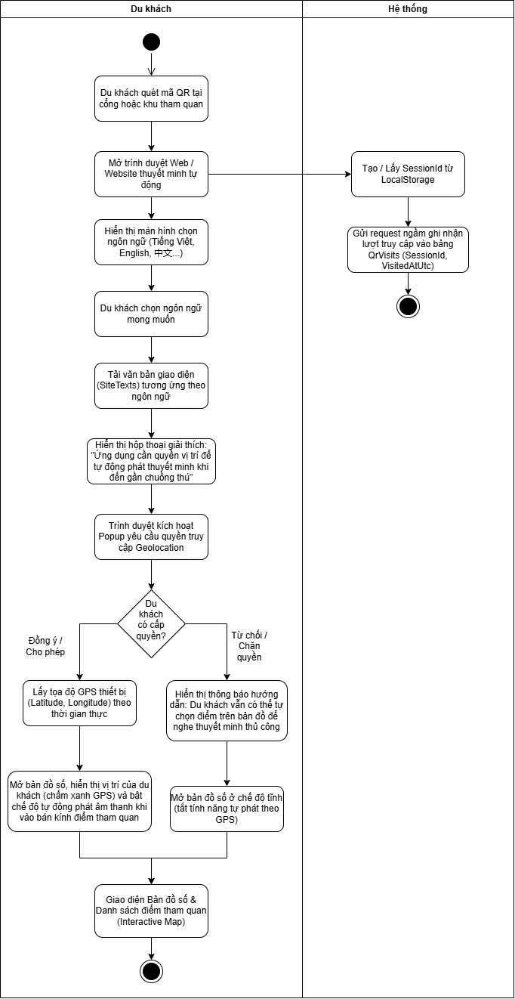

## 7.2. Listen Based on Location

Enable autoplay → receive a valid position → identify the zone → select a point → check for repeat or overlapping playback → retrieve the public revision by language → play audio.

A detected point does not guarantee the browser will allow autoplay. If autoplay is blocked, the interface offers a manual playback action.

## 7.3. Content Administration

Sign in → select or create a point → create a Vietnamese draft → translate and generate audio → edit if needed → regenerate invalid audio → preview → publish.

The existing public revision continues to be served while the new one is prepared.

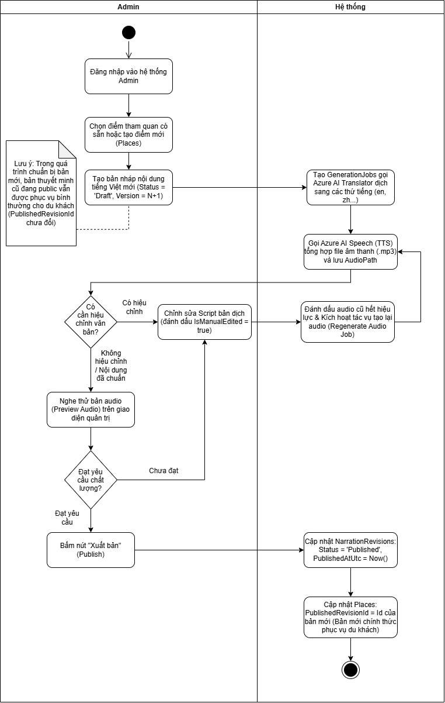

## 7.4. QR Access and Reporting

QR-marked URL → create or restore SessionId → backend deduplication → save to QrVisits → Admin selects a date range → aggregate in Vietnam time → display total visits and peak hours.

Opening the presenter's QR display page does not count as a visitor access event.

## 7.5. Change the Demo URL

Start a new tunnel → obtain the new URL → update the QR code → visitors open the new URL → continue recording to the same database.

Changing the URL retains SQL history. The identifier is stored per browser origin and may change, so the same visitor may not be recognized across different URLs.

---

# 8. Nonfunctional Requirements

## 8.1. Performance

| ID | Objective | Verification Method |
|---|---|---|
| NFR-P01 | The setup page becomes interactive in about 3 seconds on a stable test network | Record the device and network and measure multiple times |
| NFR-P02 | Read and zone-evaluation APIs meet a p95 of at most 1 second at the target load of 20 concurrent visitors | Measure the backend and SQL and record tunnel overhead |
| NFR-P03 | New public content is received within 15 seconds while the tab is active and the network is operating normally | Measure from publication to the next visitor data sync |
| NFR-P04 | Azure jobs display their actual status | Test initial generation, failures, regeneration, and each language |

These thresholds are test targets. Actual capacity remains to be demonstrated.

## 8.2. Security

- Use the same password hashing mechanism for account creation and verification.
- The backend authenticates the session for every Admin API request.
- Hiding a GUI control does not protect the API.
- If cookies are used, apply HttpOnly and Secure as appropriate for the environment and implement suitable CSRF protection.
- Keep Azure keys and sensitive connection strings out of Git.
- Validate inputs and uploaded files.
- Draft previews require sign-in. Public audio must meet public access requirements.
- Sign-in bypass is a demo-only setting and must be disabled in operation.

## 8.3. Availability and Compatibility

- Adapt the interface to mobile screens.
- Test Safari on iPhone, Chrome on Android, and desktop browsers.
- GPS and audio use HTTPS on visitor devices.
- Keep the control panel from covering the entire map.
- Distinguish data loading failures from empty lists.
- Continuous GPS or audio is not guaranteed when the app is suspended in the background or the screen is locked.
- Show state using text or icons as well as color.

## 8.4. Privacy and Analytics

- Do not require visitors to provide a name, phone number, or account.
- SessionId is used to prevent duplicate visit counts. It does not identify a person.
- Do not store location history by default.
- The main metric is visits. Do not label it as unique people.
- The team confirms the QR data retention period before operation. QR visits are retained for 90 days from the time they are recorded.

## 8.5. Reliability and Maintenance

- Report success only after all required data and files are saved.
- Log errors without exposing secrets.
- Attach Azure results only to the correct revision and a script that is still valid.
- SQL and media backups must allow data-to-file links to be restored.
- Check interrupted jobs after the backend restarts. Do not leave them in a processing state indefinitely.
- Distinguish technical failures in the test plan even when they are not listed in each use case.

---

# 9. Technology and System Design

## 9.1. Technology

| Component | Technology |
|---|---|
| Frontend | React, TypeScript, Vite, CSS |
| Map | Leaflet and a configured tile provider |
| QR Generation | Library that encodes a URL as a QR code |
| Backend | C#, ASP.NET Core Web API |
| Business Logic | Zoo.BUS |
| Data Access | Zoo.DAL, Entity Framework Core |
| Database | SQL Server |
| Translation | Azure Translator |
| Audio Generation | Azure Speech |
| Media | Files on the server. SQL stores paths and metadata |
| Demo public | Cloudflare Quick Tunnel |
| Source Control | Git, GitHub |

Use the technology versions specified in the configuration files of the source code submitted.

## 9.2. Three-Tier Architecture

| Layer or Component | Responsibility |
|---|---|
| GUI — web | Interface, location acquisition, map, player, administration, and reporting |
| BUS — Zoo.BUS | Zone rules, content, revisions, publication, Azure orchestration, and reporting |
| DAL — Zoo.DAL | DbContext, repositories, and data reads and writes, with integration adapters organized according to the project structure |
| API — Zoo.Api | HTTP entry point, authentication, request and response mapping, and calls to BUS |

Typical processing flow:

GUI → Zoo.Api → BUS → DAL → SQL Server or media storage.

The backend calls Azure through the integration layer and keeps Azure keys out of the browser.

The API is the backend's HTTP entry point. A separate API project does not add a fourth business layer.

This is the target architecture. Check the source code before claiming that every controller fully conforms.

**[INSERT THREE-TIER ARCHITECTURE DIAGRAM — GUI, API ENTRY POINT, BUS, DAL, AND STORAGE AND INTEGRATION SYSTEMS.]**

## 9.3. Component Diagram

Main components:

- User UI, Admin UI.
- Language Context and the SiteTexts service.
- Geolocation/Simulation.
- Audio Player.
- API Client.
- Auth, Places, Narration, Visit, Reporting API.
- BUS Services.
- Repositories.
- Azure Translator/Speech adapters.
- Media Storage.

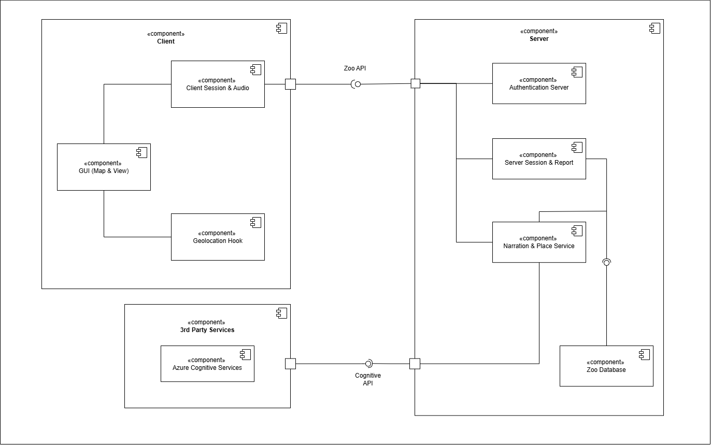

## 9.4. Deployment Diagram

The demo environment includes:

- Visitor and Admin devices running browsers.
- Cloudflare Tunnel provides the HTTPS URL.
- The demo machine runs the frontend, backend, and cloudflared.
- SQL Server.
- Image and audio file storage.
- External Azure and base map services.

Obtain the actual ports from the startup configuration. Example ports are not fixed across environments.

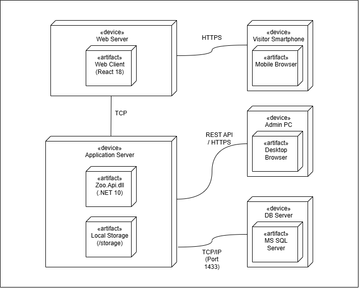

Quick Tunnel is for the demo. It does not provide a commitment to long-term hosting.

## 9.5. Database Design

The design has seven tables. QrCodes is removed. QrVisits, GenerationJobs, and SiteTexts are retained.

These column names are the design contract. Check them against the entities and migrations before drawing the physical schema.

| Table | Purpose | Main Attributes |
|---|---|---|
| AdminUsers | Admin accounts | Id, Username, PasswordHash, IsActive |
| Places | Points of interest and their zones | Id, Code, Category, Icon, Latitude, Longitude, RadiusMeters, Priority, MapX, MapY, ImageUrl, IsActive, PublishedRevisionId |
| NarrationRevisions | Content revisions | Id, PlaceId, Version, Status, CreatedByAdminId, CreatedAtUtc, PublishedAtUtc |
| NarrationTranslations | Content and audio by language | Id, RevisionId, Language, Title, Description, Script, IsManualEdited, AudioPath, AudioStatus, ScriptHash, AudioScriptHash |
| GenerationJobs | Translation and audio job status | Id, RevisionId, Language, Stage, Status, AttemptCount, LastError, CreatedAtUtc, UpdatedAtUtc |
| SiteTexts | Multilingual interface text | Id, Key, Language, Value |
| QrVisits | Visits from QR links | Id, SessionId, VisitedAtUtc, IsDemo |

### Relationships and Constraints

- AdminUsers 1 — 0..N NarrationRevisions qua CreatedByAdminId.
- Places 1 — 0..N NarrationRevisions qua PlaceId.
- Unique (PlaceId, Version).
- Places has 0..1 PublishedRevision through PublishedRevisionId.
- PublishedRevision must belong to the same Place and have the Published status.
- NarrationRevisions 1 — 0..N NarrationTranslations.
- Unique (RevisionId, Language).
- NarrationRevisions 1 — 0..N GenerationJobs.
- Unique (Key, Language) trong SiteTexts.
- SessionId in QrVisits is unique to prevent duplicate counts.
- The VisitedAtUtc index supports report filtering.
- QrVisits and SiteTexts do not need relationships to Places.
- There is no QrCodeId or foreign key to QrCodes.
- Each RevisionId and Language pair in GenerationJobs is unique.
- SQL blocks deletion of a point that still has revisions. When an eligible draft is deleted, delete the associated …

Verify the relationships and constraints above in the migrations before describing them as implemented.

A source marker such as `source=qr` identifies the type of access link. It does not prove that the visitor scanned it with a camera.

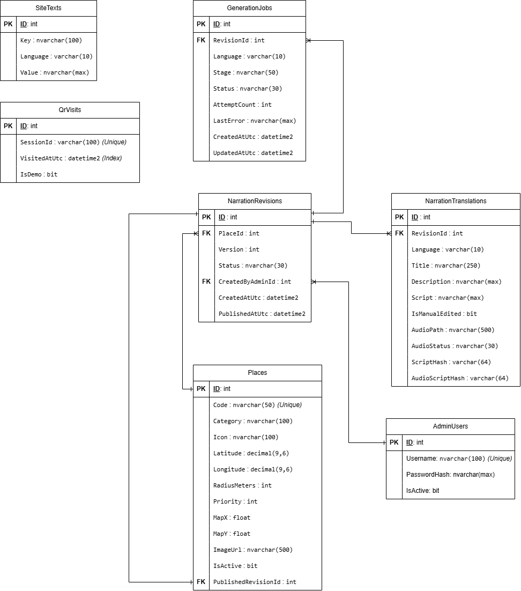

## 9.6. API Contract

Check exact paths against the controllers. This table describes the required API capabilities.

| API Group | Responsibility |
|---|---|
| Auth | Sign in, check session status, and sign out |
| Places public | Return points eligible for public display |
| Places admin | Add, edit, delete eligible points, hide or show points, and upload images |
| Narration admin | Manage Drafts, generate, edit, preview, and publish |
| Generation status | Return processing status by revision and language |
| Visit evaluate | Receive coordinates and return zone-evaluation results |
| Audio | Distinguish public audio from draft preview audio |
| SiteTexts | Return interface text by key and language |
| QR visits | Receive SessionId, use server-recorded UTC, and prevent duplicate submissions |
| Reporting | Receive the date range and demo data option, and return total visits, 24 hourly buckets, and peak hours |

Consistency requirements:

- Send GUID identifiers as strings.
- If the GUI uses lat/lng, the API must return those fields or define a clear mapping.
- Include revisionId and version in public content.
- Text and audio come from the same revision.
- QR visits do not require QrCodeId.
- Reporting has no QR code filter.
- Do not take recording time directly from the visitor's clock.

## 9.7. States and Interactions

Revision states:

Draft → Published → Archived.

Job states:

Pending → Running → Succeeded or Failed.

Audio states:

Missing / generating / valid / failed / invalidated.

Each type of state serves a different purpose and cannot substitute for the others.

**[INSERT STATE DIAGRAM — DRAFT, PUBLISHED, AND ARCHIVED REVISION LIFECYCLE.]**

**[INSERT GPS AND AUDIO SEQUENCE DIAGRAM — GUI → API/BUS → PUBLIC DATA → PLAYER.]**

**[INSERT AZURE SEQUENCE DIAGRAM — ADMIN → API/BUS → GENERATIONJOBS → AZURE → MEDIA AND TRANSLATIONS → UPDATE RESULTS.]**

## 9.8. User Interface

- Green is the primary color, with purple accents.
- Navigation includes Home, Map, and a QR page for access and demos.
- The map shows trigger zones and location.
- Use a consistent player for narration.
- The Admin interface clearly distinguishes Draft, Published, and audio states.
- Reports show the filter range, time zone, count unit, and demo data label.

**[INSERT VISITOR INTERFACE — LANGUAGE, GPS, MAP, AND PLAYER.]**

**[INSERT ADMIN INTERFACE — POINTS, DRAFTS, TRANSLATIONS, JOBS, AUDIO, AND PUBLICATION.]**

**[INSERT REPORTING INTERFACE — TOTAL VISITS, 24 HOURLY BUCKETS, AND PEAK HOURS.]**

---

# 10. Development Method and Responsibilities

## 10.1. Method

Develop in short iterations:

Agree on requirements → design → implement → test → demo → adjust.

Update the relevant specification, diagrams, data and API, and test cases together whenever a business requirement changes.

## 10.2. Use Case Assignments

| Team Member | Assigned Groups | UC | Use Case Count |
|---|---|---|---:|
| TV1 — add name | Groups 01, 02, 07 | UC01.1–01.3; UC02.1–02.2; UC07.1–07.3 | 8 |
| TV2 — add name | Groups 03, 04 | UC03.1–03.6; UC04.1 | 7 |
| TV3 — add name | Groups 05, 06 | UC05.1–05.4; UC06.1–06.7 | 11 |

UC-S01 has no assignee because it was removed from the catalog.

Each team member is responsible for:

- Use case specifications and rules.
- The group's Use Case Diagram.
- An Activity Diagram for each use case.
- Related user stories and test cases.
- Reviewing the data and API needed by the functions.
- Reporting progress and outstanding defects.

Use case assignments identify the member responsible for each business area. The team still coordinates across GUI, BUS, and DAL. Members do not have to implement every layer independently.

## 10.3. Coordination Points

| Team Member | Details |
|---|---|
| TV1 and TV2 | Language, GPS permission, public points, coordinates, and visit state |
| TV2 and TV3 | Matching public content and audio revisions, language changes, and publication requirements |
| TV1 and TV3 | Point information, hiding and showing points, images, GPS zones, and public data |
| Entire Team | DTOs, schema, terminology, use case IDs, and acceptance criteria |

## 10.4. Source Control and CI/CD

- Work on feature branches.
- Review changes before merging.
- Do not commit secrets, build files, or sensitive data.
- CI target: install dependencies, build the frontend and backend, and run relevant tests.
- Describe CI/CD as implemented only when its configuration and run results exist.
- The demo startup script and tunnel do not constitute a CD pipeline.

---

# 11. Test Plan

## 11.1. Scope

- Unit tests for zone rules, revisions, audio validity, and report aggregation.
- Integration tests for SQL, publication, administrative APIs, and QR visit recording.
- GUI tests based on the use cases.
- End-to-end tests from Admin content creation to playback on a phone.
- Field GPS testing separate from simulation.

## 11.2. Acceptance Tests

| TC | UC | Scenario | Expected Result |
|---|---|---|---|
| TC01 | UC01.3 | Open the QR link on another phone | Reach the correct public URL |
| TC02 | UC01.1–01.2 | Start a visit session | Select a language before the GPS permission request |
| TC03 | UC01.2 | Deny GPS permission | Manual browsing and playback remain available |
| TC04 | UC01.3 | Resend the same SessionId | Do not count a duplicate |
| TC05 | UC01.3 | Open the QR link without a SessionId | Create a new session according to the rule |
| TC06 | UC02.1 | A point is hidden or has only a Draft | The point does not appear publicly |
| TC07 | UC02.2 | Determine the location | Display only valid coordinates |
| TC08 | UC03.1 | Outside the zone, on its boundary, and inside it | Apply the radius correctly and confirm a stable result |
| TC09 | UC03.1 | Stale GPS position or high uncertainty | Do not use the position to trigger playback |
| TC10 | UC03.1 | Overlapping zones | Select according to priority and distance |
| TC11 | UC03.1 | A track is playing or has already been heard | Do not overlap or automatically repeat playback |
| TC12 | UC03.2 | Invalid language or audio | Do not autoplay in another language |
| TC13 | UC03.3–03.4 | Pause and resume | Keep and use the correct playback position |
| TC14 | UC03.5 | Replay | Play from the beginning and preserve history |
| TC15 | UC03.6 | Change languages during playback | Stop the old track, preserve state, and do not reload |
| TC16 | UC04.1 | Correct or incorrect password, and inactive account | Create a session only for a valid account |
| TC17 | UC05.1–05.2 | Invalid GPS or image data | Do not save. Identify the affected field |
| TC18 | UC05.3 | Delete a point referenced by a revision | Reject deletion and suggest hiding the point |
| TC19 | UC05.4 | Hide a point and then show it | Preserve the data and apply the correct public visibility conditions |
| TC20 | UC06.1–06.2 | Create or edit a Draft | Keep the existing public content as it is |
| TC21 | UC06.3 | Delete a Draft and attempt to delete a Published revision | Delete only eligible revisions |
| TC22 | UC06.4 | Generate content and audio for all five languages | Jobs and results belong to the correct revision |
| TC23 | UC06.4 | One language fails, then regeneration is requested | Keep valid results and avoid duplicates |
| TC24 | UC06.5 | Edit a translation script | The old audio becomes invalid |
| TC25 | UC06.6 | Preview a draft while signed out | Access is denied |
| TC26 | UC06.7 | A file or audio is missing, its hash does not match, or a translation still needs review | Publication is blocked |
| TC27 | UC06.7 | Publish a new revision | The public revision pointer and revision states remain consistent |
| TC28 | UC07.1 | Invalid date range or no data | Return the appropriate error or a valid zero total |
| TC29 | UC07.2 | Events near a day boundary | Assign events to the correct hour in Vietnam time |
| TC30 | UC07.3 | Ties or zero visits | Show all tied hours and report no peak hour when there are no visits |
| TC31 | QR/report | Change the tunnel URL while keeping the same database | Historical data remains and new visits are still recorded |
| TC32 | SiteTexts | Change the interface language | Read the correct key and language and provide essential fallbacks |
| TC33 | GenerationJobs | The backend is interrupted during generation | Avoid false success and handle the interrupted state |
| TC34 | Simulation | Start, stop, restart, and exit | Do not mix in real GPS or stale request results |
| TC35 | Security | Call an Admin API without a session | Deny the request |
| TC36 | Demo Reporting | An IsDemo event exists | Exclude it from operational reports by default |

For each test case, record the tester, date, environment, data, actual result, and evidence. Mark cases that have not run as “Not Tested”.

## 11.3. Test Dataset

- Seven points with verified coordinates.
- One pair of overlapping zones.
- One hidden point and one point with only a Draft.
- One point with a Published revision and a newer Draft.
- Audio for all five languages, plus cases with a missing file or changed script.
- Successful, failed, and interrupted jobs.
- SiteTexts for essential keys in all five languages.
- QrVisits with duplicate sessions, new sessions, demo visits, and timestamps near a day boundary.
- Two hourly buckets tied for the highest count, to test ties.

---

# 12. Roadmap and Priorities

## 12.1. Priority Levels

| Level | Details |
|---|---|
| P0 | QR, language, GPS, map, and listening flow, plus point and content administration, sign-in, and publication |
| P1 | Complete reporting, availability, cross-device testing, and documentation before accepting the full scope |
| P2 | Stable domain, report exports, and operational improvements outside the current scope |

GenerationJobs and SiteTexts support the agreed scope. They do not introduce new administration modules.

## 12.2. Three Review Meetings

| Milestone | Details | Outputs |
|---|---|---|
| M1 | Agree on the use cases, flows, business rules, seven-table schema, and API | Agreed items and outstanding issues |
| M2 | Check GUI, API, BUS, and DAL, along with translation and audio, GPS, and publication | End-to-end demo and defect list |
| M3 | Check QR, reporting, real devices, diagrams, and the PRD | Acceptance records, limitations, and submission package |

If the team uses the three-day plan at 12 hours per person per day, each day ends with a milestone meeting. Measure completion by test results as well as time spent.

## 12.3. Progress Tracking

| Group | Owner | Specification | Diagrams | Implementation | Testing |
|---|---|---|---|---|---|
| 01 | TV1 | Update with actual status | Update with actual status | Update with actual status | Update with actual status |
| 02 | TV1 | Update with actual status | Update with actual status | Update with actual status | Update with actual status |
| 03 | TV2 | Update with actual status | Update with actual status | Update with actual status | Update with actual status |
| 04 | TV2 | Update with actual status | Update with actual status | Update with actual status | Update with actual status |
| 05 | TV3 | Update with actual status | Update with actual status | Update with actual status | Update with actual status |
| 06 | TV3 | Update with actual status | Update with actual status | Update with actual status | Update with actual status |
| 07 | TV1 | Update with actual status | Update with actual status | Update with actual status | Update with actual status |

---

# 13. Definition of Done

- [ ] Use case specifications and Activity Diagrams agree.
- [ ] The use case catalog, User Stories, and test cases use the same IDs.
- [ ] GUI, API, BUS, and DAL agree on the data.
- [ ] The seven-table schema is checked against the migrations.
- [ ] The agreed reporting scope no longer depends on QrCodes or QrCodeId.
- [ ] The frontend and backend build successfully.
- [ ] The backend authenticates Admins.
- [ ] Public content and audio match in revision and language.
- [ ] Drafts cannot be accessed through the public API or public audio.
- [ ] GenerationJobs accurately reflects progress and results.
- [ ] SiteTexts provides the correct interface text for the selected language.
- [ ] Field GPS and simulation are tested separately.
- [ ] QR access is tested on another device.
- [ ] Reporting avoids duplicates, uses Vietnam time, and handles ties.
- [ ] Images, the PRD, ERD, Component Diagram, and Deployment Diagram are consistent.
- [ ] Startup instructions, demo data, and a list of remaining limitations are available.

---

# APPENDICES

## A. Access Permissions

| Function | Visitor | Admin |
|---|---|---|
| Select Language, Use the Map, and Use GPS | Yes | Yes, when using the website as a visitor |
| Nghe audio public | Yes | Yes |
| Add, edit, delete, or hide points | No | Yes |
| Manage Drafts and Previews | No | Yes |
| Translate, generate audio, and publish | No | Yes |
| Submit a QR access event | Yes | Yes, when accessing the website as a visitor |
| View Reports | No | Yes |

This release has a single Admin role and does not define multiple administrative permission levels.

## B. Mapping from Old to New Use Cases

| Old Use Case | New Function |
|---|---|
| UC01 — QR Access | Website entry flow and UC01.3 |
| UC02 — Language Selection | UC01.1, UC03.6 |
| UC03 — Location Permission | UC01.2 and the relevant part of UC02.2 |
| UC04 — Map | UC02.1–UC02.2 |
| UC05 — Point Identification | UC03.1 |
| UC06 — Nghe | UC03.2 |
| UC07 — Audio Controls | UC03.3–UC03.5 |
| UC08 — Sign-In | UC04.1 |
| UC09 — Manage Points | UC05.1–UC05.4 |
| UC10 — Narration | UC06.1–UC06.3 |
| UC11 — Translation and Audio | UC06.4, UC06.6 |
| UC12 — Editing | UC06.5 |
| UC13 — Publication | UC06.7 |
| UC14 — Reporting | UC07.1–UC07.3 |

This update clarifies deletion actions and several use cases that were separated out. Check the implementation before acceptance.

## C. Traceability Matrix by Group

| Group | User Stories | Key Test Cases | Owner |
|---|---|---|---|
| 01 | US-01–US-03 | TC01–TC05 | TV1 |
| 02 | US-03–US-04 | TC06–TC07 | TV1 |
| 03 | US-05–US-07 | TC08–TC15 | TV2 |
| 04 | US-08 | TC16, TC35 | TV2 |
| 05 | US-09 | TC17–TC19 | TV3 |
| 06 | US-10–US-13 | TC20–TC27, TC33 | TV3 |
| 07 | US-14 | TC28–TC31, TC36 | TV1 |

TC32 and TC34 support multiple groups and require coordination.

## D. Glossary

| Term | Meaning |
|---|---|
| Point of Interest / POI | A managed point with coordinates, a zone, and content |
| Geofence | Trigger zone around a point |
| Revision | Narration revision |
| Draft | An editable draft |
| Published | A revision that has been published |
| Archived | A revision retained in the history |
| TTS | Text-to-speech conversion |
| GenerationJob | A record that tracks a content generation job |
| SiteText | Interface text by key and language |
| QR visit | A recorded visit originating from a QR link |
| SessionId | A session ID used to prevent duplicate records |
| Public | Content that may be served to visitors |
| Preview | Viewing or listening to content through Admin access |

## E. List of Figures

### Functional Diagrams

- One BFD covering all seven groups.
- One overall Use Case Diagram.
- Seven group Use Case Diagrams.
- Twenty-six Activity Diagrams corresponding to UC01.1 through UC07.3.
- No UC-S01 diagram.

### Flow and Design Figures

- Visitor User Flow.
- Content Administration Flow.
- Three-Tier Architecture.
- Component Diagram.
- Deployment Diagram.
- Logical ERD with seven tables.
- Physical Database Schema.
- Revision State Diagram.
- Sequence GPS/audio.
- Translation and Audio Generation Sequence Diagram.
- Visitor Interface.
- Admin Interface.
- Reporting Interface.

Figures must use the same use case IDs, actors, table names, and rules as the document.

## F. Design Decisions

| Details | Decision |
|---|---|
| Functional Grouping | Seven groups and 26 detailed use cases |
| Separate Access Check | Remove UC-S01 and retain backend authentication and sign-in preconditions |
| Architecture | Retain three tiers with the API as the backend's HTTP entry point |
| Database | Seven tables |
| QrCodes | Removed |
| QrVisits | Retained for reporting |
| GenerationJobs | Retained to track translation and audio jobs |
| SiteTexts | Retained for multilingual interface text |
| Main Reporting Metrics | Total visits, hourly distribution, and peak hours |
| Unique Visitors | Accurate measurement is not guaranteed |
| SiteTexts Management in the GUI | Not a separate administrative function at this stage |
| Separate Job Management | Not a separate use case at this stage |
| Assignments | Assign by use case group and coordinate across layers |

Details still to fill in: names for TV1–TV3, Hậu's full student ID, the instructor's name, deployment details, and test results.

## G. References

- The team's original PRD.
- The provided PRD and Use Case Specification templates.
- The Use Case and Activity Diagrams agreed during analysis.
- Source code, entities, migrations, and configuration for the submitted version.
- Team test and demo records.

Reference templates guide presentation only. Do not add business requirements from other projects to the scope.

## H. Revision History

| Version | Date | Details |
|---|---|---|
| 1.0 | 25/10/2026 | Initial PRD organized into 14 use cases |
| 1.1 | 29/10/2026 | Reorganized into seven groups and 26 use cases, removed UC-S01 and QrCodes, retained GenerationJobs, SiteTexts, and QrVisits, and aligned user stories, architecture, tests, assignments, and appendices |
